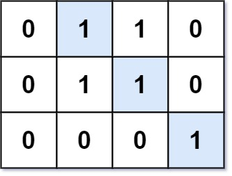
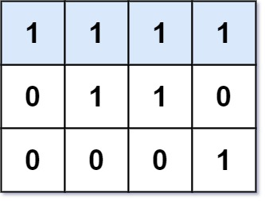

# [562. Longest Line of Consecutive One in Matrix](https://leetcode.com/problems/longest-line-of-consecutive-one-in-matrix/)

| Category | Difficulty | Likes | Dislikes |
| :------: | :--------: | :---: | :------: |
| Algorithms | Medium | 904 | 119 |

**Tags:** [`array`](https://leetcode.com/tag/array), [`dynamic-programming`](https://leetcode.com/tag/dynamic-programming), [`matrix`](https://leetcode.com/tag/matrix)

**Companies:** `google`

## Description

Given an `m x n` binary matrix `mat`, return *the length of the longest line of consecutive one in the matrix*.

The line could be horizontal, vertical, diagonal, or anti-diagonal.

 

**Example 1:**


```

Input: mat = [[0,1,1,0],[0,1,1,0],[0,0,0,1]]
Output: 3

```

**Example 2:**


```

Input: mat = [[1,1,1,1],[0,1,1,0],[0,0,0,1]]
Output: 4

```

 

**Constraints:**

	- `m == mat.length`

	- `n == mat[i].length`

	- `1 <= m, n <= 10^4`

	- `1 <= m * n <= 10^4`

	- `mat[i][j]` is either `0` or `1`.

---

**Links:** [Submissions](https://leetcode.com/problems/longest-line-of-consecutive-one-in-matrix/) | [Solutions](https://leetcode.com/problems/longest-line-of-consecutive-one-in-matrix/)
