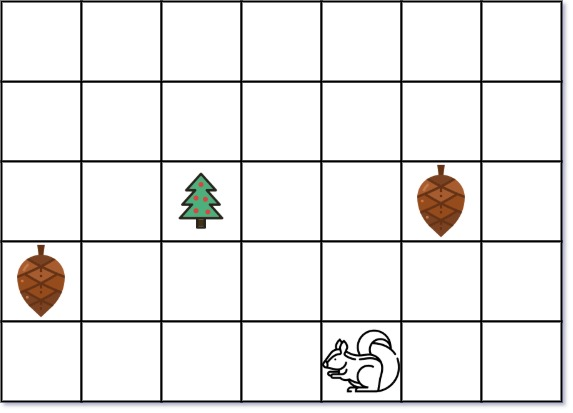
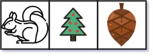

# [573. Squirrel Simulation](https://leetcode.com/problems/squirrel-simulation/)

| Category | Difficulty | Likes | Dislikes |
| :------: | :--------: | :---: | :------: |
| Algorithms | Medium | 420 | 40 |

**Tags:** [`array`](https://leetcode.com/tag/array), [`math`](https://leetcode.com/tag/math)

**Companies:** `square`

## Description

You are given two integers `height` and `width` representing a garden of size `height x width`. You are also given:

	- an array `tree` where `tree = [tree_r, tree_c]` is the position of the tree in the garden,

	- an array `squirrel` where `squirrel = [squirrel_r, squirrel_c]` is the position of the squirrel in the garden,

	- and an array `nuts` where `nuts[i] = [nut_ir, nut_ic]` is the position of the `i^th` nut in the garden.

The squirrel can only take at most one nut at one time and can move in four directions: up, down, left, and right, to the adjacent cell.

Return *the **minimal distance** for the squirrel to collect all the nuts and put them under the tree one by one*.

The **distance** is the number of moves.

 

**Example 1:**


```

Input: height = 5, width = 7, tree = [2,2], squirrel = [4,4], nuts = [[3,0], [2,5]]
Output: 12
Explanation: The squirrel should go to the nut at [2, 5] first to achieve a minimal distance.

```

**Example 2:**


```

Input: height = 1, width = 3, tree = [0,1], squirrel = [0,0], nuts = [[0,2]]
Output: 3

```

 

**Constraints:**

	- `1 <= height, width <= 100`

	- `tree.length == 2`

	- `squirrel.length == 2`

	- `1 <= nuts.length <= 5000`

	- `nuts[i].length == 2`

	- `0 <= tree_r, squirrel_r, nut_ir <= height`

	- `0 <= tree_c, squirrel_c, nut_ic <= width`

---

**Links:** [Submissions](https://leetcode.com/problems/squirrel-simulation/) | [Solutions](https://leetcode.com/problems/squirrel-simulation/)
