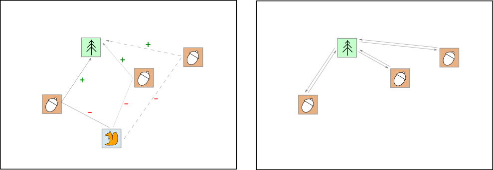
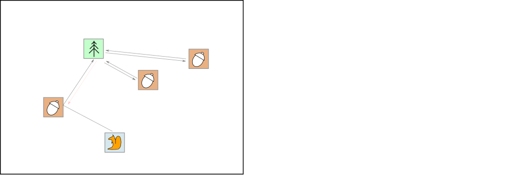

# ok ^^

**Author:** andrii_khlevniuk
**Votes:** 0
**Link:** [https://leetcode.com/problems/squirrel-simulation/solutions/4569983/](https://leetcode.com/problems/squirrel-simulation/solutions/4569983/)

---

**time: `O(N)`; space: `O(N)`**





```
int minDistance(int h, int w, vector<int>& t, vector<int>& s, vector<vector<int>>& n) 
{
	int out{}, M{INT_MIN};
	for(const auto & n : n)
	{
		M    = max(M, abs(t[0]-n[0])+abs(t[1]-n[1])-abs(s[0]-n[0])-abs(s[1]-n[1]));
		out += 2*(abs(t[0]-n[0])+abs(t[1]-n[1]));
	}
	return out-M;
}
```