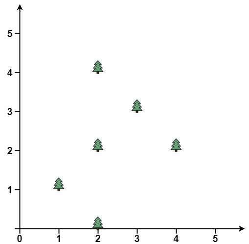
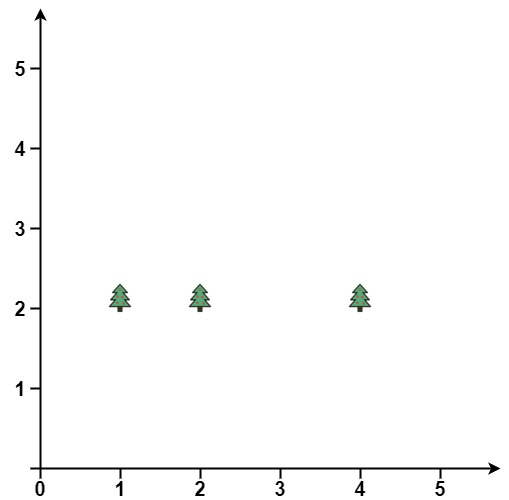

# [587. Erect the Fence](https://leetcode.com/problems/erect-the-fence/)

| Category | Difficulty | Likes | Dislikes |
| :------: | :--------: | :---: | :------: |
| Algorithms | Hard | 1529 | 648 |

**Tags:** [`array`](https://leetcode.com/tag/array), [`math`](https://leetcode.com/tag/math), [`geometry`](https://leetcode.com/tag/geometry)

**Companies:** `meesho`, `amazon`, `google`

## Description

You are given an array `trees` where `trees[i] = [x_i, y_i]` represents the location of a tree in the garden.

Fence the entire garden using the minimum length of rope, as it is expensive. The garden is well-fenced only if **all the trees are enclosed**.

Return *the coordinates of trees that are exactly located on the fence perimeter*. You may return the answer in **any order**.

 

**Example 1:**


```

Input: trees = [[1,1],[2,2],[2,0],[2,4],[3,3],[4,2]]
Output: [[1,1],[2,0],[4,2],[3,3],[2,4]]
Explanation: All the trees will be on the perimeter of the fence except the tree at [2, 2], which will be inside the fence.

```

**Example 2:**


```

Input: trees = [[1,2],[2,2],[4,2]]
Output: [[4,2],[2,2],[1,2]]
Explanation: The fence forms a line that passes through all the trees.

```

 

**Constraints:**

	- `1 <= trees.length <= 3000`

	- `trees[i].length == 2`

	- `0 <= x_i, y_i <= 100`

	- All the given positions are **unique**.

---

**Links:** [Submissions](https://leetcode.com/problems/erect-the-fence/) | [Solutions](https://leetcode.com/problems/erect-the-fence/)
