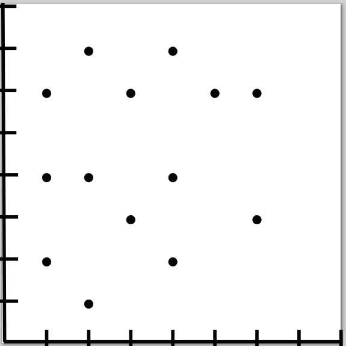
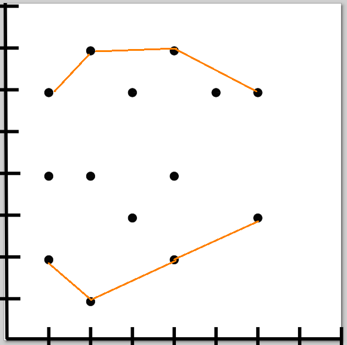
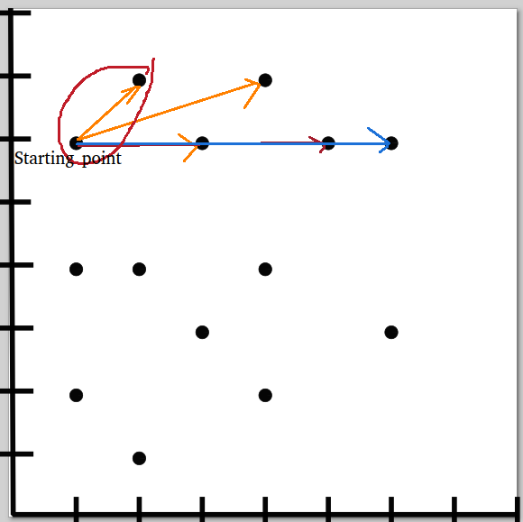
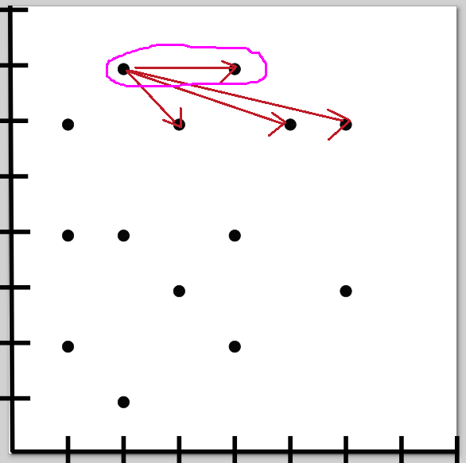
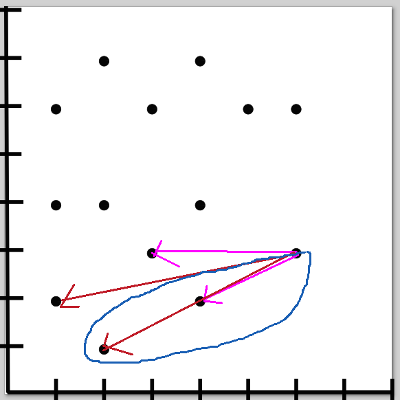
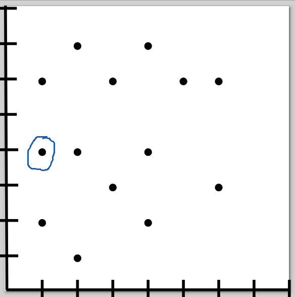

# Ruby solution

**Author:** ozovalihasan
**Votes:** 0
**Link:** [https://leetcode.com/problems/erect-the-fence/solutions/2831089/](https://leetcode.com/problems/erect-the-fence/solutions/2831089/)

---


# Approach
Let me try to explain my approach by giving an example;



If you check the next draw, you will notice that it is necessary to use only the maximum and the minimum values of each coordinate on an axis(I have used x-axis to solve the challenge). 



Did you notice that we skipped some minimum and maximum values of some coordinates on x-axis?

How do we decide to use which ones? 
Let's start from the beginning. We are selecting the leftmost and uppermost one. Then, a line between the current point and all maximum points of each next coordinate on x-axis is being drawn. Then, the point with the highest slope value will be the next point(I'm not explaining how to calculate the slope here, but if you can check it on Net, you can find a lot of resources about it.).



Then we are repeating same procedure until the rightmost one.



---

Now, it is necessary to check the lower part. We are selecting the rightmost and lowermost one. Then, a line between the current point and all minimum points of each previous coordinate on x-axis is being drawn.

 


As you can see, we have two winners. So, the furthest one is chosen as the next point and other/s are being added to the result. 

Again, the same procedure is being followed until the leftmost one.

---

There is one more issue. One valid point is missed.



To handle this issue, all the leftmost and rightmost points are added to the result as default.

...The end...

Note: Some points may be added more than one time depending on your implementation, so it may be necessary to remove the duplicated ones of the result.

# Code
My implementation is not crystal clear. I hope I will refactor it one day, but not today. Please don't hesitate to share a clearer solution on the comment section.

```ruby []
# @param {Integer[][]} trees
# @return {Integer[][]}
def outer_trees(trees)
  
  group_by_first = trees.group_by(&:first).each do |_, coordinates|
    coordinates.map! {|_, last| last}.sort!
  end
  
  return trees if group_by_first.size == 1

  group_by_first_keys = group_by_first.keys.sort

  result = []
  index = 0
  selected_x = group_by_first_keys.first
  group_by_first[selected_x].each do |y|
    result << [selected_x, y]
  end
  
  loop do
    hash = {}
    group_by_first_keys[index..].each do |x|
      (hash[slope(x, group_by_first[x].last, selected_x, group_by_first[selected_x].last )] ||= []) << [x, group_by_first[x].last]
    end

    hash[hash.keys.max].each { |coordinate| result << coordinate }
    selected_x = hash[hash.keys.max].max_by(&:first).first

    
    index = group_by_first_keys.bsearch_index {|val| val >= selected_x}
    break if group_by_first_keys.size - 1 == index
  end

  group_by_first[selected_x].each do |y|
    result << [selected_x, y]
  end

  loop do
    hash = {}
    group_by_first_keys[..index].map do |x|
      (hash[slope(x, group_by_first[x].first, selected_x, group_by_first[selected_x].first )] ||= []) << [x, group_by_first[x].first]
    end

    hash[hash.keys.max].each do |coordinate|
      result << coordinate
    end
    selected_x = hash[hash.keys.max].min_by(&:first).first
    
    index = group_by_first_keys.bsearch_index {|val| val >= selected_x}
    break if index.zero?
  end

  result.uniq

end

def slope(x1, y1, x2, y2) 
  return -Float::INFINITY if x1 == x2 && y1 == y2
  (y2 - y1) / (x2 - x1).to_f
end
```