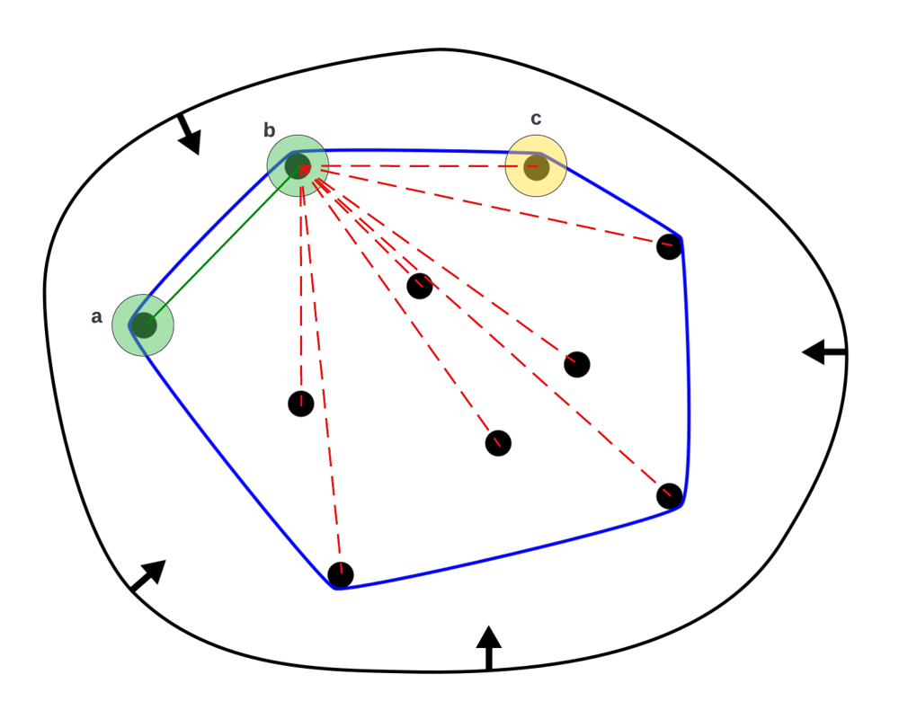

# Erect the fence - Scala - O(nk)

**Author:** ahmahran
**Votes:** 0
**Link:** [https://leetcode.com/problems/erect-the-fence/solutions/2833456/](https://leetcode.com/problems/erect-the-fence/solutions/2833456/)

---

# Intuition
<!-- Describe your first thoughts on how to solve this problem. -->
Basically, this is a [convex hull](https://en.wikipedia.org/wiki/Convex_hull) problem. The solution is based on the observation that, for any two adjacent points, $$a$$ and $$b$$, on the hull (forming an edge on the hull), such that $$a$$ is before $$b$$ in a clockwise order, the next adjacent point on the hull, $$c$$, after $$b$$, forms the max angle $$\\widehat{abc}$$ of all angles $$\\widehat{abx}$$ where $$x$$ is any point inside or on the hull except $$a$$ and $$b$$.

 


# Approach
<!-- Describe your approach to solving the problem. -->
We will determine an initail point on the hull, then iteratively we will find the next adjacent point until the hull is closed (i.e. we finally meet the initial point). At each step we will keep two points, the head of the hull and its previous adjacent point (i.e. the previous head). Using these two points, we will iterate through all other remaining points (that are not on the hull yet), compute the angle $$\\widehat{\	ext{previous head}, \	ext{head}, \	ext{point}}$$, and pick $$point$$ with the maximum angle as the next point on the hull.

Initial point on the hull can be one of the following 4 cases:
1. Points with min y value.
2. Points with max y value.
3. Points with min x value.
4. Points with max x value.

# Complexity
- Time complexity:
<!-- Add your time complexity here, e.g. $$O(n)$$ -->
$$O(nk)$$ where $$k$$ is number of points on the hull

- Space complexity:
<!-- Add your space complexity here, e.g. $$O(n)$$ -->
$$O(n)$$

# Code
```
object Solution {
    type Point = Array[Int]
    type Vec = Array[Int]

    @inline def dot(v1: Vec, v2: Vec) = v1(0) * v2(0) + v1(1) * v2(1)

    @inline def magnitude(v: Vec) = math.sqrt(dot(v, v))

    @inline def vector(p1: Point, p2: Point) = Array(p1(0) - p2(0), p1(1) - p2(1))

    @inline def pEq(p1: Point, p2: Point) = p1(0) == p2(0) && p1(1) == p2(1)

    @inline def angle(pivot: Point, point1: Point, point2: Point) = {
        if (pEq(point1, point2)) 2 * math.Pi
        else if (pEq(pivot, point1) || pEq(pivot, point2)) 2 * math.Pi
        else {
            val v1 = vector(pivot, point1)
            val v2 = vector(pivot, point2)
            val cos = dot(v1, v2) / (magnitude(v1) * magnitude(v2))
            if (cos + 1 <= 0.0000001) math.Pi else math.acos(cos)
        }
    }

    @inline def p2s(p: Point) = p.mkString(s"[", ",", "]")

    def showTrees(trees: Array[Point], scaleX: Int = 2): Unit = {
        val xMax = trees.map(_.head).max
        val yMax = trees.map(_.last).max

        val xMargin = yMax.toString.length
        val yMargin = xMax.toString.length

        val cols = scaleX * (xMax + 1) + xMargin
        val rows = (yMax + 1) + yMargin

        // init grid space
        val grid = Array.fill[String](rows, cols)(" ")

        // draw x-axis
        grid.update(rows - 1 - yMargin, Array.fill[String](cols)("_"))
        for {
            i    <- 0 to xMax
            label = i.toString
            xTick = scaleX * i + xMargin
            k    <- label.indices
            j     = rows - yMargin + k
            row   = grid(j)
        } {
            row.update(xTick, label(k).toString)
            grid.update(j, row)
        }

        // draw y-axis
        for {
            i    <- 0 to yMax
            label = " " * (xMargin - i.toString.length) + i.toString + "|"
            yTick = rows - yMargin - i - 1
            row   = grid(yTick)
            k    <- label.indices
        } {
            row.update(k, label(k).toString)
            grid.update(yTick, row)
        }

        // place points
        trees.foreach { p =>
            val row = grid(rows - yMargin - p.last - 1)
            row.update(scaleX * p.head + xMargin, "+")
            grid.update(rows - yMargin - p.last - 1, row)
        }

        // show grid
        println(grid.map(_.mkString("")).mkString("\
"))
    }

    def outerTrees(trees: Array[Point]): Array[Point] = {
        // showTrees(trees)
        if (trees.length <= 1) trees
        else {
            val remaining = collection.mutable.HashSet[Point]()
            val convexHull = collection.mutable.HashSet[Point]()

            // first corner point of the hull
            // val p0 = trees.sortBy(p => p(1)).head
            // val remaining = trees.remove(p0)
            val p0 = trees.tail.foldLeft(trees.head) { case (pOfMinY, currentP) =>
                if (currentP.last < pOfMinY.last) {
                    remaining += pOfMinY
                    currentP
                } else {
                    remaining += currentP
                    pOfMinY
                }
            }
            convexHull += p0

            // returns the next point on the hull given the current head and the previous one
            def nextPoint(head: Point, pre: Point) = {
                // finds the point, p, in remaining list which produces the largest angle
                // between vectors: (head, pre) and (head, p)
                def a(rem: List[Point], p: Option[Point], pAngle: Option[Double]): Point = rem match {
                    case Nil =>
                        // base case: nothing to compare to, return p
                        p.get
                    case h :: t if pAngle.isEmpty =>
                        // initial case, pick h as p
                        a(t, Some(h), Some(angle(head, pre, h)))
                    case h :: t if pEq(h, head) || pEq(h, pre) =>
                        // edge case: h is already a hull point, just continue with p
                        // println(s"\	Preferring p=${p2s(p.get)} over h=${p2s(h)} as " +
                        //         s"h is either head=${p2s(head)} or pre=${p2s(pre)}")
                        a(t, p, pAngle)
                    case h :: t if (pEq(p.get, head) || pEq(p.get, pre)) && !convexHull.contains(p.get) =>
                        // edge case: covering for arbitrary point picked initially as pre (which is not
                        // actually yet on hull)
                        // println(s"\	Preferring h=${p2s(h)} over p=${p2s(p.get)} as " +
                        //         s"p is either head=${p2s(head)} or pre=${p2s(pre)} and not on hull")
                        a(t, Some(h), Some(angle(head, pre, h)))
                    case h :: t =>
                        val hAngle = angle(head, pre, h)
                        if (
                            // if hAngle is significantly bigger than pAngle
                            (math.abs(hAngle - pAngle.get) > 0.000001 && hAngle > pAngle.get) ||
                            // or (hAngle is approximatley equal to pAngle and
                            //     h is closer to head than p)
                            (math.abs(hAngle - pAngle.get) <= 0.000001 &&
                            magnitude(vector(head, h)) < magnitude(vector(head, p.get))
                            )
                        ) {
                            // pick h
                            // println(s"\	Preferring h=${p2s(h)} over p=${p2s(p.get)} as " +
                            //     s"hAngle=$hAngle > pAngle=${pAngle.get} (${hAngle > pAngle.get}) " +
                            //     s"||h||=${magnitude(vector(head, h))} < ||p||=${magnitude(vector(head, p.get))} " +
                            //     s"(${magnitude(vector(head, h)) < magnitude(vector(head, p.get))})")
                            a(t, Some(h), Some(hAngle))
                         } else {
                            // o.w. keep p
                            //  println(s"\	Preferring p=${p2s(p.get)} over h=${p2s(h)} as " +
                            //     s"hAngle=$hAngle > pAngle=${pAngle.get} (${hAngle > pAngle.get}) " +
                            //     s"||h||=${magnitude(vector(head, h))} < ||p||=${magnitude(vector(head, p.get))} " +
                            //     s"(${magnitude(vector(head, h)) < magnitude(vector(head, p.get))})")
                            a(t, p, pAngle)
                         }
                }
                // always add initial hull point, p0, to be able to detect when the hull is finally closed
                a(remaining.toList :+ p0, None, None)
            }

            // pick an arbitrary point as pre of current hull head
            var preHead = remaining.head //Array(0, 0)
            var head = p0
            var isClosed = false
            // println(s"First: ${p2s(head)}, Pre: ${p2s(preHead)}, remaining: ${remaining.map(p2s)}")

            while (remaining.nonEmpty && !isClosed) {
                val next = nextPoint(head, preHead)
                isClosed = next == p0
                if (!isClosed) {
                    remaining -= next
                    convexHull += next
                    preHead = head
                    head = next
                    // println(s"Next: ${p2s(next)}, Pre: ${p2s(preHead)}, isClosed: $isClosed, remaining: ${remaining.map(p2s)}")
                }
                // else println("Closed")
            }

            convexHull.toArray
        }
    }
}
```