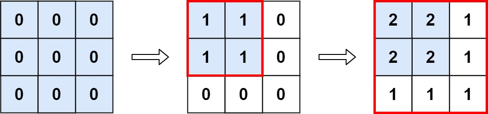

# [598. Range Addition II](https://leetcode.com/problems/range-addition-ii/)

| Category | Difficulty | Likes | Dislikes |
| :------: | :--------: | :---: | :------: |
| Algorithms | Easy | 1026 | 985 |

**Tags:** [`array`](https://leetcode.com/tag/array), [`math`](https://leetcode.com/tag/math)

**Companies:** `ixl`

## Description

You are given an `m x n` matrix `M` initialized with all `0`'s and an array of operations `ops`, where `ops[i] = [a_i, b_i]` means `M[x][y]` should be incremented by one for all `0 <= x < a_i` and `0 <= y < b_i`.

Count and return *the number of maximum integers in the matrix after performing all the operations*.

 

**Example 1:**


```

Input: m = 3, n = 3, ops = [[2,2],[3,3]]
Output: 4
Explanation: The maximum integer in M is 2, and there are four of it in M. So return 4.

```

**Example 2:**

```

Input: m = 3, n = 3, ops = [[2,2],[3,3],[3,3],[3,3],[2,2],[3,3],[3,3],[3,3],[2,2],[3,3],[3,3],[3,3]]
Output: 4

```

**Example 3:**

```

Input: m = 3, n = 3, ops = []
Output: 9

```

 

**Constraints:**

	- `1 <= m, n <= 4 * 10^4`

	- `0 <= ops.length <= 10^4`

	- `ops[i].length == 2`

	- `1 <= a_i <= m`

	- `1 <= b_i <= n`

---

**Links:** [Submissions](https://leetcode.com/problems/range-addition-ii/) | [Solutions](https://leetcode.com/problems/range-addition-ii/)
