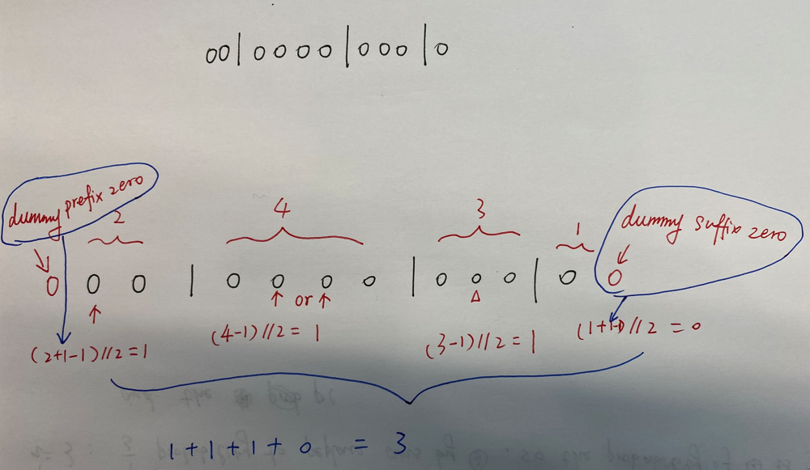

# ✅ [C++/Java/Python] 2 Simple Solutions || Image Explanation || Beginner Friendly

**Author:** linfq
**Votes:** 181
**Link:** [https://leetcode.com/problems/can-place-flowers/solutions/1698771/](https://leetcode.com/problems/can-place-flowers/solutions/1698771/)

---

**PLEASE UPVOTE if you like** \uD83D\uDE01 **If you have any question, feel free to ask.** 
* Solution1: Check and Place
	* Just Check each position `i` sequentially whether a flower can be placed
		* If not, just go on
		* if ok, just place a flower at `i`
			* `n = n - 1`
			* `flowerbed[i] = 1`
				* note that we change the flowerbed, so the next `0` cannot place.
	* for example: `flowerbed = 01000100, n = 2`
		* `i = 0`: **0**1000100 cannot place
		* `i = 1`: 0**1**000100 cannot place
		* `i = 2`: 01**0**00100 cannot place
		* `i = 3`: 010**0**0100 can place, so `flowerbed` became 010**1**0100, that is  `n = n - 1 = 1, flowerbed = 01010100`
		* `i = 4`: 0101**0**100 cannot place
		* `i = 5`: 01010**1**00 cannot place
		* `i = 6`: 010101**0**0 cannot place
		* `i = 7`: 0101010**0** can place, so `flowerbed` became 0101010**1**, that is  `n = n - 1 = 0, flowerbed = 01010101`
			* since `n == 0`, then `return True`
* Solution2: Count consecutive zeros
	* **One-liner is possible in Python**
	* Prefixes and suffixes require special handling
		* For `zeros` in the middle, that is to say consecutive `zeros` with ones on both sides, we can place `(zeros - 1) // 2`
			* for example: 
				* 10001 => we can place only one 0, 10**1**01
				* 1001  => we can not place 0 anywhere.
		* for `zeros` in prefix or the suffix, we can place `zeros // 2`
			* for exapmle
				* 001 => we can place one 0, **1**01
			* A trick to simplify the code is to add two dummy zero at the both side of `flowerbed`, so that we can handle the prefix and suffix as the same way of the middle.
				* In code, we just initialize `zeros` to 1 which is a dummy zero added to the prefix
				* at last, the last `zeros` is the suffix, we need not `-1`

		


**Python can be One-liner**
```
class Solution(object):
    def canPlaceFlowers(self, flowerbed, n):
        if n == 0: return True
        for i in range(len(flowerbed)):
            if flowerbed[i] == 0 and (i == 0 or flowerbed[i - 1] == 0) and (i == len(flowerbed) - 1 or flowerbed[i + 1] == 0):  # can place?
                n -= 1
                if n == 0: return True
                flowerbed[i] = 1  # palce!
        return False
```
```
class Solution(object):
    def canPlaceFlowers(self, flowerbed, n):
        zeros, ans = 1, 0  # Easier handling of prefixes, just initialize zeros to 1
        for f in flowerbed:
            if f == 0: 
                zeros += 1
            else:
                ans += (zeros - 1) // 2
                zeros = 0
        return ans + zeros // 2 >= n  # Note that suffix zeros need not -1
```

```
class Solution(object):
    def canPlaceFlowers(self, F, n):
        return sum((len(zeros) - 1) // 2 for zeros in ''.join(map(str, [0] + F + [0])).split('1')) >= n
```

**C++**
```
class Solution {
public:
    bool canPlaceFlowers(vector<int>& flowerbed, int n) {
        if (n == 0) return true;
        for (int i = 0; i < flowerbed.size(); i ++) {
            if (flowerbed[i] == 0 && (i == 0 || flowerbed[i - 1] == 0) && (i == flowerbed.size() - 1 || flowerbed[i + 1] == 0)) { // can place?
                -- n;
                if (n == 0) return true;
                flowerbed[i] = 1; // place!
            }
        }
        return false;
    }
};
```
```
class Solution {
public:
    bool canPlaceFlowers(vector<int>& flowerbed, int n) {
        int zeros = 1, ans = 0; // Easier handling of prefixes, just initialize zeros to 1
        for (int i = 0; i < flowerbed.size(); i ++) {
            if (flowerbed[i] == 0) {
                ++ zeros;
            } else {
                ans += (zeros - 1) / 2;
                zeros = 0;
            }
        }
        return ans + zeros / 2 >= n; // Note that suffix zeros need not -1
    }
};
```

**Java**
```
class Solution {
    public boolean canPlaceFlowers(int[] flowerbed, int n) {
        if (n == 0) return true;
        for (int i = 0; i < flowerbed.length; i ++) {
            if (flowerbed[i] == 0 && (i == 0 || flowerbed[i - 1] == 0) && (i == flowerbed.length - 1 || flowerbed[i + 1] == 0)) { // can place?
                -- n;
                if (n == 0) return true;
                flowerbed[i] = 1; // place!
            }
        }
        return false;
    }
}
```
```
class Solution {
    public boolean canPlaceFlowers(int[] flowerbed, int n) {
        int zeros = 1, ans = 0; // Easier handling of prefixes, just initialize zeros to 1
        for (int i = 0; i < flowerbed.length; i ++) {
            if (flowerbed[i] == 0) {
                ++ zeros;
            } else {
                ans += (zeros - 1) / 2;
                zeros = 0;
            }
        }
        return ans + zeros / 2 >= n; // Note that suffix zeros need not -1
    }
}
```

**PLEASE UPVOTE if you like** \uD83D\uDE01 **If you have any question, feel free to ask.**