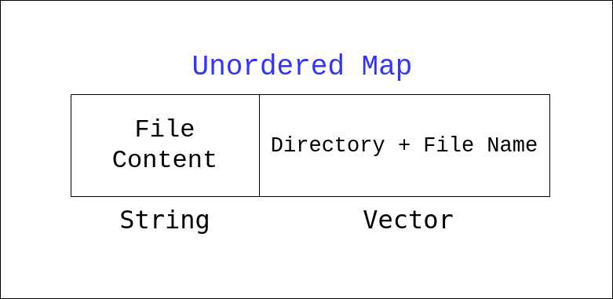

# C++ | StringStream | Related Problems

**Author:** kiranpalsingh1806
**Votes:** 40
**Link:** [https://leetcode.com/problems/find-duplicate-file-in-system/solutions/2595085/](https://leetcode.com/problems/find-duplicate-file-in-system/solutions/2595085/)

---

- We will use **stringstream library of C++** to **extract words from string**.
- We will **map the file content with directory and file name** in unordered map.
- If there is one file for one file content, then it means that file is unique. We will not include that in our final answer. 




```cpp
vector<vector<string>> findDuplicate(vector<string>& paths) {
        
        int N = paths.size();
        unordered_map<string, vector<string>> M;
        
        for (int i = 0; i < N; i++) {
            string directoryInfo = paths[i];
            
            stringstream ss(directoryInfo);
            string s, directoryName;
            bool firstWord = true;
            
            while (getline(ss, s, ' ')) {
                if (firstWord) {
                    directoryName = s;
                    firstWord = false;
                } else {
                    // Find the file name
                    int fileNameLength = 0, i = 0;
                    while(i < s.length() && s[i++] != '(') fileNameLength++;
                    string fileName = s.substr(0, fileNameLength);

                    // Find the file content
                    int fileLength = 0, j = fileNameLength + 1;
                    while (j < s.length() && s[j++] != ')') fileLength++;
                    string fileContent = s.substr(fileNameLength + 1, fileLength);

                    M[fileContent].push_back(directoryName + "/" + fileName);
                }
            }
        }
        
        vector<vector<string>> ans;
        for (auto &[content, directoryAndFile] : M) {
            if(directoryAndFile.size() == 1) continue;
            ans.push_back(directoryAndFile);
        }
        
        return ans;
}
```

These type of problems are **heavily downvoted** because **many people face issues in extracting words from string**. The **stringstream takes care of all edge cases** and makes it really fun to do these type of problems. 

**Related Problem**
[Apply Discount To Prices](https://leetcode.com/problems/apply-discount-to-prices/)