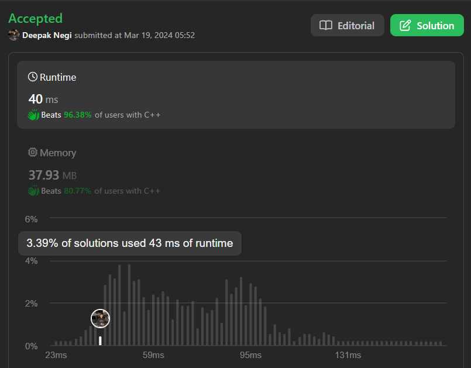

# Easy Explanation | | Greedy | | Beats 96.38% | | C++ | | Java | | Python3 | | Kotlin | | ✅✅✅🔥🔥🔥

**Author:** Hunter_0718
**Votes:** 70
**Link:** [https://leetcode.com/problems/task-scheduler/solutions/4894956/](https://leetcode.com/problems/task-scheduler/solutions/4894956/)

---



**Intuition:**
To solve this problem, we need to find the minimum number of intervals required to complete all tasks while following the cooling time constraint. One way to approach this is to first count the frequency of each task. Then, we can sort the frequencies in descending order to prioritize tasks with higher frequency. After sorting, we can calculate the number of intervals needed by considering the task with the maximum frequency.

**Approach:**
1. Count the frequency of each task using an array `freq`.
2. Sort the `freq` array in descending order.
3. Calculate the number of intervals needed based on the task with the maximum frequency.
4. Return the total number of intervals required.

**Complexity:**
- **Time complexity:** Sorting the `freq` array takes O(26 log 26), which simplifies to O(1) as it's a constant time operation. The loop to calculate intervals takes O(26), which is again a constant. So overall, the time complexity is O(1).
- **Space complexity:** We use an array of size 26 for frequency, so the space complexity is O(1).

# Code : 
```C++ []
class Solution {
public:
    int leastInterval(vector<char>& tasks, int n) {
        int freq[26] = {0};
        for(char task : tasks){
            freq[task - 'A']++;
        }
        sort(begin(freq) , end(freq));
        int chunk = freq[25] - 1;
        int idel = chunk * n;

        for(int i=24; i>=0; i--){
            idel -= min(chunk,freq[i]);
        }

        return idel < 0 ? tasks.size() : tasks.size() + idel;
    }
};

```
```Java []
class Solution {
    public int leastInterval(char[] tasks, int n) {
        int[] freq = new int[26];
        for (char task : tasks) {
            freq[task - 'A']++;
        }
        Arrays.sort(freq);
        int chunk = freq[25] - 1;
        int idle = chunk * n;

        for (int i = 24; i >= 0; i--) {
            idle -= Math.min(chunk, freq[i]);
        }

        return idle < 0 ? tasks.length : tasks.length + idle;
    }
}

```
```Python3 []
class Solution:
    def leastInterval(self, tasks: List[str], n: int) -> int:
        freq = [0] * 26
        for task in tasks:
            freq[ord(task) - ord('A')] += 1
        freq.sort()
        chunk = freq[25] - 1
        idle = chunk * n

        for i in range(24, -1, -1):
            idle -= min(chunk, freq[i])

        return len(tasks) + idle if idle >= 0 else len(tasks)

```

```Kotlin []
class Solution {
    fun leastInterval(tasks: CharArray, n: Int): Int {
        val freq = IntArray(26)
        tasks.forEach { task ->
            freq[task - 'A']++
        }
        freq.sort()
        var chunk = freq[25] - 1
        var idle = chunk * n

        for (i in 24 downTo 0) {
            idle -= minOf(chunk, freq[i])
        }

        return if (idle < 0) tasks.size else tasks.size + idle
    }
}

```
```Javascript []
/**
 * @param {character[]} tasks
 * @param {number} n
 * @return {number}
 */
var leastInterval = function(tasks, n) {
    let freq = Array(26).fill(0);
    for (let task of tasks) {
        freq[task.charCodeAt(0) - 'A'.charCodeAt(0)]++;
    }
    freq.sort((a, b) => b - a);
    let chunk = freq[0] - 1;
    let idle = chunk * n;

    for (let i = 1; i < 26; i++) {
        idle -= Math.min(chunk, freq[i]);
    }

    return idle < 0 ? tasks.length : tasks.length + idle;
};

```
**Key Points:**


1. The min(chunk, freq[i]) calculation effectively adapts the initial idel estimate based on less frequent tasks.
2. The final check for negative idel handles scenarios where all tasks can be scheduled without remaining idle slots.

# Dry Run : 

Let's dry run the first test case: `tasks = ["A","A","A","B","B","B"], n = 2`

1. Count the frequency of each task:
   - Frequency of A = 3
   - Frequency of B = 3
   - All other tasks have frequency 0.
2. Sort the `freq` array: `[0, 0, 0, ..., 3, 3]`
3. Calculate `chunk` as `3 - 1 = 2`.
4. Calculate `idle` as `2 * 2 = 4`.
5. Iterate from index 24 to 0 in the `freq` array:
   - For index 24 (B's frequency), `idel -= min(2, 3)` => `idel -= 2`.
   - For index 23 (A's frequency), `idel -= min(2, 3)` => `idel -= 2`.
   - Other frequencies are 0, so no changes to `idel`.
6. Return `idel < 0 ? tasks.size() : tasks.size() + idel`, which is `8`.

Thus, the output is 8, which matches the expected result.