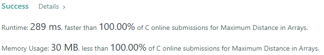
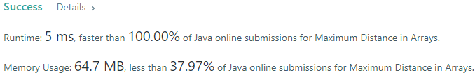
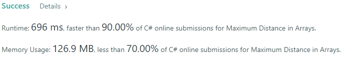
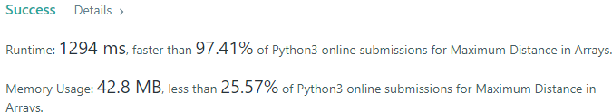
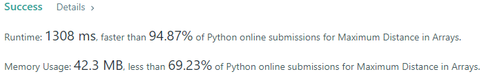
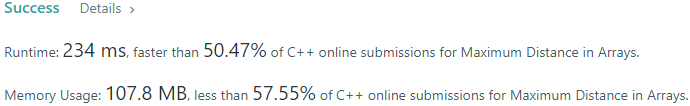
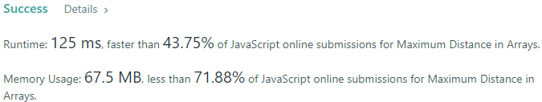

# 💢☠💫Easiest👾Faster✅💯 Lesser🧠 🎯 C++✅Python3🐍✅Java✅C✅Python🐍✅C#✅💥🔥💫Explained☠💥🔥 Beats 💯

**Author:** Edwards310
**Votes:** 4
**Link:** [https://leetcode.com/problems/maximum-distance-in-arrays/solutions/5644619/](https://leetcode.com/problems/maximum-distance-in-arrays/solutions/5644619/)

---

# Intuition








```javascript []
//JavaScript Code
/**
 * @param {number[][]} arrays
 * @return {number}
 */
var maxDistance = function (A) {
    let prev_min = A[0][0], prev_max = A[0][0], res = 0;

    A.forEach((row, idx) => {
        let min = row[0], max = row[row.length - 1];

        if (idx !== 0) {
            if (res < Math.abs(prev_max - min))
                res = Math.abs(prev_max - min);
            if (res < Math.abs(max - prev_min))
                res = Math.abs(max - prev_min);
        }

        prev_min = Math.min(prev_min, min);
        prev_max = Math.max(prev_max, max);
    })

    return res;
};
```
```C++ []
//C++ Code
class Solution {
    int currMax = INT_MIN / 2;
    int currMin = INT_MAX / 2;
    int maxDiff = 0;
public:
    int maxDistance(vector<vector<int>>& arrays) {
        for(const auto &el: arrays){
            int newMax = el.back();
            int newMin = el[0];
            maxDiff = fmax(maxDiff, max(newMax - currMin, currMax - newMin));
            currMax = fmax(currMax, newMax);
            currMin = fmin(currMin, newMin);
        }
        return maxDiff; 
    }
};
```
```Python3 []
#Python Code
class Solution:
    def maxDistance(self, arrays: List[List[int]]) -> int:
        n = len(arrays)
        global_min = (arrays[0][0], 0)
        global_max = (arrays[0][-1], 0)

        prev_min = (arrays[1][0], 1)
        prev_max = (arrays[1][-1], 1)

        if prev_min < global_min:
            prev_min, global_min = global_min, prev_min

        if prev_max > global_max:
            prev_max, global_max = global_max, prev_max

        for idx, a in enumerate(arrays[2:]):
            if a[0] < global_min[0]:
                prev_min = global_min
                global_min = (a[0], idx+2)
            elif a[0] < prev_min[0]:
                prev_min = (a[0], idx+2)

            if a[-1] > global_max[0]:
                prev_max = global_max
                global_max = (a[-1], idx+2)
            elif a[-1] > prev_max[0]:
                prev_max = (a[-1], idx+2)

        if global_max[1] != global_min[1]:
            return global_max[0] - global_min[0]
        else:
            print(global_max[0], prev_min[0], prev_max[0], global_min[0])
            return max(global_max[0] - prev_min[0], prev_max[0] - global_min[0])
```
```Java []
//Java Code

class Solution {
    int currMax = Integer.MIN_VALUE / 2;
    int currMin = Integer.MAX_VALUE / 2;
    int maxDiff = 0;
    public int maxDistance(List<List<Integer>> arrays) {
        for(int i = 0; i < arrays.size(); ++i){
            List<Integer> ans = arrays.get(i);
            int newMax = ans.get(ans.size() - 1);
            int newMin = ans.get(0);
            maxDiff = Math.max(maxDiff, Math.max(newMax - currMin, currMax - newMin));
            currMax = Math.max(currMax, newMax);
            currMin = Math.min(currMin, newMin);
        }
        return maxDiff; 
    }
}
```
```C []
//C Code
#include<stdio.h>
#include<stdlib.h>
#define Rep(i, n) for(int i = 0; i < n; i++)

int maxDistance(int** arrays, int arraysSize, int* arraysColSize) {
    short min = 10000, max = -10000;
    int i, imin, imax;
    Rep(i, arraysSize){
        if(arrays[i][0] < min)
            min = arrays[i][0], imin = i;
        if(arrays[i][arraysColSize[i] - 1] > max)
            max = arrays[i][arraysColSize[i] - 1], imax = i;
    }

    if(imin != imax) return max - min;

    short min1 = 10000, max1 = -10000;
    Rep(i, arraysSize){
        if(arrays[i][0] < min1 && i != imin)
            min1 = arrays[i][0];
        
        if(arrays[i][arraysColSize[i] - 1] > max1 && i != imax)
            max1 = arrays[i][arraysColSize[i] - 1];
    }

    return max - min1 > max1 - min ? max - min1 : max1 - min;
}
```
```Python []
#Python Code
class Solution(object):
    def maxDistance(self, arrays):
        """
        :type arrays: List[List[int]]
        :rtype: int
        """
        minl = {}
        maxl = {}
        for i in range(len(arrays)):
            minl[i] = arrays[i][0]
            maxl[i] = arrays[i][-1]

        maxkey = max(maxl, key=maxl.get)
        minkey = min(minl, key=minl.get)
        
        if maxkey != minkey:
            return maxl[maxkey] - minl[minkey]
        else:
            max1 = maxl[maxkey]
            min1 = minl[minkey]
            del maxl[maxkey]
            del minl[minkey]
            if maxl and minl:  
                maxkey1 = max(maxl, key=maxl.get)
                minkey1 = min(minl, key=minl.get)
                max2 = maxl[maxkey1]
                min2 = minl[minkey1]
                return max((max1 - min2), (max2 - min1))
            else:
                return 0 
```
```C# []
//C# Code
public class Solution {
    int currMax = Int32.MinValue / 2;
    int currMin = Int32.MaxValue / 2;
    int maxDiff = 0;
    public int MaxDistance(IList<IList<int>> arrays) {
        foreach(var el in arrays){
            int newMax = el[el.Count - 1];
            int newMin = el[0];
            maxDiff = Math.Max(maxDiff, Math.Max(newMax - currMin, currMax - newMin));
            currMax = Math.Max(currMax, newMax);
            currMin = Math.Min(currMin, newMin);
        }
        return maxDiff; 
    }
}

```
<!-- Describe your first thoughts on how to solve this problem. -->

# Approach
<!-- Describe your approach to solving the problem. -->

# Complexity
- Time complexity:
<!-- Add your time complexity here, e.g. $$O(n)$$ -->

- Space complexity:
<!-- Add your space complexity here, e.g. $$O(n)$$ -->

# Code

