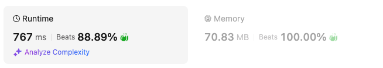

# Find 2 max and 2 min. No abs. Only 1 calculation at end.

**Author:** yunhao_liu
**Votes:** 2
**Link:** [https://leetcode.com/problems/maximum-distance-in-arrays/solutions/5645370/](https://leetcode.com/problems/maximum-distance-in-arrays/solutions/5645370/)

---



# Intuition
Since arrays are all sorted, we only need to care about the first and the last number in each array. The max distance is the max number minus the min number.

But the overall max and overall min could belong to the same array. So we can save the max 2 numbers and min 2 numbers when traversing the list, if top max and min are blong to the same array, we compare and use the combination of first and second.

# Approach
Initialize 2 max numbers and 2 min numbers. Initial value would be MIN_VALUE and MAX_VALUE so whenever there's a new, it could replace. Indices are -1. 
```
        var firstMax = Pair(Int.MIN_VALUE, -1)
        var secondMax = Pair(Int.MIN_VALUE, -1)
        var firstMin = Pair(Int.MAX_VALUE, -1)
        var secondMin = Pair(Int.MAX_VALUE, -1)
```
For each list, we check the last element. If it's bigger than first max, we pass first max to second, and update the first max. If it's bigger than second max, we replace second max directly.
```
            val biggest = arrays[i].last()
            if (biggest > firstMax.first) {
                secondMax = firstMax
                firstMax = Pair(biggest, i)
            } else if (biggest > secondMax.first) {
                secondMax = Pair(biggest, i)
            }
```
Same for first element, to update the first min and second min
```
            val smallest = arrays[i][0]
            if (smallest < firstMin.first) {
                secondMin = firstMin
                firstMin = Pair(smallest, i)
            } else if (smallest < secondMin.first) {
                secondMin = Pair(smallest, i)
            }
```
Then if first max and first min are not from the same array, we can return their distance directly.
```
        if (firstMax.second != firstMin.second) {
            return firstMax.first - firstMin.first
        } 
```
Else, we compare first max minus second min, and second max minus first min, return the bigger.
```
        else {
            return maxOf(firstMax.first - secondMin.first, secondMax.first - firstMin.first)
        }    
```


# Complexity
- Time complexity:
$$O(n)$$

- Space complexity:
$$O(1)$$

# Code
```
class Solution {
    fun maxDistance(arrays: List<List<Int>>): Int {
        var firstMax = Pair(Int.MIN_VALUE, -1)
        var secondMax = Pair(Int.MIN_VALUE, -1)
        var firstMin = Pair(Int.MAX_VALUE, -1)
        var secondMin = Pair(Int.MAX_VALUE, -1)

        for (i in arrays.indices) {
            val biggest = arrays[i].last()
            if (biggest > firstMax.first) {
                secondMax = firstMax
                firstMax = Pair(biggest, i)
            } else if (biggest > secondMax.first) {
                secondMax = Pair(biggest, i)
            }
            val smallest = arrays[i][0]
            if (smallest < firstMin.first) {
                secondMin = firstMin
                firstMin = Pair(smallest, i)
            } else if (smallest < secondMin.first) {
                secondMin = Pair(smallest, i)
            }
        }        
        if (firstMax.second != firstMin.second) {
            return firstMax.first - firstMin.first
        } else {
            return maxOf(firstMax.first - secondMin.first, secondMax.first - firstMin.first)
        }        
    }
}
```