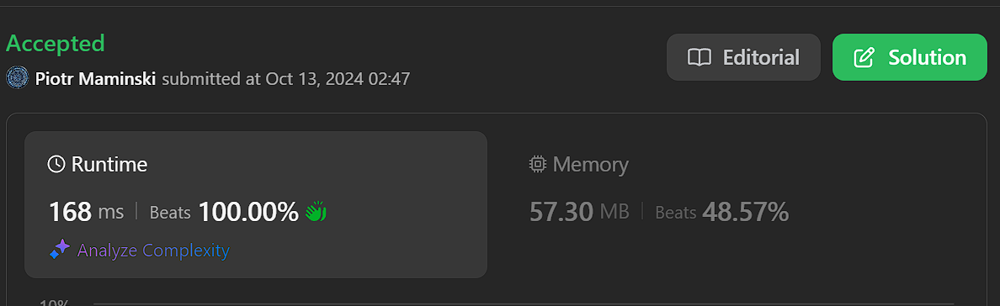
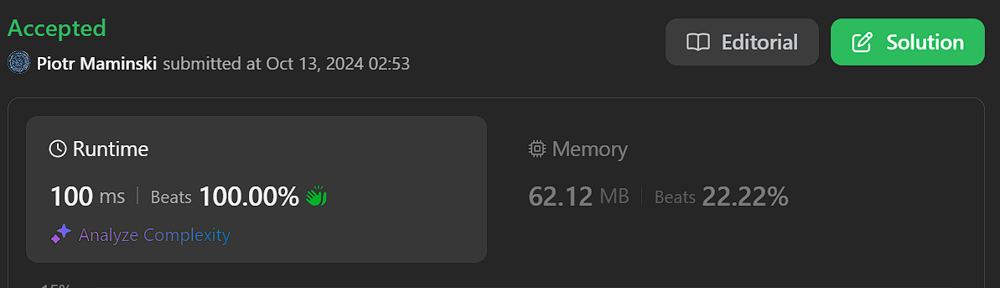

# ✅ Beats 100% | Working 13.10.2024

**Author:** Piotr_Maminski
**Votes:** 19
**Link:** [https://leetcode.com/problems/smallest-range-covering-elements-from-k-lists/solutions/5905077/](https://leetcode.com/problems/smallest-range-covering-elements-from-k-lists/solutions/5905077/)

---


```python3 []
from typing import List
from collections import defaultdict

class Solution:
    def smallestRange(self, nums: List[List[int]]) -> List[int]:
        # List to store all numbers with their list index
        ordered = []

        # Populate the ordered list with all numbers and their corresponding list index
        for k, num_list in enumerate(nums):
            for n in num_list:
                ordered.append((n, k))

        # Sort the ordered list based on the numbers
        ordered.sort()

        i, k = 0, 0  # i: start of current range, k: count of unique lists covered
        ans = []     # List to store the final answer (smallest range)
        count = defaultdict(int)  # Dictionary to keep track of number of elements from each list

        # Iterate through the sorted ordered list
        for j in range(len(ordered)):
            # If this is a new list or increment the count for this list
            if count[ordered[j][1]] == 0:
                k += 1
            count[ordered[j][1]] += 1

            # If we have covered all lists
            if k == len(nums):
                # Shrink the range from the start while maintaining coverage of all lists
                while count[ordered[i][1]] > 1:
                    count[ordered[i][1]] -= 1
                    i += 1

                # Update the answer if this is the first valid range or if it's smaller than the previous range
                if not ans or ans[1] - ans[0] > ordered[j][0] - ordered[i][0]:
                    ans = [ordered[i][0], ordered[j][0]]

        return ans  # Return the smallest range that includes at least one number from each list
```
```cpp []
class Solution {
public:
    vector<int> smallestRange(vector<vector<int>>& nums) {
        // Vector to store all numbers with their list index
        vector<pair<int, int>> ordered;

        // Populate the ordered vector with all numbers and their corresponding list index
        for (size_t k = 0; k < nums.size(); ++k)
            for (auto n: nums[k]) ordered.push_back({n, k});

        // Sort the ordered vector based on the numbers
        sort(ordered.begin(), ordered.end());

        int i = 0, k = 0;  // i: start of current range, k: count of unique lists covered
        vector<int> ans;   // Vector to store the final answer (smallest range)
        unordered_map<int, int> count;  // Map to keep track of number of elements from each list

        // Iterate through the sorted ordered vector
        for (size_t j = 0; j < ordered.size(); ++j) {
            // If this is a new list or increment the count for this list
            if (! count[ordered[j].second]++) ++k;

            // If we have covered all lists
            if (k == nums.size()) { 
                // Shrink the range from the start while maintaining coverage of all lists
                while (count[ordered[i].second] > 1) --count[ordered[i++].second]; 

                // Update the answer if this is the first valid range or if it's smaller than the previous range
                if (ans.empty() || ans[1] - ans[0] > ordered[j].first - ordered[i].first) {
                    ans = vector<int>{ordered[i].first, ordered[j].first};
                }
            }
        }

        return ans;  // Return the smallest range that includes at least one number from each list
    }
};
```
```java []
import java.util.*;

class Solution {
    public int[] smallestRange(List<List<Integer>> nums) {
        // List to store all numbers with their list index
        List<int[]> ordered = new ArrayList<>();

        // Populate the ordered list with all numbers and their corresponding list index
        for (int k = 0; k < nums.size(); ++k) {
            for (int n : nums.get(k)) {
                ordered.add(new int[]{n, k});
            }
        }

        // Sort the ordered list based on the numbers
        Collections.sort(ordered, (a, b) -> Integer.compare(a[0], b[0]));

        int i = 0, k = 0;  // i: start of current range, k: count of unique lists covered
        int[] ans = new int[0];   // Array to store the final answer (smallest range)
        Map<Integer, Integer> count = new HashMap<>();  // Map to keep track of number of elements from each list

        // Iterate through the sorted ordered list
        for (int j = 0; j < ordered.size(); ++j) {
            // If this is a new list or increment the count for this list
            if (count.getOrDefault(ordered.get(j)[1], 0) == 0) ++k;
            count.put(ordered.get(j)[1], count.getOrDefault(ordered.get(j)[1], 0) + 1);

            // If we have covered all lists
            if (k == nums.size()) {
                // Shrink the range from the start while maintaining coverage of all lists
                while (count.get(ordered.get(i)[1]) > 1) {
                    count.put(ordered.get(i)[1], count.get(ordered.get(i)[1]) - 1);
                    ++i;
                }

                // Update the answer if this is the first valid range or if it's smaller than the previous range
                if (ans.length == 0 || ans[1] - ans[0] > ordered.get(j)[0] - ordered.get(i)[0]) {
                    ans = new int[]{ordered.get(i)[0], ordered.get(j)[0]};
                }
            }
        }

        return ans;  // Return the smallest range that includes at least one number from each list
    }
}
```
```javascript [JS]
var smallestRange = function(nums) {
    // k is the number of lists in nums
    const k = nums.length;
    
    // Map to keep track of how many elements from each list are in the current range
    const coverMap = new Map();
    
    // Flatten the nums array and keep track of which list each element came from
    const elements = nums.reduce((result, list, index) => {
        for (const num of list) {
            result.push({ num, index });
        }
        return result;
    }, []);
    
    // Initialize variables for the sliding window
    let left = 0;  // Left pointer of the window
    let coverCount = 0;  // Number of lists covered by the current window
    let minRange = Number.MAX_SAFE_INTEGER;  // Initialize the minimum range to a large number
    
    // Sort the flattened array by the numeric value
    elements.sort((a, b) => a.num - b.num);
    
    // Iterate through the sorted array
    for (let index = 0; index < elements.length; index++) {
        const element = elements[index];
        const count = coverMap.get(element.index) ?? 0;
        
        // If this is the first element from this list, increment coverCount
        if (!count) coverCount += 1;
        coverMap.set(element.index, count + 1);
        
        // While the window covers all k lists, try to minimize the range
        while (coverCount === k) {
            const leftElement = elements[left];
            const range = element.num - leftElement.num;
            const leftCount = coverMap.get(leftElement.index);
            
            // Update the minimum range if a smaller range is found
            if (range < minRange) {
                minRange = range;
                result = [leftElement.num, element.num];
            }
            
            // Move the left pointer of the window
            coverMap.set(leftElement.index, leftCount - 1);
            if (leftCount - 1 === 0) coverCount -= 1;
            left += 1;
        }
    }
    
    // Return the smallest range found
    return result;
};
```
```typescript [TS]
type NumElement = {
    num: number;
    index: number;
};

function smallestRange(nums: number[][]): number[] {
    // k is the number of lists in nums
    const k: number = nums.length;
    
    // Map to keep track of how many elements from each list are in the current range
    const coverMap: Map<number, number> = new Map();
    
    // Flatten the nums array and keep track of which list each element came from
    const elements: NumElement[] = nums.reduce((result: NumElement[], list: number[], index: number) => {
        for (const num of list) {
            result.push({ num, index });
        }
        return result;
    }, []);
    
    // Initialize variables for the sliding window
    let left: number = 0;  // Left pointer of the window
    let coverCount: number = 0;  // Number of lists covered by the current window
    let minRange: number = Number.MAX_SAFE_INTEGER;  // Initialize the minimum range to a large number
    let result: number[] = [];
    
    // Sort the flattened array by the numeric value
    elements.sort((a, b) => a.num - b.num);
    
    // Iterate through the sorted array
    for (let index = 0; index < elements.length; index++) {
        const element = elements[index];
        const count = coverMap.get(element.index) ?? 0;
        
        // If this is the first element from this list, increment coverCount
        if (!count) coverCount += 1;
        coverMap.set(element.index, count + 1);
        
        // While the window covers all k lists, try to minimize the range
        while (coverCount === k) {
            const leftElement = elements[left];
            const range = element.num - leftElement.num;
            const leftCount = coverMap.get(leftElement.index)!;
            
            // Update the minimum range if a smaller range is found
            if (range < minRange) {
                minRange = range;
                result = [leftElement.num, element.num];
            }
            
            // Move the left pointer of the window
            coverMap.set(leftElement.index, leftCount - 1);
            if (leftCount - 1 === 0) coverCount -= 1;
            left += 1;
        }
    }
    
    // Return the smallest range found
    return result;
}

```
```rust []
// Import the Reverse wrapper from the std::cmp module
// This is used to create a min-heap instead of a max-heap
use std::cmp::Reverse;

// Import BinaryHeap from the std::collections module
// BinaryHeap is used to efficiently maintain the smallest element from each list
use std::collections::BinaryHeap;

impl Solution {
    pub fn smallest_range(nums: Vec<Vec<i32>>) -> Vec<i32> {
        // Initialize variables:
        // range: Option to store the current smallest range
        // k: number of lists
        // max: current maximum value in the heap
        let (mut range, k, mut max) = (None, nums.len(), i32::MIN);

        // Create a min-heap (using Reverse) containing tuples:
        // (Reverse(first element), list index, element index within the list)
        let mut heap = nums.iter().enumerate().fold(BinaryHeap::new(), |mut heap, (idx, vec)| {
            heap.push((Reverse(vec[0]), idx, 0));
            max = max.max(vec[0]);
            heap
        });

        // Continue while the heap contains elements from all k lists
        while heap.len() == k {
            // Pop the smallest element from the heap
            if let Some((Reverse(min), list_index, element_index)) = heap.pop() {
                let current_range = max - min;

                // Update the range if necessary
                match range {
                    None => range = Some((min, max)),
                    Some((start, end)) if current_range < end - start => range = Some((min, max)),
                    Some((start, end)) if current_range == end - start && min < start => range = Some((min, max)),
                    _ => {}
                }

                // If there are more elements in the current list, add the next one to the heap
                if element_index + 1 < nums[list_index].len() {
                    let next = nums[list_index][element_index + 1];
                    heap.push((Reverse(next), list_index, element_index + 1));
                    max = max.max(next);
                } else {
                    // If we've exhausted a list, we can't form a range with all lists, so break
                    break;
                }
            }
        }

        // Convert the range to a Vec<i32> or return an empty vector if no range was found
        range.map_or_else(Vec::new, |r| vec![r.0, r.1])
    }
}
```
```csharp []
public class Solution {
    public int[] SmallestRange(IList<IList<int>> nums) {
        // Create a priority queue to store points, sorted by their values
        PriorityQueue<point,point> pq = new(new SortComparer());
        
        // Initialize the answer array with default values
        int[] ans = new int[2]{0,Int32.MaxValue};
        
        // Keep track of the maximum value in the current range
        int max = Int32.MinValue;
        
        // Initialize the priority queue with the first element from each list
        for(int i=0;i<nums.Count;i++)
        {
            point p = new point(i,0,nums[i][0]);
            max=Math.Max(max,nums[i][0]);
            pq.Enqueue(p,p);
        }
        
        while(true)
        {
            // Get the point with the smallest value from the queue
            point curr = pq.Dequeue();
            
            // Update the answer if the current range is smaller
            if(ans[1]-ans[0] > max-curr.val)
            {
                ans[0]=curr.val;
                ans[1]=max;
            }
            
            int row = curr.i;
            int col= curr.j+1;
            
            // If there are more elements in the current list
            if(col<nums[row].Count)
            {
                // Update the maximum value
                max = Math.Max(max,nums[row][col]);
                
                // Create a new point for the next element and add it to the queue
                point n = new point(row,col,nums[row][col]);
                pq.Enqueue(n,n);
            }
            else
                // If we've reached the end of a list, we're done
                break;
        }
        
        return ans;
    }
}

// Class to represent a point in the 2D list
public class point
{
    public int val; // The value at this point
    public int j;   // The column index
    public int i;   // The row index (list number)
    
    public point(int a,int b,int c)
    {
        i=a;
        j=b;
        val=c;
    }
}

// Custom comparer for the priority queue to sort points by their values
public class SortComparer: IComparer<point>
{
    public int Compare(point a , point b)
    {
        return a.val-b.val;
    }
}
```
```swift []
class Solution {
    func smallestRange(_ nums: [[Int]]) -> [Int] {
        // Array to store all numbers with their list index
        var ordered: [(Int, Int)] = []

        // Populate the ordered array with all numbers and their corresponding list index
        for (k, list) in nums.enumerated() {
            for n in list {
                ordered.append((n, k))
            }
        }

        // Sort the ordered array based on the numbers
        ordered.sort { $0.0 < $1.0 }

        var i = 0, k = 0  // i: start of current range, k: count of unique lists covered
        var ans: [Int] = []  // Array to store the final answer (smallest range)
        var count: [Int: Int] = [:]  // Dictionary to keep track of number of elements from each list

        // Iterate through the sorted ordered array
        for j in 0..<ordered.count {
            // If this is a new list or increment the count for this list
            if count[ordered[j].1, default: 0] == 0 {
                k += 1
            }
            count[ordered[j].1, default: 0] += 1

            // If we have covered all lists
            if k == nums.count {
                // Shrink the range from the start while maintaining coverage of all lists
                while count[ordered[i].1]! > 1 {
                    count[ordered[i].1]! -= 1
                    i += 1
                }

                // Update the answer if this is the first valid range or if it's smaller than the previous range
                if ans.isEmpty || ans[1] - ans[0] > ordered[j].0 - ordered[i].0 {
                    ans = [ordered[i].0, ordered[j].0]
                }
            }
        }

        return ans  // Return the smallest range that includes at least one number from each list
    }
}
```
```php []
class Solution {
    /**
     * @param Integer[][] $nums
     * @return Integer[]
     */
    function smallestRange($nums) {
        // Array to store all numbers with their list index
        $ordered = [];

        // Populate the ordered array with all numbers and their corresponding list index
        foreach ($nums as $k => $list) {
            foreach ($list as $n) {
                $ordered[] = [$n, $k];
            }
        }

        // Sort the ordered array based on the numbers
        usort($ordered, function($a, $b) {
            return $a[0] - $b[0];
        });

        $i = 0;
        $k = 0;  // i: start of current range, k: count of unique lists covered
        $ans = [];  // Array to store the final answer (smallest range)
        $count = [];  // Array to keep track of number of elements from each list

        // Iterate through the sorted ordered array
        for ($j = 0; $j < count($ordered); $j++) {
            // If this is a new list or increment the count for this list
            if (!isset($count[$ordered[$j][1]]) || $count[$ordered[$j][1]] == 0) {
                $k++;
            }
            $count[$ordered[$j][1]] = ($count[$ordered[$j][1]] ?? 0) + 1;

            // If we have covered all lists
            if ($k == count($nums)) {
                // Shrink the range from the start while maintaining coverage of all lists
                while ($count[$ordered[$i][1]] > 1) {
                    $count[$ordered[$i][1]]--;
                    $i++;
                }

                // Update the answer if this is the first valid range or if it's smaller than the previous range
                if (empty($ans) || $ans[1] - $ans[0] > $ordered[$j][0] - $ordered[$i][0]) {
                    $ans = [$ordered[$i][0], $ordered[$j][0]];
                }
            }
        }

        return $ans;  // Return the smallest range that includes at least one number from each list
    }
}
```


### Complexity 
- Time complexity: O(n log n)

- Space complexity: O(n)





