# 👶🏻0% to ✅100% Thought process clearity + Full Concept + illustrations

**Author:** Rarma
**Votes:** 40
**Link:** [https://leetcode.com/problems/smallest-range-covering-elements-from-k-lists/solutions/5906369/](https://leetcode.com/problems/smallest-range-covering-elements-from-k-lists/solutions/5906369/)

---

# Youtube Explanation
Soon to be on Channel : https://www.youtube.com/@Intuit_and_Code
Edited:
https://youtu.be/JShaO9xoEU0?si=eMp_gi-NhYCVEqjh

> Go on Each Slides according to your Speed. 
Grab your Coffee and Wake Up Your Brain, Let's Go!
# Intuition & Approach
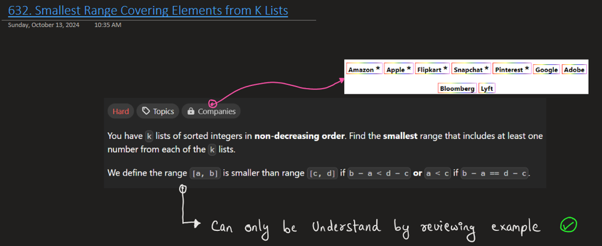
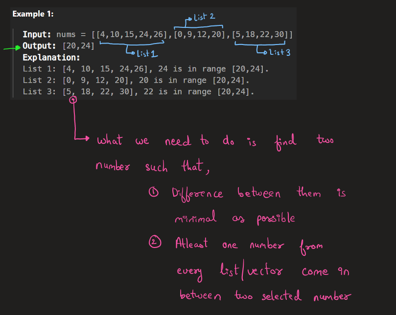
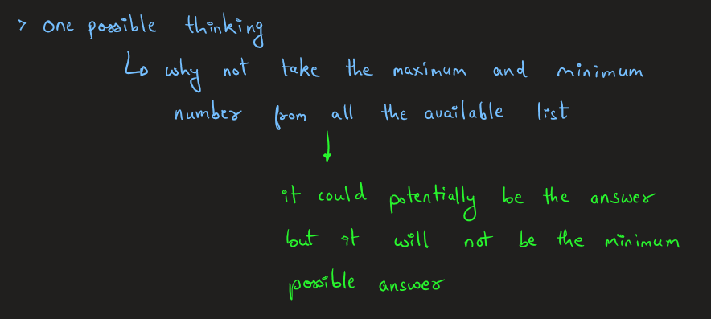
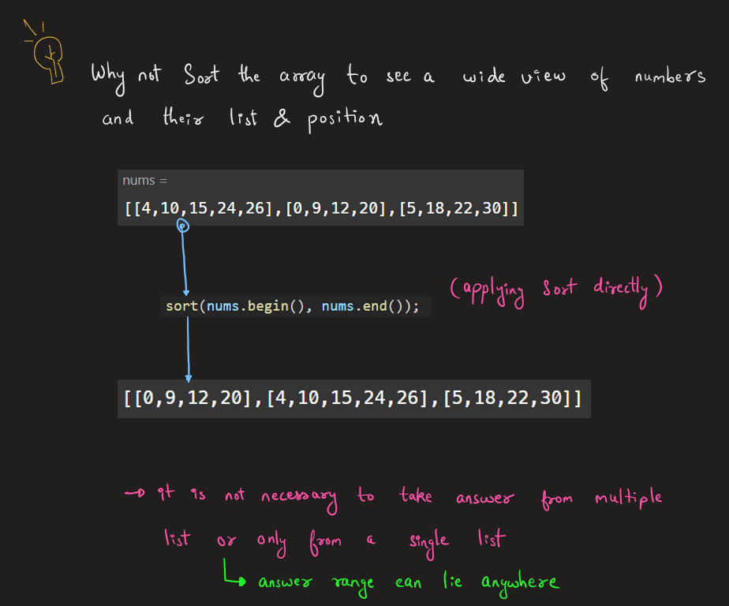
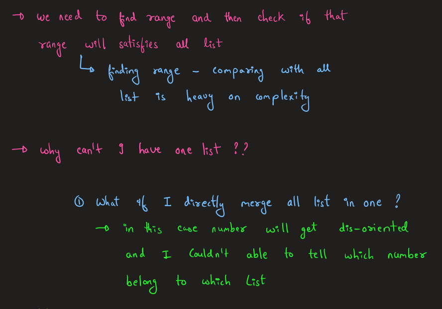
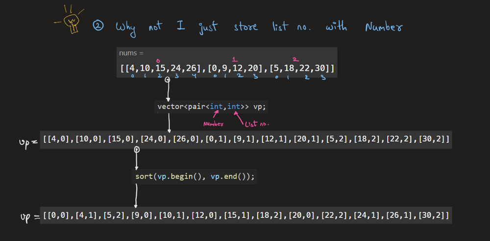
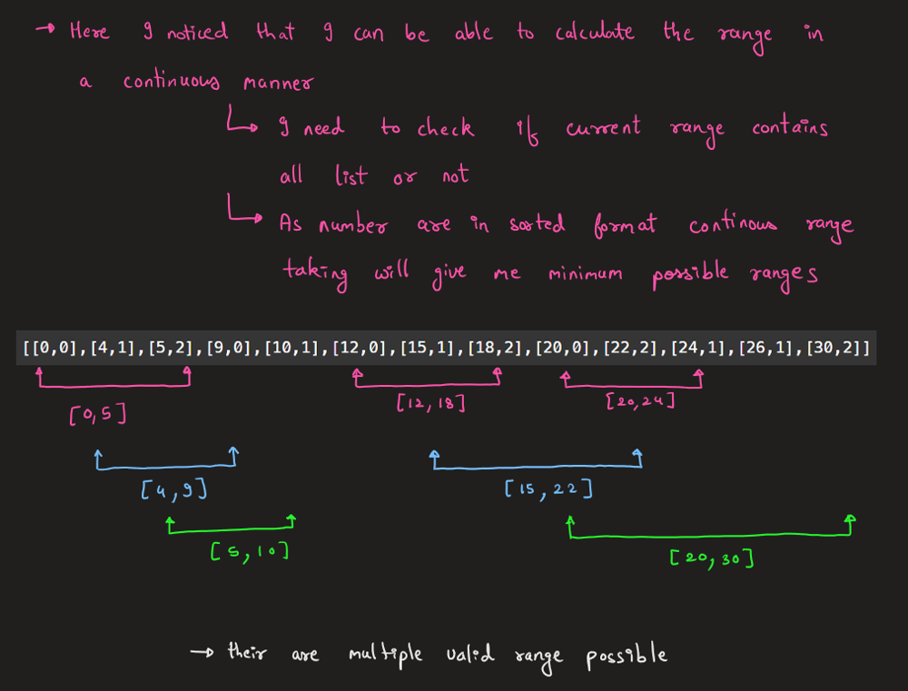
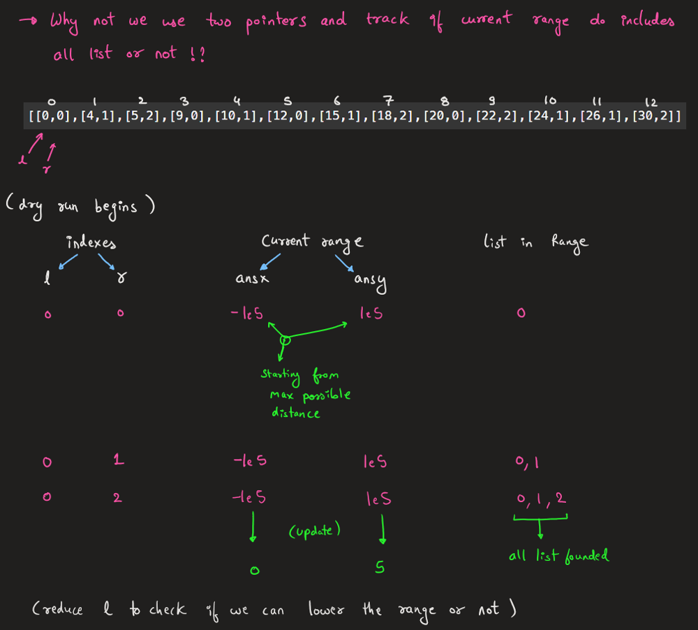
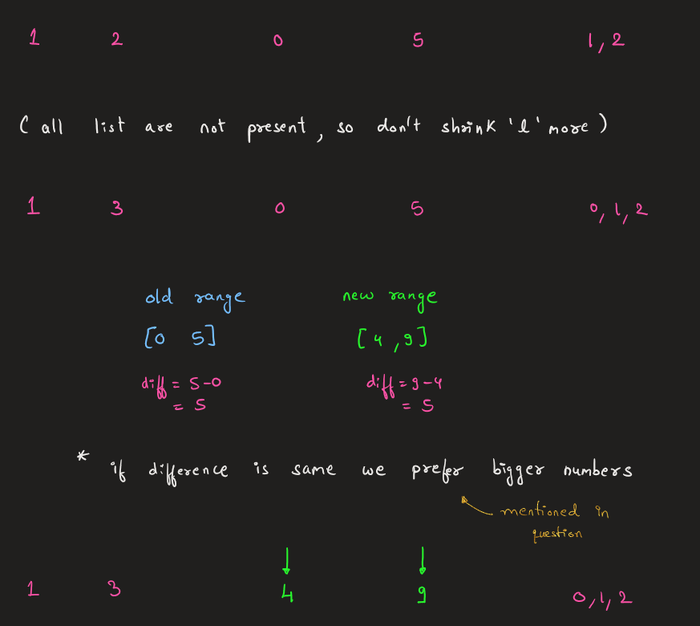
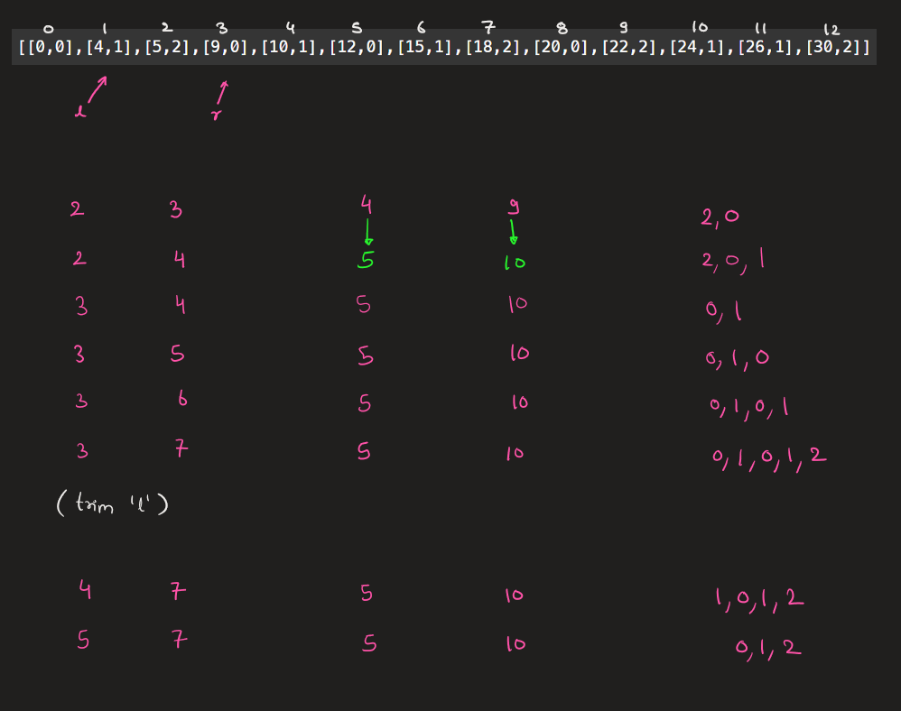
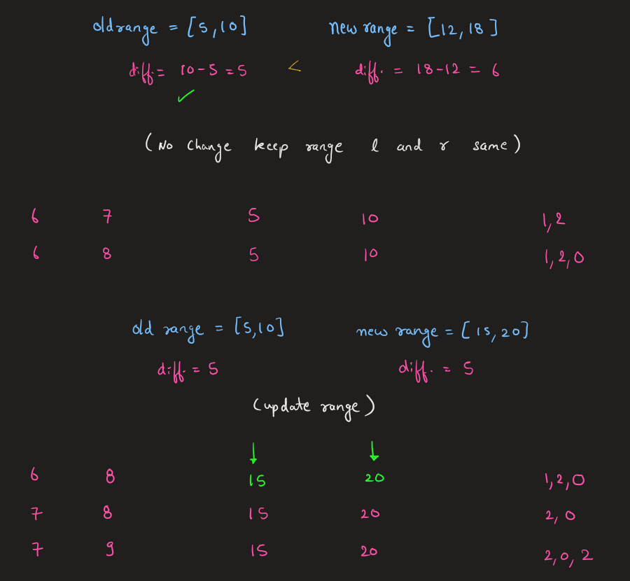
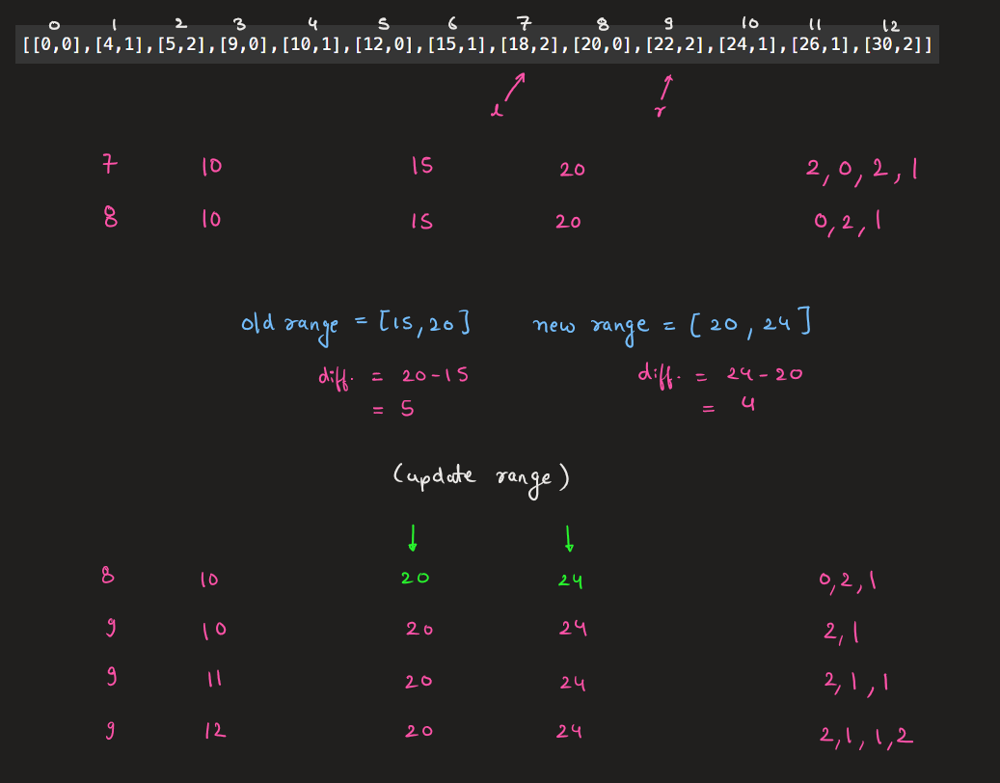
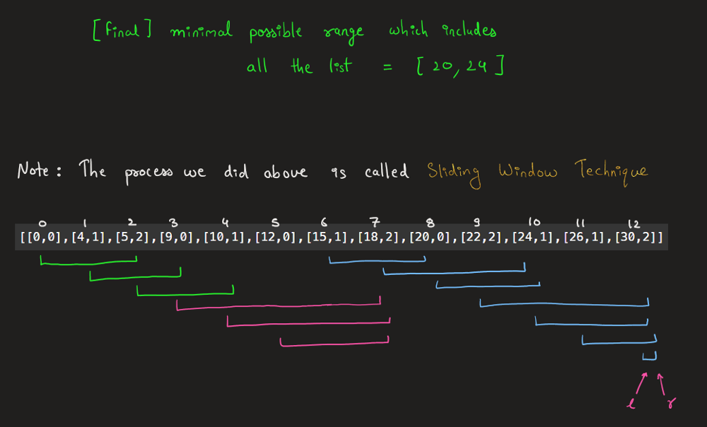


# Complexity
- Time complexity: o(NlogN)
<!-- Add your time complexity here, e.g. $$O(n)$$ -->

- Space complexity: O(2*N) ~> O(N)
<!-- Add your space complexity here, e.g. $$O(n)$$ -->

# Code
```cpp []
class Solution {
private:
    bool chk(int a,int b, int c, int d){
        // if new numbers are answer
        if(b-a < d-c){
            return true;
        }
        else if(b-a == d-c){
            if(a<c){return true;}
        }

        // new number dont have minimum difference
        // uptill now
        return false;
    }
public:
    vector<int> smallestRange(vector<vector<int>>& a) {
        int ansx = -1e5, ansy = 1e5; 
        int total_list = a.size();

        // UNCOMMENT TO CHECK HOW GIVEN ARRAY PRINT AFTER SORT
        // sort(a.begin(), a.end());
        //     cout<<"[";
        // for(int i=0;i<total_list;i++){
        //     cout<<"[";
        //     for(int j=0;j<a[i].size();j++){
        //         cout<<a[i][j]<<((j==a[i].size()-1)?"":",");
        //     }
        //     cout<<"]"<<((i==total_list-1)?"":",");
        // }
        //     cout<<"]";
        // cout<<endl;
        // cout<<endl;

        vector<pair<int,int>> vp;
        for(int i=0;i<total_list;i++){
            for(int j=0;j<a[i].size();j++){
                vp.push_back({a[i][j],i});
            }
        }


        sort(vp.begin(), vp.end());

        // UNCOMMENT TO CHECK HOW VECTOR IS PRINTING AFTER SORT
        // int cnt=0;
        // cout<<"[";
        // for(auto& val:vp){
        //     cout<<"["<<val.first<<","<<val.second<<"]";
        //     cnt++;
        //     if(cnt!=vp.size()){cout<<",";}
        // }
        // cout<<"]";

        unordered_map<int,int> um;
        int l=0, r=0;
        int n = vp.size();
        while(r<n){
            int num = vp[r].first;
            int list = vp[r].second;

            um[list]++;

            while(um.size() >= total_list){
                //    |-----new range---------| |--old range--|
                if(chk(vp[l].first,vp[r].first,   ansx, ansy )){
                    // cout<<"Possible ans = "<<ansx<<" "<<ansy<<endl;
                    ansx = vp[l].first;
                    ansy = vp[r].first;
                    // cout<<"Possible ans = "<<ansx<<" "<<ansy<<endl;
                }

                int old_list = vp[l].second;
                
                um[old_list]--;
                l++;

                if(um[old_list]==0){um.erase(old_list);}
            }

            r++;
        }

        return {ansx, ansy};
    }
};
```
``` java [ ]
class Solution {
    private boolean chk(int a, int b, int c, int d) {
        // if new numbers are answer
        if (b - a < d - c) {
            return true;
        } else if (b - a == d - c) {
            if (a < c) {
                return true;
            }
        }
        // new number doesn't have minimum difference uptill now
        return false;
    }

    public int[] smallestRange(List<List<Integer>> a) {
        int ansx = -100000, ansy = 100000;
        int total_list = a.size();

        List<int[]> vp = new ArrayList<>();
        for (int i = 0; i < total_list; i++) {
            for (int j = 0; j < a.get(i).size(); j++) {
                vp.add(new int[]{a.get(i).get(j), i});
            }
        }

        vp.sort(Comparator.comparingInt(x -> x[0]));

        Map<Integer, Integer> um = new HashMap<>();
        int l = 0, r = 0;
        int n = vp.size();
        while (r < n) {
            int num = vp.get(r)[0];
            int list = vp.get(r)[1];

            um.put(list, um.getOrDefault(list, 0) + 1);

            while (um.size() >= total_list) {
                if (chk(vp.get(l)[0], vp.get(r)[0], ansx, ansy)) {
                    ansx = vp.get(l)[0];
                    ansy = vp.get(r)[0];
                }

                int old_list = vp.get(l)[1];
                um.put(old_list, um.get(old_list) - 1);
                if (um.get(old_list) == 0) {
                    um.remove(old_list);
                }
                l++;
            }

            r++;
        }

        return new int[]{ansx, ansy};
    }
}
```
``` Py [ ]
class Solution:
    def chk(self, a, b, c, d):
        # if new numbers are answer
        if b - a < d - c:
            return True
        elif b - a == d - c:
            if a < c:
                return True
        # new number doesn't have minimum difference up till now
        return False

    def smallestRange(self, a):
        ansx, ansy = -100000, 100000
        total_list = len(a)

        vp = []
        for i in range(total_list):
            for j in range(len(a[i])):
                vp.append((a[i][j], i))

        vp.sort()

        um = defaultdict(int)
        l, r = 0, 0
        n = len(vp)
        while r < n:
            num, lst = vp[r]

            um[lst] += 1

            while len(um) >= total_list:
                if self.chk(vp[l][0], vp[r][0], ansx, ansy):
                    ansx = vp[l][0]
                    ansy = vp[r][0]

                old_list = vp[l][1]
                um[old_list] -= 1
                if um[old_list] == 0:
                    del um[old_list]
                l += 1

            r += 1

        return [ansx, ansy]
```
``` Go [ ]
func chk(a, b, c, d int) bool {
	// if new numbers are better (smaller range)
	if b-a < d-c {
		return true
	} else if b-a == d-c && a < c {
		return true
	}
	// otherwise, the previous range is better
	return false
}

func smallestRange(nums [][]int) []int {
	ansx, ansy := -100000, 100000
	totalLists := len(nums)

	var vp [][]int
	// Create a pair of (value, listIndex)
	for i := 0; i < totalLists; i++ {
		for j := 0; j < len(nums[i]); j++ {
			vp = append(vp, []int{nums[i][j], i})
		}
	}

	// Sort the pair by the value in increasing order
	sort.Slice(vp, func(i, j int) bool {
		return vp[i][0] < vp[j][0]
	})

	um := make(map[int]int)
	l, r := 0, 0
	n := len(vp)

	for r < n {
		list := vp[r][1] // only list is needed here

		um[list]++

		// If we have covered all lists in the current window
		for len(um) >= totalLists {
			if chk(vp[l][0], vp[r][0], ansx, ansy) {
				// Update the answer range
				ansx = vp[l][0]
				ansy = vp[r][0]
			}

			oldList := vp[l][1]
			um[oldList]--

			// Remove the list from the map if its count goes to zero
			if um[oldList] == 0 {
				delete(um, oldList)
			}
			l++
		}

		r++
	}

	return []int{ansx, ansy}
}
```