# 99.99% You will Understand the concept + Drawing illustration + Full Concept

**Author:** Rarma
**Votes:** 115
**Link:** [https://leetcode.com/problems/design-circular-deque/solutions/5841935/](https://leetcode.com/problems/design-circular-deque/solutions/5841935/)

---

# Youtube Explanation
Soon to be on Channel : https://www.youtube.com/@Intuit_and_Code
Edited:
> If Deque nhi pta watch video, You will be like maaza aa gya!

https://youtu.be/csMVGH6Rc4c?si=HZB5eGDjI7u8FPAL

> Just Go on to slides read carefully,
You will Surely get the concept
# Intuition & Approach
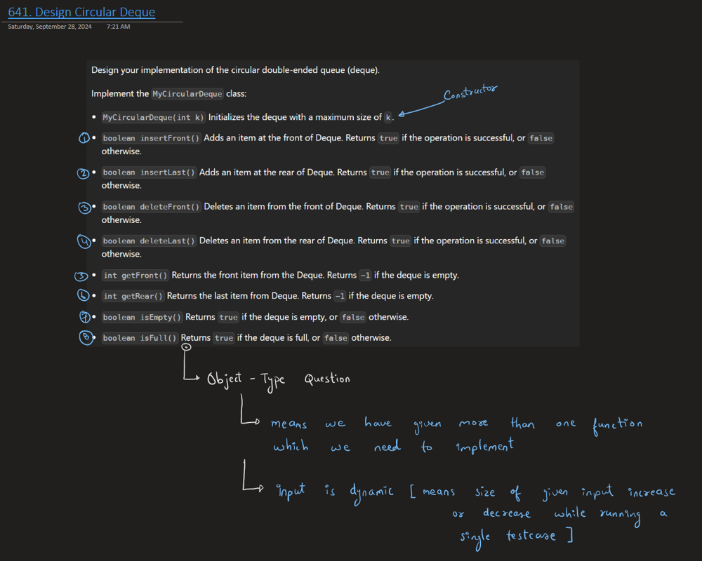
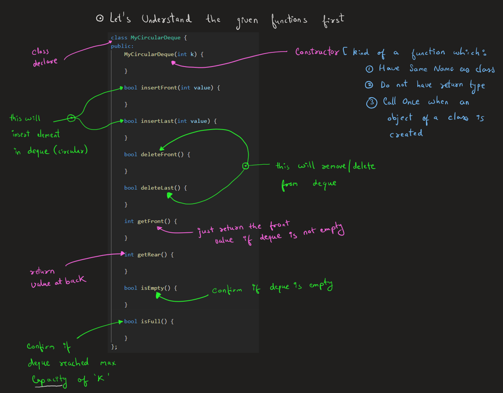
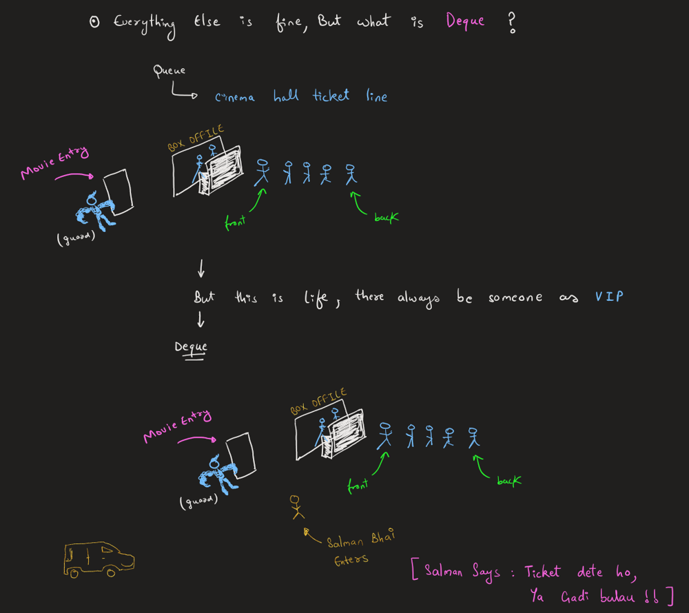
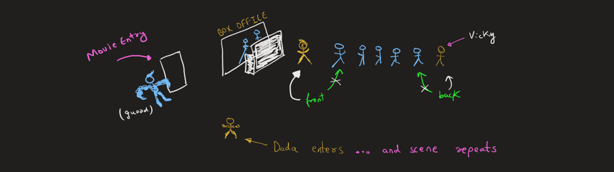
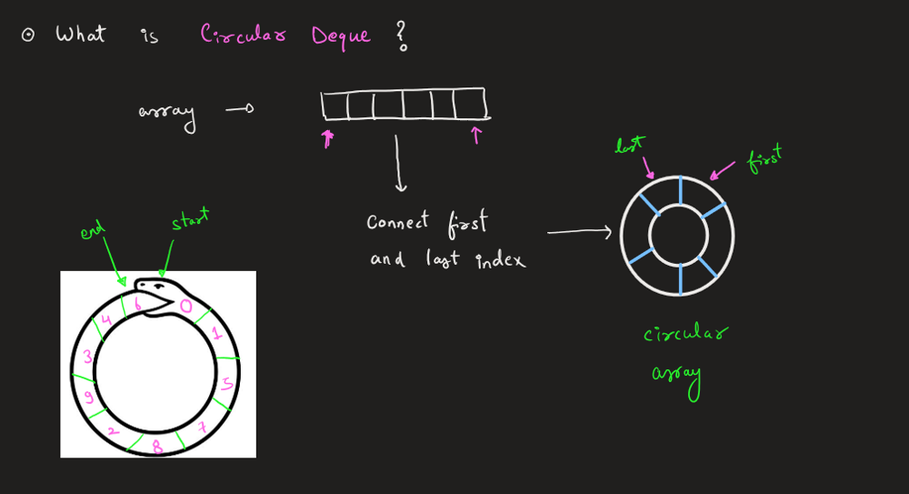
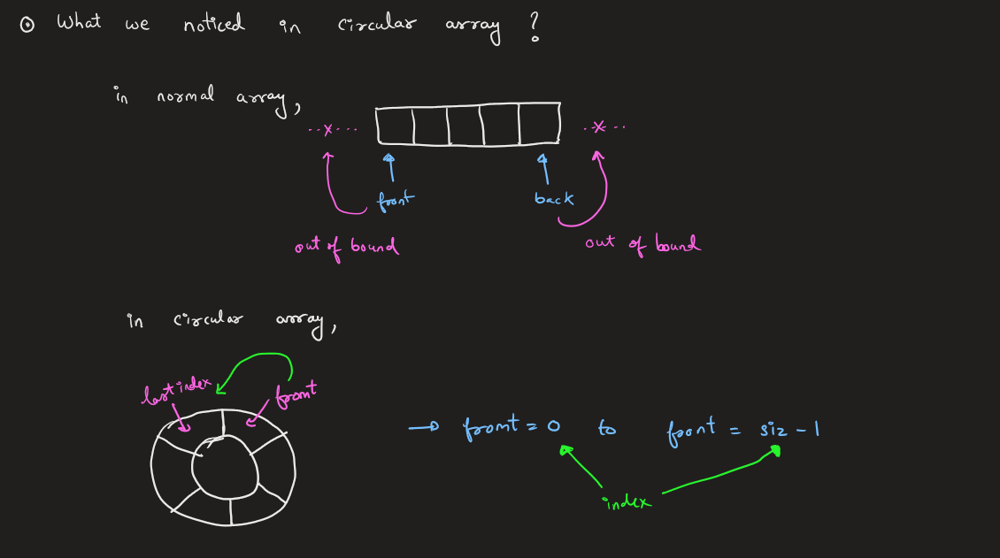
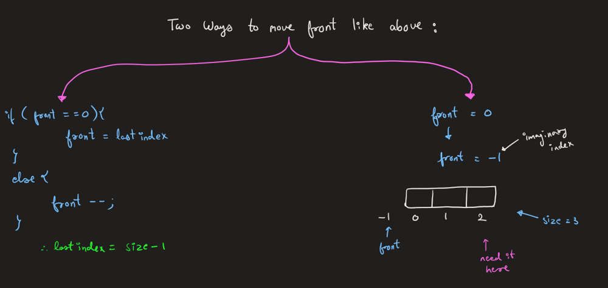
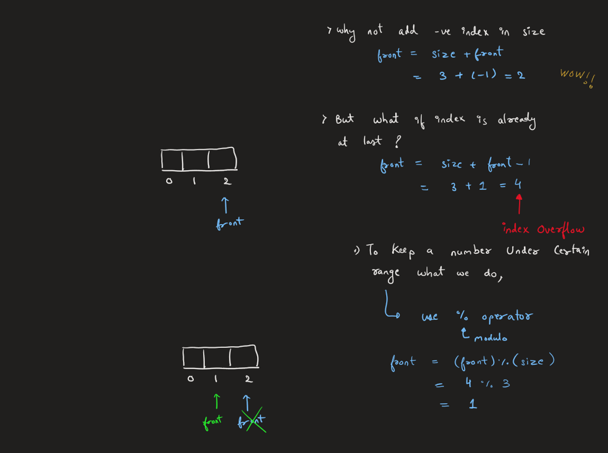
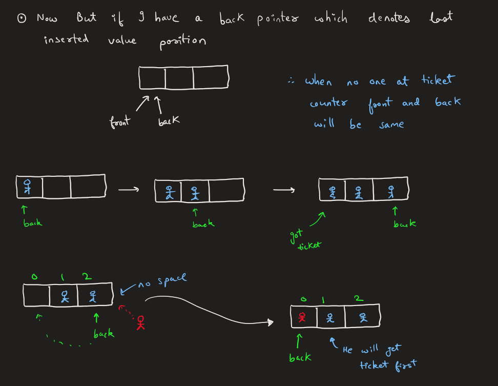
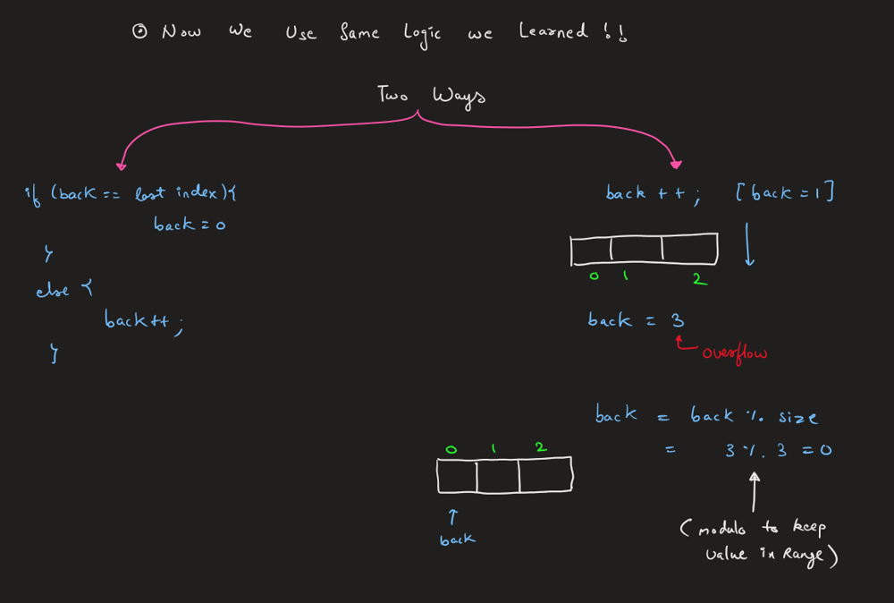
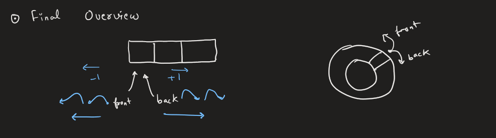


# Complexity
- Time complexity: O(1)
<!-- Add your time complexity here, e.g. $$O(n)$$ -->

- Space complexity: O(k)
<!-- Add your space complexity here, e.g. $$O(n)$$ -->

# Code
```cpp []
class MyCircularDeque {
public:
    vector<int> v;
    int front, back, sizee, capacity;

    MyCircularDeque(int k) {
        v = vector<int>(k, -1);
        front = 0;
        back = 0;
        sizee = 0; // Keeps track of the current number of elements
        capacity = k;
    }

    bool insertFront(int value) {
        if (isFull()) {
            return false;
        }

        // Way - 01
        if (front == 0) {
            front = capacity - 1; // Wrap around to the end
        } 
        else {
            front--; // Simply decrement front
        }

        // Way  - 02
        // front--;
        // front = capacity + front;
        // front %= capacity;

        v[front] = value;

        sizee++;
        return true;
    }

    bool insertLast(int value) {
        if (isFull()) {
            return false;
        }

        v[back] = value;

        // Way - 01
        if (back == capacity - 1) {
            back = 0; // Wrap around to the beginning
        } 
        else {
            back++; // Simply increment back
        }

        // Way - 02
        // back++;
        // back %= capacity;

        sizee++;
        return true;
    }

    bool deleteFront() {
        if (isEmpty()) {
            return false;
        }

        v[front] = -1;

        // Way - 01
        if (front == capacity - 1) {
            front = 0; // Wrap around to the beginning
        } 
        else {
            front++; // Simply increment front
        }
        
        // Way - 02
        // front++;
        // front %= capacity;

        sizee--;
        return true;
    }

    bool deleteLast() {
        if (isEmpty()) {
            return false;
        }

        if (back == 0) {
            back = capacity - 1; // Wrap around to the end
        } 
        else 
        {
            back--; // Simply decrement back
        }
        v[back] = -1;
        
        sizee--;
        return true;
    }

    int getFront() {
        if (isEmpty()){return -1;}
        return v[front];
    }

    int getRear() {
        if (isEmpty()){return -1;} 
        if (back == 0) {
            return v[capacity - 1]; // Wrap around to the last valid element
        } 
        else {
            return v[back - 1]; // Get the last element
        }
    }

    bool isEmpty() { return (sizee == 0); }

    bool isFull() { return (sizee == capacity); }
};
```
``` java [ ]
class MyCircularDeque {
    private int[] v;
    private int front, back, size, capacity;

    public MyCircularDeque(int k) {
        v = new int[k];
        Arrays.fill(v, -1); // Initialize the deque with -1
        front = 0;
        back = 0;
        size = 0; // Keeps track of the current number of elements
        capacity = k;
    }

    public boolean insertFront(int value) {
        if (isFull()) {
            return false;
        }

        // Way - 01
        if (front == 0) {
            front = capacity - 1; // Wrap around to the end
        } else {
            front--; // Simply decrement front
        }

        // Way - 02 (Alternative method commented out)
        // front = (front - 1 + capacity) % capacity;

        v[front] = value;
        size++;
        return true;
    }

    public boolean insertLast(int value) {
        if (isFull()) {
            return false;
        }

        v[back] = value;

        // Way - 01
        if (back == capacity - 1) {
            back = 0; // Wrap around to the beginning
        } else {
            back++; // Simply increment back
        }

        // Way - 02 (Alternative method commented out)
        // back = (back + 1) % capacity;

        size++;
        return true;
    }

    public boolean deleteFront() {
        if (isEmpty()) {
            return false;
        }

        v[front] = -1;

        // Way - 01
        if (front == capacity - 1) {
            front = 0; // Wrap around to the beginning
        } else {
            front++; // Simply increment front
        }

        // Way - 02 (Alternative method commented out)
        // front = (front + 1) % capacity;

        size--;
        return true;
    }

    public boolean deleteLast() {
        if (isEmpty()) {
            return false;
        }

        if (back == 0) {
            back = capacity - 1; // Wrap around to the end
        } else {
            back--; // Simply decrement back
        }
        v[back] = -1;

        size--;
        return true;
    }

    public int getFront() {
        if (isEmpty()) {
            return -1;
        }
        return v[front];
    }

    public int getRear() {
        if (isEmpty()) {
            return -1;
        }
        if (back == 0) {
            return v[capacity - 1]; // Wrap around to the last valid element
        } else {
            return v[back - 1]; // Get the last element
        }
    }

    public boolean isEmpty() {
        return size == 0;
    }

    public boolean isFull() {
        return size == capacity;
    }
}
```
``` Python [ ]
class MyCircularDeque:
    def __init__(self, k: int):
        self.v = [-1] * k  # Initialize deque with -1
        self.front = 0
        self.back = 0
        self.size = 0  # Keeps track of the current number of elements
        self.capacity = k

    def insertFront(self, value: int) -> bool:
        if self.isFull():
            return False

        # Way - 01
        if self.front == 0:
            self.front = self.capacity - 1  # Wrap around to the end
        else:
            self.front -= 1  # Simply decrement front

        # Way - 02 (Alternative method commented out)
        # self.front = (self.front - 1 + self.capacity) % self.capacity

        self.v[self.front] = value
        self.size += 1
        return True

    def insertLast(self, value: int) -> bool:
        if self.isFull():
            return False

        self.v[self.back] = value

        # Way - 01
        if self.back == self.capacity - 1:
            self.back = 0  # Wrap around to the beginning
        else:
            self.back += 1  # Simply increment back

        # Way - 02 (Alternative method commented out)
        # self.back = (self.back + 1) % self.capacity

        self.size += 1
        return True

    def deleteFront(self) -> bool:
        if self.isEmpty():
            return False

        self.v[self.front] = -1

        # Way - 01
        if self.front == self.capacity - 1:
            self.front = 0  # Wrap around to the beginning
        else:
            self.front += 1  # Simply increment front

        # Way - 02 (Alternative method commented out)
        # self.front = (self.front + 1) % self.capacity

        self.size -= 1
        return True

    def deleteLast(self) -> bool:
        if self.isEmpty():
            return False

        if self.back == 0:
            self.back = self.capacity - 1  # Wrap around to the end
        else:
            self.back -= 1  # Simply decrement back

        self.v[self.back] = -1
        self.size -= 1
        return True

    def getFront(self) -> int:
        if self.isEmpty():
            return -1
        return self.v[self.front]

    def getRear(self) -> int:
        if self.isEmpty():
            return -1
        if self.back == 0:
            return self.v[self.capacity - 1]  # Wrap around to the last valid element
        else:
            return self.v[self.back - 1]  # Get the last element

    def isEmpty(self) -> bool:
        return self.size == 0

    def isFull(self) -> bool:
        return self.size == self.capacity

```
