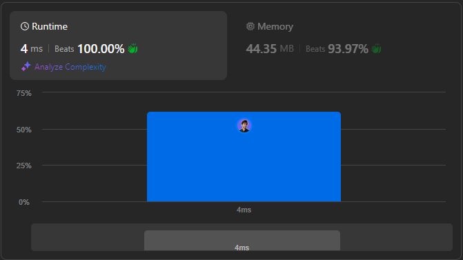

# 🌟 From Zero to Hero: Circular Deque Solution in 5 Languages 🔥💯

**Author:** withaarzoo
**Votes:** 3
**Link:** [https://leetcode.com/problems/design-circular-deque/solutions/5841746/](https://leetcode.com/problems/design-circular-deque/solutions/5841746/)

---


Explore a collection of solutions to LeetCode problems in multiple programming languages. Each solution includes a detailed explanation and step-by-step approach to solving the problem efficiently. Whether you're a beginner looking to learn or an experienced coder seeking optimized solutions, this repository aims to provide clear and insightful approaches to tackling challenging LeetCode problems.

### **Access daily LeetCode Solutions Repo :** [click here](https://github.com/withaarzoo/LeetCode-Solutions)

---



---

### Intuition
The problem requires the implementation of a **circular double-ended queue (deque)**, where elements can be inserted or deleted from both ends. By using a circular structure, the queue can efficiently utilize space and avoid unnecessary shifts during insertions or deletions.

---

### Approach
We can represent the circular deque using an array. Two pointers (`front` and `rear`) will keep track of the deque's front and rear positions. Insertions and deletions will modify these pointers using **modular arithmetic** to ensure the circular nature. 

To differentiate between the full and empty states, we will use an array of size `k+1`. The extra space helps identify when the deque is full (when the rear pointer is just behind the front pointer).

---

### Complexity
- **Time complexity**:  
  All operations (`insertFront`, `insertLast`, `deleteFront`, `deleteLast`, `getFront`, `getRear`, `isEmpty`, `isFull`) take **O(1)** because they involve simple pointer manipulations.
  
- **Space complexity**:  
  The space complexity is **O(k)**, where `k` is the maximum size of the deque, plus an extra space for circular handling.

---

### Code
```C++ []
class MyCircularDeque {
private:
    vector<int> deque;
    int front, rear, size;
public:
    // Constructor to initialize the deque with size k
    MyCircularDeque(int k) {
        deque.resize(k + 1); // One extra space to differentiate between full and empty
        front = 0;
        rear = 0;
        size = k + 1;
    }

    // Insert an item at the front of the deque
    bool insertFront(int value) {
        if (isFull()) return false;
        front = (front - 1 + size) % size; // Move front pointer backward
        deque[front] = value;
        return true;
    }

    // Insert an item at the rear of the deque
    bool insertLast(int value) {
        if (isFull()) return false;
        deque[rear] = value;
        rear = (rear + 1) % size; // Move rear pointer forward
        return true;
    }

    // Delete an item from the front of the deque
    bool deleteFront() {
        if (isEmpty()) return false;
        front = (front + 1) % size; // Move front pointer forward
        return true;
    }

    // Delete an item from the rear of the deque
    bool deleteLast() {
        if (isEmpty()) return false;
        rear = (rear - 1 + size) % size; // Move rear pointer backward
        return true;
    }

    // Get the front item
    int getFront() {
        if (isEmpty()) return -1;
        return deque[front];
    }

    // Get the rear item
    int getRear() {
        if (isEmpty()) return -1;
        return deque[(rear - 1 + size) % size];
    }

    // Check if the deque is empty
    bool isEmpty() {
        return front == rear;
    }

    // Check if the deque is full
    bool isFull() {
        return (rear + 1) % size == front;
    }
};

```
```Java []
class MyCircularDeque {
    private int[] deque;
    private int front, rear, size;

    public MyCircularDeque(int k) {
        deque = new int[k + 1]; // Allocate size k+1 for circular structure
        front = 0;
        rear = 0;
        size = k + 1;
    }

    public boolean insertFront(int value) {
        if (isFull()) return false;
        front = (front - 1 + size) % size; // Move front pointer backward
        deque[front] = value;
        return true;
    }

    public boolean insertLast(int value) {
        if (isFull()) return false;
        deque[rear] = value;
        rear = (rear + 1) % size; // Move rear pointer forward
        return true;
    }

    public boolean deleteFront() {
        if (isEmpty()) return false;
        front = (front + 1) % size; // Move front pointer forward
        return true;
    }

    public boolean deleteLast() {
        if (isEmpty()) return false;
        rear = (rear - 1 + size) % size; // Move rear pointer backward
        return true;
    }

    public int getFront() {
        if (isEmpty()) return -1;
        return deque[front];
    }

    public int getRear() {
        if (isEmpty()) return -1;
        return deque[(rear - 1 + size) % size];
    }

    public boolean isEmpty() {
        return front == rear;
    }

    public boolean isFull() {
        return (rear + 1) % size == front;
    }
}

```
```JavaScript []
class MyCircularDeque {
    constructor(k) {
        this.deque = new Array(k + 1); // Array of size k+1
        this.front = 0;
        this.rear = 0;
        this.size = k + 1;
    }

    insertFront(value) {
        if (this.isFull()) return false;
        this.front = (this.front - 1 + this.size) % this.size;
        this.deque[this.front] = value;
        return true;
    }

    insertLast(value) {
        if (this.isFull()) return false;
        this.deque[this.rear] = value;
        this.rear = (this.rear + 1) % this.size;
        return true;
    }

    deleteFront() {
        if (this.isEmpty()) return false;
        this.front = (this.front + 1) % this.size;
        return true;
    }

    deleteLast() {
        if (this.isEmpty()) return false;
        this.rear = (this.rear - 1 + this.size) % this.size;
        return true;
    }

    getFront() {
        if (this.isEmpty()) return -1;
        return this.deque[this.front];
    }

    getRear() {
        if (this.isEmpty()) return -1;
        return this.deque[(this.rear - 1 + this.size) % this.size];
    }

    isEmpty() {
        return this.front === this.rear;
    }

    isFull() {
        return (this.rear + 1) % this.size === this.front;
    }
}

```
```Python []
class MyCircularDeque:

    def __init__(self, k: int):
        self.deque = [0] * (k + 1)
        self.front = 0
        self.rear = 0
        self.size = k + 1

    def insertFront(self, value: int) -> bool:
        if self.isFull(): return False
        self.front = (self.front - 1 + self.size) % self.size
        self.deque[self.front] = value
        return True

    def insertLast(self, value: int) -> bool:
        if self.isFull(): return False
        self.deque[self.rear] = value
        self.rear = (self.rear + 1) % self.size
        return True

    def deleteFront(self) -> bool:
        if self.isEmpty(): return False
        self.front = (self.front + 1) % self.size
        return True

    def deleteLast(self) -> bool:
        if self.isEmpty(): return False
        self.rear = (self.rear - 1 + self.size) % self.size
        return True

    def getFront(self) -> int:
        if self.isEmpty(): return -1
        return self.deque[self.front]

    def getRear(self) -> int:
        if self.isEmpty(): return -1
        return self.deque[(self.rear - 1 + self.size) % self.size]

    def isEmpty(self) -> bool:
        return self.front == self.rear

    def isFull(self) -> bool:
        return (self.rear + 1) % self.size == self.front

```
```Go []
type MyCircularDeque struct {
    deque []int
    front, rear, size int
}

func Constructor(k int) MyCircularDeque {
    return MyCircularDeque{
        deque: make([]int, k + 1),
        front: 0,
        rear: 0,
        size: k + 1,
    }
}

func (this *MyCircularDeque) InsertFront(value int) bool {
    if this.IsFull() { return false }
    this.front = (this.front - 1 + this.size) % this.size
    this.deque[this.front] = value
    return true
}

func (this *MyCircularDeque) InsertLast(value int) bool {
    if this.IsFull() { return false }
    this.deque[this.rear] = value
    this.rear = (this.rear + 1) % this.size
    return true
}

func (this *MyCircularDeque) DeleteFront() bool {
    if this.IsEmpty() { return false }
    this.front = (this.front + 1) % this.size
    return true
}

func (this *MyCircularDeque) DeleteLast() bool {
    if this.IsEmpty() { return false }
    this.rear = (this.rear - 1 + this.size) % this.size
    return true
}

func (this *MyCircularDeque) GetFront() int {
    if this.IsEmpty() { return -1 }
    return this.deque[this.front]
}

func (this *MyCircularDeque) GetRear() int {
    if this.IsEmpty() { return -1 }
    return this.deque[(this.rear - 1 + this.size) % this.size]
}

func (this *MyCircularDeque) IsEmpty() bool {
    return this.front == this.rear
}

func (this *MyCircularDeque) IsFull() bool {
    return (this.rear + 1) % this.size == this.front
}

```

---

### Step-by-Step Detailed Explanation
1. **Initialization**: We initialize a deque of size `k+1` to handle the circular nature, with `front` and `rear` pointers at position 0.
2. **Inserting at Front**: We move the `front` pointer backward using modular arithmetic and insert the value.
3. **Inserting at Rear**: We insert the value at the rear and move the `rear` pointer forward.
4. **Deleting from Front**: We remove the front element and move the `front` pointer forward.
5. **Deleting from Rear**: We remove the rear element and move the `rear` pointer backward.
6. **Get Front/Rear**: We retrieve the front or rear element based on the pointers, ensuring the deque is not empty.
7. **Is Empty/Full**: We check if the deque is empty (`front == rear`) or full (`(rear + 1) % size == front`).

---


