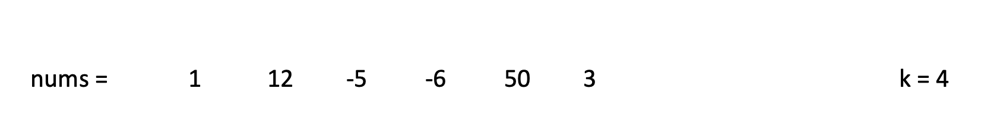
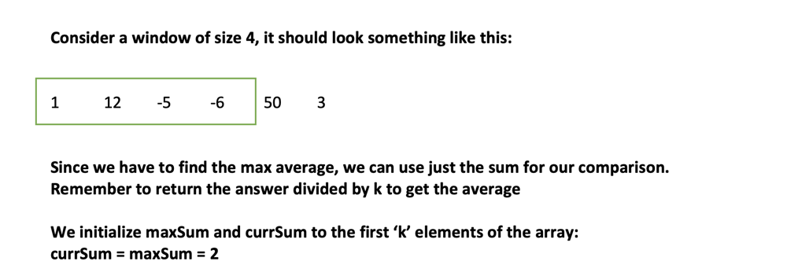
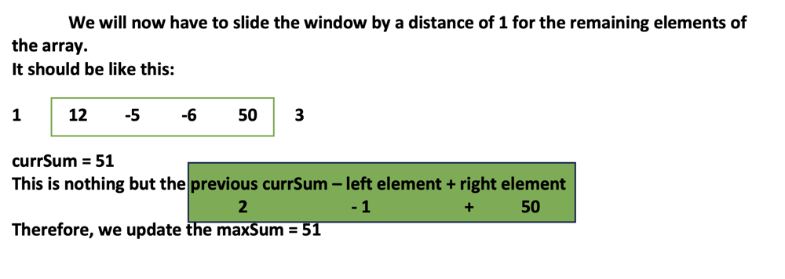
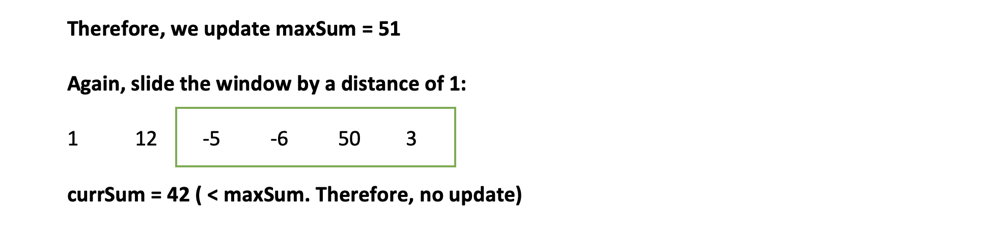

# Py3 | Beginner friendly with details and explanation

**Author:** younus_baig
**Votes:** 182
**Link:** [https://leetcode.com/problems/maximum-average-subarray-i/solutions/3532127/](https://leetcode.com/problems/maximum-average-subarray-i/solutions/3532127/)

---

# Approach

This problem uses sliding window concept.
You can solve this problem using two loops in $O(n^2)$ time complexity. However, with sliding window approach, you can easily resolve this in O(n) time.


Follow the images below to look at how this works:
1. Our given input

2. Initialization


3. Operations


3. Final operation

4. We now return the `maxSum / k` to return the max average.

# Complexity
 Time: O(n)
Space: O(1)

# Code
``` Python []
class Solution:
    def findMaxAverage(self, nums: List[int], k: int) -> float:
        
        # Initialize currSum and maxSum to the sum of the initial k elements
        currSum = maxSum = sum(nums[:k])

        # Start the loop from the kth element 
        # Iterate until you reach the end
        for i in range(k, len(nums)):

            # Subtract the left element of the window
            # Add the right element of the window
            currSum += nums[i] - nums[i - k]
            
            # Update the max
            maxSum = max(maxSum, currSum)

        # Since the problem requires average, we return the average
        return maxSum / k

```
``` C++ []
class Solution {
public:
    double findMaxAverage(vector<int>& nums, int k) {
        double currSum = 0, maxSum = 0;
        
        // Initialize currSum and maxSum to the sum of the initial k elements
        for (int i = 0; i < k; i++)
            currSum += nums[i];
        maxSum = currSum;
        
        // Start the loop from the kth element 
        // Iterate until you reach the end
        for (int i = k; i < nums.size(); i++) {
            // Subtract the left element of the window
            // Add the right element of the window
            currSum += nums[i] - nums[i - k];
            
            // Update the max
            maxSum = max(maxSum, currSum);
        }
        
        // Since the problem requires average, we return the average
        return maxSum / k;
    }
};

```