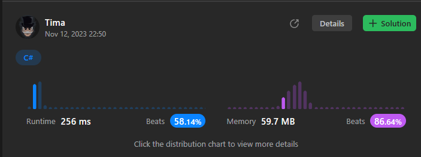
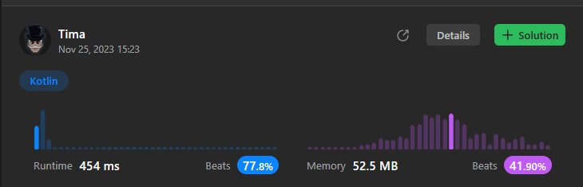
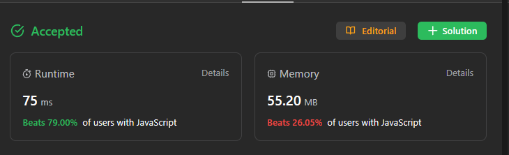

# ✔C# & Kotlin & JS Easy to understand solution | Beats Runtime 58%|77%|79% Memory 86%|41%|26%

**Author:** Timaku
**Votes:** 4
**Link:** [https://leetcode.com/problems/maximum-average-subarray-i/solutions/4328409/](https://leetcode.com/problems/maximum-average-subarray-i/solutions/4328409/)

---

# C#


# Kotlin


# JS


# Approach
We start by calculating the sum of the first k elements in the array. This sum is then used to calculate the initial average. We keep track of this average as it\u2019s our maximum average so far.

Next, we iterate over the rest of the array. In each iteration, we \u201Cslide\u201D our window of k elements one step to the right. We do this by subtracting the first element of the current window from the sum and adding the next element in the array to the sum. This effectively removes the last element from the window and adds a new one.

After updating the sum, we calculate the new average. If this average is greater than our stored maximum average, we update the maximum average to this new value.

By sliding the window and updating the sum in this way, we efficiently check all subarrays of length k for the maximum average. The beauty of this approach is that each element is added and removed from the sum only once, making the algorithm very efficient.

# Complexity
- Time complexity:
$$O(n)$$

- Space complexity:
$$O(1)$$

# Code
```C# []
public class Solution {
    public double FindMaxAverage(int[] nums, int k) {
        double sum = 0;
        for (int i = 0; i < k; i++)
        {
            sum += nums[i];
        }

        double maxAverage = sum;
        for (int i = k; i < nums.Length; i++)
        {
            sum = sum - nums[i - k] + nums[i];
            maxAverage = Math.Max(maxAverage, sum);
        }

        return maxAverage / k;
    }
}
```
```Kotlin []
class Solution {
    fun findMaxAverage(nums: IntArray, k: Int): Double {
			var sum = 0
			for (i in 0 until k) {
				sum += nums[i]
			}
			
			var maxSum = sum
			for(i in k until nums.size){
				sum = sum - nums[i - k] + nums[i]
				maxSum = Math.max(maxSum, sum)
			}
			
			return maxSum.toDouble() / k
    }
}
```
```javascript []
/**
 * @param {number[]} nums
 * @param {number} k
 * @return {number}
 */
var findMaxAverage = function(nums, k) {
    let sum = 0;
		for (let i = 0; i < k; i++) {
			sum += nums[i];
		}

		let maxSum = sum;
		for (let i = k; i < nums.length; i++) {
			sum = sum - nums[i - k] + nums[i];
			maxSum = Math.max(maxSum, sum);
		}

		return maxSum / k;
};
```