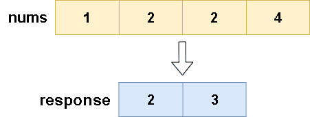

# 🔥🔥 Explicación y Resolución Del Ejercicio En Español Java | Python | PHP | C++ | JavaScript  🔥🔥

**Author:** hermescoder02
**Votes:** 4
**Link:** [https://leetcode.com/problems/set-mismatch/solutions/4094846/](https://leetcode.com/problems/set-mismatch/solutions/4094846/)

---

# Lectura

*Establecer discrepancia (Java, Python, PHP, C++, Javascript)*

Se tiene un array de n\xFAmeros enteros, y  este contiene un par de valores duplicados y, adem\xE1s , uno de los valores de la secuencia  se ha perdido, entonces el objetivo del ejercicio es encontrar el valor repetido y el valor  faltante del conjunto de n\xFAmeros 



En el ejemplo se puede apreciar, que el valor repetido es 2, y el valor faltante ser\xEDa 3, ya que en la secuencia pasa los valores del array de 2 a 4.


# Explicaci\xF3n del ejercicio Paso por paso

https://youtu.be/OqPhgxCL96w

Si te gust\xF3 el contenido \xA1visita mi canal de youtube!: 
\u2705https://www.youtube.com/@hermescoder

Si deseas profundizar m\xE1s en este tema \xA1visita mi blog!: 
\u2705https://hermescoder.com/set-mismatch-leetcode-espanol.html

# C\xF3digo 

```Java []
class Solution {
    public int[] findErrorNums(int[] nums) {
        // Paso #1
    Map<Integer, Integer> cantidad = new HashMap<>();
    for (int num : nums) {
      cantidad.put(num, cantidad.getOrDefault(num, 0) + 1);
    }

    // Paso #2
    int size = nums.length;
    int not_found = 1;
    int dup = 0;

    // Paso #3
    for (int i = 1; i <= size; i++) {
      if (!cantidad.containsKey(i)) {
        not_found = i;
        break;
      }
    }

    // Paso #4
    for (Map.Entry<Integer, Integer> entry : cantidad.entrySet()) {
      if (entry.getValue() == 2) {
        dup = entry.getKey();
        break;
      }
    }

    // Paso #5
    int[] response = new int[2];
    response[0] = dup;
    response[1] = not_found;

    return response;
    }
}
```
```Python []
class Solution:
    def findErrorNums(self, nums):
        # paso#1
        counts = {}
        for num in nums:
            counts[num] = counts.get(num, 0) + 1

        # paso#2
        size = len(nums)
        not_found = 0
        duplicate = 0

        # paso#3
        for i in range(1, size + 1):
            if i not in counts:
                not_found = i
                break

        # paso#4
        for num, count in counts.items():
            if count == 2:
                duplicate = num
                break

        # paso#5
        response = [duplicate, not_found]
        return response
```
```PHP []
class Solution {

    /**
     * @param Integer[] $nums
     * @return Integer[]
     */
    function findErrorNums($nums) {
        //paso#1
        $cantidad=array();
        foreach ($nums as $clave => $num) $cantidad[$num]++;


        //paso#2
        $size=count($nums);
        $not_found=0;
        $dup=0;

        //paso#3
        for ($i = 1; $i <= $size; $i++) {
            if(!isset($cantidad[$i])) {
                $not_found=$i;
                break;
            }
        }


        //paso#4
        foreach ($cantidad as $clave => $val){
            if($val==2){
                $dup=$clave;
                break;
            }
        }


        //paso#5
        $response=array();
        $response[0]=$dup;
        $response[1]=$not_found;
        
        return $response;

    }
}
```
```C++ []
class Solution {
public:
    vector<int> findErrorNums(std::vector<int>& nums) {

        vector<int> cantidad(nums.size() + 1, 0);

        for (int num : nums) cantidad[num]++;
        
        int not_found = 0;
        for (int i = 1; i < cantidad.size(); i++) {
            if (cantidad[i] == 0) {
                not_found = i;
                break;
            }
        }

        int dup = 0;
        for (int i = 1; i < cantidad.size(); i++) {
            if (cantidad[i] == 2) {
                dup = i;
                break;
            }
        }

        return {dup, not_found};
    }
};

```
```JavaScript []
/**
 * @param {number[]} nums
 * @return {number[]}
 */
var findErrorNums = function(nums) {
    // Paso #1
    const cantidad = {};
    for (const num of nums) {
      cantidad[num] = (cantidad[num] || 0) + 1;
    }

    // Paso #2
    const size = nums.length;
    let not_found = 1;
    let dup = 0;

    // Paso #3
    for (let i = 1; i <= size; i++) {
      if (!cantidad.hasOwnProperty(i)) {
        not_found = i;
        break;
      }
    }

    // Paso #4
    for (const [num, val] of Object.entries(cantidad)) {
      if (val === 2) {
        dup = num;
        break;
      }
    }

    // Paso #5
    const response = [dup, not_found];

    return response;
};
```


