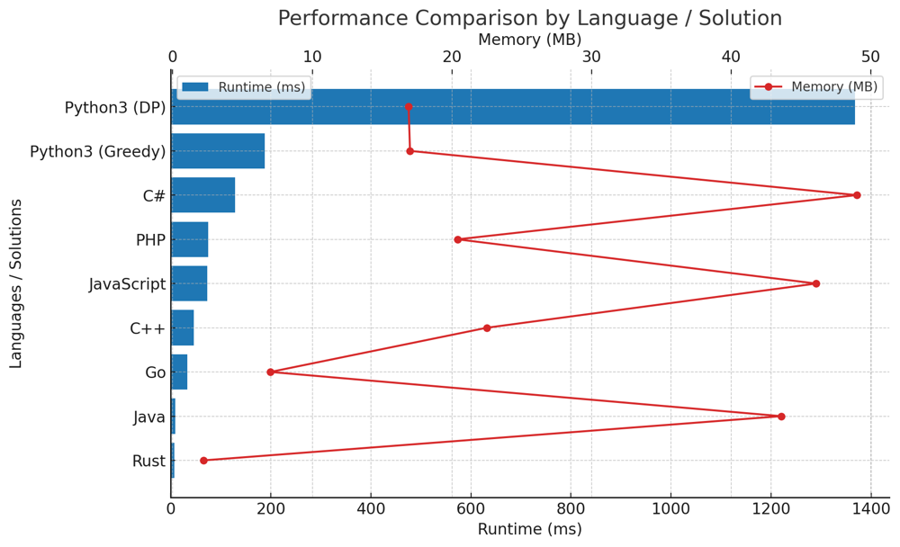

# ✅ 98.17% 2-Approaches Greedy & Dynamic Programming

**Author:** vanAmsen
**Votes:** 94
**Link:** [https://leetcode.com/problems/maximum-length-of-pair-chain/solutions/3960470/](https://leetcode.com/problems/maximum-length-of-pair-chain/solutions/3960470/)

---

# Interview Guide: "Maximum Length of Pair Chain" Problem

## Problem Understanding

**Description**:  
You're given an array of `n` pairs. Each pair $$ p = [\	ext{left}, \	ext{right}] $$ follows the rule $$ \	ext{left} < \	ext{right} $$. A pair $$ p_2 $$ can follow $$ p_1 $$ if the second element of $$ p_1 $$ is less than the first element of $$ p_2 $$. Your task is to find the longest chain of pairs that can be formed. This is a frequent interview question that tests your understanding of sorting algorithms and dynamic programming.

### Pro Tips for Interviews

1. **Clarify the Problem**: Always make sure to clarify the constraints and understand the problem statement fully before jumping into the solution.

2. **Think Out Loud**: Share your thought process with the interviewer. This not only shows your problem-solving skills but also gives the interviewer a chance to guide you if you go astray.

3. **Analyze Constraints**: 
    - There can be up to 1000 pairs.
    - Each pair is defined by integers where $$ -1000 \\leq \	ext{left} < \	ext{right} \\leq 1000 $$.

### Approaches to Consider

#### 1. Greedy Algorithm
- **Why**: Greedy algorithms are great when you're looking to optimize something in one pass. They're generally simpler and faster.
- **How**: Sort the pairs by their second elements and then traverse the list to construct the longest chain.
- **Time Complexity**: $$ O(n \\log n) $$
- **Space Complexity**: $$ O(1) $$

#### 2. Dynamic Programming
- **Why**: DP is useful when the solution involves solving sub-problems. It's more versatile but often slower.
- **How**: Sort the pairs by their first elements, and then use dynamic programming to find the longest chain for each pair.
- **Time Complexity**: $$ O(n^2) $$
- **Space Complexity**: $$ O(n) $$

### Conclusion & Tips

1. **Choose Wisely**: For this problem, the Greedy Algorithm is faster and should be preferred for larger datasets. But it's always good to know more than one way to solve a problem.
  
2. **Space vs. Time**: The Greedy approach minimizes space but uses more time due to sorting. Dynamic Programming, however, uses more space to save time. Make your choice based on the problem's constraints.

3. **Practice**: The key to acing algorithm questions in interviews is practice. The more you solve, the more patterns you'll recognize, helping you solve even unfamiliar problems more efficiently. So, keep grinding and good luck with your interviews! \uD83D\uDCA1\uD83C\uDF1F\uD83D\uDE80

---

# Live Coding & Explenation in Python:
https://youtu.be/mQ4bx2rWsZM?si=f7eHKQhyBnt7sG7X

---

# Approach 1: Greedy Algorithm

## Key Data Structures

- **List**: Used for storing the pairs of numbers.

## Detailed Steps

### Initialization:
1. **Sort the Pairs**: The first step is to sort all the given pairs based on their second elements in ascending order. Sorting makes it easier to find the longest chain in a single pass through the list.

### Main Algorithm:
1. **Initialize Variables**: Create two variables:
  - `cur`: It keeps track of the last element of the current chain. Initialize it to negative infinity.
  - `ans`: It keeps track of the length of the longest chain. Initialize it to 0.

2. **Iterate and Update**: Loop through the sorted list of pairs:
  - If the first element of the current pair is greater than `cur`, it means we can extend the current chain.
  - Update `cur` to be the second element of the current pair.
  - Increment `ans` by 1.

## Complexity

### Time Complexity:  
- $$ O(n \\log n) $$ due to sorting the pairs.

### Space Complexity:  
- $$ O(1) $$ as we only use two additional variables (`cur` and `ans`).

---

# Approach 2: Dynamic Programming (DP)

## Key Data Structures

- **List**: Used for storing the pairs of numbers.
- **DP Array**: An array where `dp[i]` stores the length of the longest chain ending at `pairs[i]`.

## Detailed Steps

### Initialization:
1. **Sort the Pairs**: Sort all the pairs based on their first elements in ascending order.
2. **Initialize DP Array**: Create a DP array with the same length as the list of pairs and initialize all its elements to 1.

### Main Algorithm:
1. **Nested Loop**: Use a nested loop to compare each pair with every other pair that comes before it in the sorted list.
  - If the first element of the later pair is greater than the second element of the earlier pair, update the DP value for the later pair.

2. **Find Maximum**: At the end, the maximum value in the DP array will be the length of the longest chain.

## Complexity

### Time Complexity:  
- $$ O(n^2) $$ because of the nested loop to update the DP array.

### Space Complexity:  
- $$ O(n) $$ for the DP array.

---

| Language  | Runtime (ms) | Memory (MB) |
|-----------|--------------|-------------|
| Rust      | 7            | 2.2         |
| Java      | 9            | 43.6        |
| Go        | 33           | 7           |
| C++       | 46           | 22.5        |
| JavaScript| 73           | 46.1        |
| PHP       | 75           | 20.4        |
| C#        | 129          | 49          |
| Python3 (Greedy) | 188    | 17          |
| Python3 (DP)     | 1368   | 16.9        |




# Code Greedy
``` Python []
class Solution:
    def findLongestChain(self, pairs: List[List[int]]) -> int:
        pairs.sort(key=lambda x: x[1])
        cur, ans = float('-inf'), 0
        
        for pair in pairs:
            if cur < pair[0]:
                cur = pair[1]
                ans += 1
                
        return ans
```
``` C++ []
class Solution {
public:
    int findLongestChain(std::vector<std::vector<int>>& pairs) {
        std::sort(pairs.begin(), pairs.end(), [](const std::vector<int>& a, const std::vector<int>& b) {
            return a[1] < b[1];
        });
        
        int cur = INT_MIN, ans = 0;
        
        for (const auto& pair : pairs) {
            if (cur < pair[0]) {
                cur = pair[1];
                ans++;
            }
        }
        
        return ans;
    }
};
```
``` Rust []
impl Solution {
    pub fn find_longest_chain(pairs: Vec<Vec<i32>>) -> i32 {
        let mut pairs = pairs;
        pairs.sort_by_key(|k| k[1]);
        
        let (mut cur, mut ans) = (i32::MIN, 0);
        
        for pair in &pairs {
            if cur < pair[0] {
                cur = pair[1];
                ans += 1;
            }
        }
        
        ans
    }
}
```
``` Go []
import (
	"math"
	"sort"
)

func findLongestChain(pairs [][]int) int {
	sort.Slice(pairs, func(i, j int) bool {
		return pairs[i][1] < pairs[j][1]
	})

	cur, ans := math.MinInt64, 0 // Smallest int value

	for _, pair := range pairs {
		if cur < pair[0] {
			cur = pair[1]
			ans++
		}
	}

	return ans
}
```
``` Java []
public class Solution {
    public int findLongestChain(int[][] pairs) {
        Arrays.sort(pairs, (a, b) -> Integer.compare(a[1], b[1]));
        
        int cur = Integer.MIN_VALUE, ans = 0;
        
        for (int[] pair : pairs) {
            if (cur < pair[0]) {
                cur = pair[1];
                ans++;
            }
        }
        
        return ans;
    }
}
```
``` C# []
public class Solution {
    public int FindLongestChain(int[][] pairs) {
        Array.Sort(pairs, (a, b) => a[1].CompareTo(b[1]));
        
        int cur = int.MinValue, ans = 0;
        
        foreach (var pair in pairs) {
            if (cur < pair[0]) {
                cur = pair[1];
                ans++;
            }
        }
        
        return ans;
    }
}
```
``` JavaScript []
/**
 * @param {number[][]} pairs
 * @return {number}
 */
var findLongestChain = function(pairs) {
    pairs.sort((a, b) => a[1] - b[1]);
    
    let cur = Number.MIN_SAFE_INTEGER, ans = 0;
    
    for (const [start, end] of pairs) {
        if (cur < start) {
            cur = end;
            ans++;
        }
    }
    
    return ans;
};
```
``` PHP []
class Solution {

    /**
     * @param Integer[][] $pairs
     * @return Integer
     */
    function findLongestChain($pairs) {
    usort($pairs, function($a, $b) {
        return $a[1] <=> $b[1];
    });

    $cur = PHP_INT_MIN;
    $ans = 0;

    foreach ($pairs as $pair) {
        if ($cur < $pair[0]) {
            $cur = $pair[1];
            $ans++;
        }
    }

    return $ans;
}
}
```

# Code Dynamic Programming
``` Python []
class Solution:
    def findLongestChain(self, pairs: List[List[int]]) -> int:
        pairs.sort(key=lambda x: x[0])
        n = len(pairs)
        dp = [1] * n
        
        for i in range(1, n):
            dp[i] = max(dp[i], max(dp[j] + 1 if pairs[i][0] > pairs[j][1] else 1 for j in range(i)))
        
        return max(dp)
```

Both the Greedy and Dynamic Programming approaches have their merits. Greedy is fast but less intuitive, while Dynamic Programming is more understandable but slower. Choose based on your specific needs. \uD83D\uDCA1