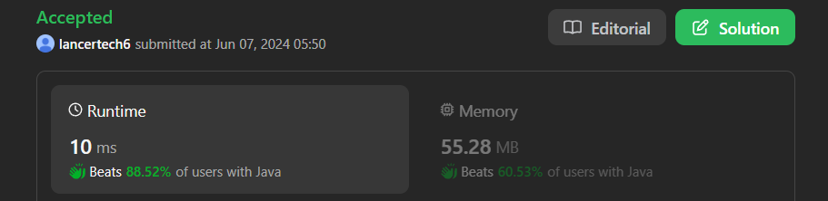

# ✅Beats 100% - Explained with [ Video ] - C++/Java/Python/JS - Tries - Strings - Interview Solution

**Author:** lancertech6
**Votes:** 192
**Link:** [https://leetcode.com/problems/replace-words/solutions/5271643/](https://leetcode.com/problems/replace-words/solutions/5271643/)

---




# YouTube Video Explanation:

<!-- **If you want a video for this question please write in the comments** -->

<!-- https://www.youtube.com/watch?v=ujU-jeO1v-k -->

https://youtu.be/HdQeNCwE2tU

**\uD83D\uDD25 Please like, share, and subscribe to support our channel's mission of making complex concepts easy to understand.**

Subscribe Link: https://www.youtube.com/@leetlogics/?sub_confirmation=1

*Subscribe Goal: 1900 Subscribers*
*Current Subscribers: 1855*

---

# Intuition
<!-- Describe your first thoughts on how to solve this problem. -->
The goal of this problem is to replace words in a sentence with their corresponding roots from a given dictionary. The solution involves efficiently checking each word in the sentence to see if it starts with any of the roots in the dictionary. If a word starts with a root, it should be replaced with that root. To ensure that the solution is efficient and scalable, a Trie (prefix tree) data structure is used, which allows for fast prefix search operations.

# Approach
<!-- Describe your approach to solving the problem. -->
1. **Trie Construction:**
   - First, we create a Trie data structure to store all the roots from the dictionary. Each node in the Trie represents a character, and nodes are linked to form paths representing the roots.
   - We insert each root into the Trie. During insertion, if a character is not already a child of the current node, a new Trie node is created.

2. **Sentence Processing:**
   - Split the sentence into individual words.
   - For each word, search the Trie to find the shortest prefix that matches any root in the Trie.
   - If a matching prefix is found, replace the word with this prefix. If no matching prefix is found, retain the original word.
   - Reconstruct the sentence from the processed words.

3. **Trie Search:**
   - To search for the shortest prefix, traverse the Trie character by character.
   - If a node is marked as the end of a root during traversal, return the prefix up to that node.
   - If traversal ends without finding any root, return the original word.


# Complexity
- **Time Complexity:**
  - **Trie Construction:** Inserting each root into the Trie takes O(L), where L is the length of the root. For N roots, this results in O(NL) time.
  - **Sentence Processing:** For each word in the sentence, the Trie is traversed character by character, taking O(L') time per word, where L' is the length of the word. For M words in the sentence, this results in O(M * L') time.
  - Overall, the time complexity is O(NL + M * L'), where N is the number of roots, L is the average length of the roots, M is the number of words in the sentence, and L' is the average length of the words.

- **Space Complexity:**
  - The space complexity is O(26 * NL) for storing the Trie nodes, where each node can have up to 26 children (one for each lowercase letter).
  - Additionally, storing the input sentence and the resulting sentence takes O(M * L') space.
  - Overall, the space complexity is O(NL + M * L').


### Explanation Using Tables

| **Step** | **Operation** | **Description** |
|----------|---------------|-----------------|
| 1        | Insert "cat"  | Create nodes for 'c', 'a', 't' in the Trie and mark 't' as end. |
| 2        | Insert "bat"  | Create nodes for 'b', 'a', 't' in the Trie and mark 't' as end. |
| 3        | Insert "rat"  | Create nodes for 'r', 'a', 't' in the Trie and mark 't' as end. |
| 4        | Process "the" | No root match in Trie, retain "the". |
| 5        | Process "cattle" | Match 'cat', replace "cattle" with "cat". |
| 6        | Process "was" | No root match in Trie, retain "was". |
| 7        | Process "rattled" | Match 'rat', replace "rattled" with "rat". |
| 8        | Process "by" | No root match in Trie, retain "by". |
| 9        | Process "the" | No root match in Trie, retain "the". |
| 10       | Process "battery" | Match 'bat', replace "battery" with "bat". |
| 11       | Combine Words | Join processed words to form the final sentence. |


# Step By Step Explanation


1. **Trie Construction**
   - First, we need to construct a Trie from the dictionary of roots.
   - Each node in the Trie represents a character.
   - We will insert each root word into the Trie, marking the end of each root.

   **Example Dictionary:**
   ```
   ["cat", "bat", "rat"]
   ```

   **Trie Construction Table:**
   | Root | Trie Construction                                |
   |------|-------------------------------------------------|
   | "cat"| c -> a -> t (mark 't' as end)                   |
   | "bat"| b -> a -> t (mark 't' as end)                   |
   | "rat"| r -> a -> t (mark 't' as end)                   |

2. **Sentence Processing**
   - Split the input sentence into individual words.
   - For each word, traverse the Trie to find the shortest root that matches the beginning of the word.
   - If a root is found, replace the word with that root. If no root is found, retain the original word.

   **Example Sentence:**
   ```
   "the cattle was rattled by the battery"
   ```

   **Sentence Processing Table:**
   | Word     | Trie Traversal Result | Replacement |
   |----------|-----------------------|-------------|
   | "the"    | No match              | "the"       |
   | "cattle" | Match with "cat"      | "cat"       |
   | "was"    | No match              | "was"       |
   | "rattled"| Match with "rat"      | "rat"       |
   | "by"     | No match              | "by"        |
   | "the"    | No match              | "the"       |
   | "battery"| Match with "bat"      | "bat"       |

3. **Final Sentence Construction**
   - Combine the processed words to form the final sentence.

   **Final Sentence:**
   ```
   "the cat was rat by the bat"
   ```


# Code

```java []
class Solution {
    Trie root;
    public String replaceWords(List<String> dictionary, String sentence) {
        root = new Trie();
        for(String word : dictionary){
            insert(word);
        }
        StringBuilder result = new StringBuilder();
        String []  input = sentence.split(" ");
        for(String i : input){
            result.append(search(i));
            result.append(" ");
        }
        return result.toString().trim();
    }
    public String search(String word){
        Trie node = root;
        int j = 0;
        for(char c : word.toCharArray()){
            int i = c - 'a';
            j++;
            if(node.children[i] == null){
                return word;
            }else if(node.children[i].isEnd){
                return word.substring(0, j);
            }else{
                node = node.children[i];
            }
            
        }
        return word;

    }
    public void insert(String word){
        Trie node = root;
        for(char c: word.toCharArray()){
            int i = c - 'a';
            if(node.children[i] == null){
                node.children[i] = new Trie();
            }
            node = node.children[i];
        }
        node.isEnd = true;
    }
}
class Trie{
    Trie [] children;
    boolean isEnd;
    public Trie(){
        children = new Trie[26];
        isEnd =false;
    }
} 
```
```C++ []
class Trie {
public:
    Trie* children[26];
    bool isEnd;

    Trie() {
        for (int i = 0; i < 26; i++) {
            children[i] = nullptr;
        }
        isEnd = false;
    }
};

class Solution {
public:
    Trie* root;

    Solution() {
        root = new Trie();
    }

    void insert(string word) {
        Trie* node = root;
        for (char c : word) {
            int i = c - 'a';
            if (node->children[i] == nullptr) {
                node->children[i] = new Trie();
            }
            node = node->children[i];
        }
        node->isEnd = true;
    }

    string search(string word) {
        Trie* node = root;
        string result;
        for (char c : word) {
            int i = c - 'a';
            if (node->children[i] == nullptr) {
                return word;
            }
            result += c;
            if (node->children[i]->isEnd) {
                return result;
            }
            node = node->children[i];
        }
        return word;
    }

    string replaceWords(vector<string>& dictionary, string sentence) {
        for (string word : dictionary) {
            insert(word);
        }

        stringstream ss(sentence);
        string word, result;
        while (ss >> word) {
            if (!result.empty()) {
                result += " ";
            }
            result += search(word);
        }
        return result;
    }
};
```
```Python []
class TrieNode:
    def __init__(self):
        self.children = {}
        self.isEnd = False

class Trie:
    def __init__(self):
        self.root = TrieNode()
    
    def insert(self, word):
        node = self.root
        for char in word:
            if char not in node.children:
                node.children[char] = TrieNode()
            node = node.children[char]
        node.isEnd = True
    
    def search(self, word):
        node = self.root
        prefix = ''
        for char in word:
            if char not in node.children:
                return word
            prefix += char
            if node.children[char].isEnd:
                return prefix
            node = node.children[char]
        return word

class Solution:
    def replaceWords(self, dictionary, sentence):
        trie = Trie()
        for word in dictionary:
            trie.insert(word)
        
        result = []
        for word in sentence.split():
            result.append(trie.search(word))
        
        return ' '.join(result)
```
```JavaScript []
class TrieNode {
    constructor() {
        this.children = {};
        this.isEnd = false;
    }
}

class Trie {
    constructor() {
        this.root = new TrieNode();
    }
    
    insert(word) {
        let node = this.root;
        for (const char of word) {
            if (!node.children[char]) {
                node.children[char] = new TrieNode();
            }
            node = node.children[char];
        }
        node.isEnd = true;
    }
    
    search(word) {
        let node = this.root;
        let prefix = '';
        for (const char of word) {
            if (!node.children[char]) {
                return word;
            }
            prefix += char;
            if (node.children[char].isEnd) {
                return prefix;
            }
            node = node.children[char];
        }
        return word;
    }
}

var replaceWords = function(dictionary, sentence) {
    const trie = new Trie();
    for (const word of dictionary) {
        trie.insert(word);
    }
    
    const words = sentence.split(' ');
    const result = words.map(word => trie.search(word));
    
    return result.join(' ');
};
```

