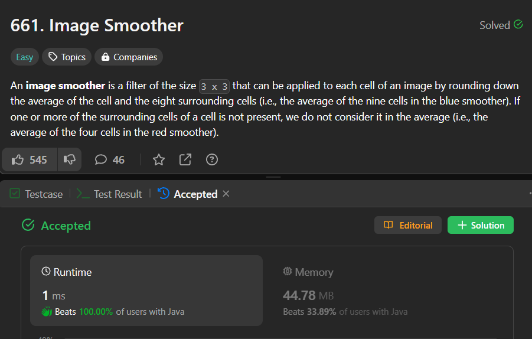

# ✅Beats 100% - Explained with [ Video ] - C++/Java/Python/JS  - O( m x n ) - Visualized

**Author:** lancertech6
**Votes:** 83
**Link:** [https://leetcode.com/problems/image-smoother/solutions/4423344/](https://leetcode.com/problems/image-smoother/solutions/4423344/)

---



# YouTube Video Explanation:

[https://youtu.be/BJ75zpgEBCs](https://youtu.be/BJ75zpgEBCs)
<!-- **If you want a video for this question please write in the comments** -->

**\uD83D\uDD25 Please like, share, and subscribe to support our channel's mission of making complex concepts easy to understand.**

Subscribe Link: https://www.youtube.com/@leetlogics/?sub_confirmation=1

*Subscribe Goal: 900 Subscribers*
*Current Subscribers: 882*

---

# Example Explanation

**Original Image Matrix:**
```
+------+------+------+  
| 1    | 1    | 1    |  
+------+------+------+  
| 1    | 0    | 1    |  
+------+------+------+  
| 1    | 1    | 1    |  
+------+------+------+  
```

**Resulting Image Matrix:**
```
+------+------+------+  
| 0    | 0    | 0    |  
+------+------+------+  
| 0    | 0    | 0    |  
+------+------+------+  
| 0    | 0    | 0    |  
+------+------+------+  
```

**Explanation:**
1. For each cell in the original matrix, apply the 3x3 smoother filter.
2. Calculate the average of the cell and its eight surrounding cells, considering only valid neighbors.
3. Set the value of the corresponding cell in the result matrix as the floor of the average.

Now, let's take an example for one cell in the middle of the matrix:

**Example:**
Consider the cell (1, 1) in the original matrix:
```
+------+------+------+  
| 1    | 0    | 1    |  
+------+------+------+  
| 1    | X    | 1    |  
+------+------+------+  
| 1    | 0    | 1    |  
+------+------+------+  
```
Here, X represents the current cell. Calculate the sum of X and its eight neighbors: 1 + 0 + 1 + 1 + 0 + 1 + 1 + 0 + 1 = 6.

Count the valid neighbors (excluding the ones outside the matrix): 8.

Calculate the floor of the average: floor(6 / 8) = 0.

Set the value of the corresponding cell in the result matrix (1, 1) as 0.

Repeat this process for each cell, and you get the resulting image matrix.

# Intuition
<!-- Describe your first thoughts on how to solve this problem. -->
The problem requires applying a 3x3 smoother filter to each cell of a grayscale image. The smoother calculates the floor of the average of the current cell and its eight surrounding cells. If a surrounding cell is not present, it is not considered in the average.

# Approach
<!-- Describe your approach to solving the problem. -->
1. Iterate through each cell in the image matrix.
2. For each cell, calculate the sum of the values of the cell and its eight surrounding cells.
3. Count the number of valid cells included in the sum.
4. Set the value of the corresponding cell in the result matrix as the floor of the sum divided by the count.
5. Return the result matrix.

# Complexity
- Time Complexity: `O(m * n)`, where m and n are the dimensions of the image matrix. We iterate through each cell once.
- Space Complexity: `O(m * n)`, the space required for the result matrix.

# Code
```java []
class Solution {
    public int[][] imageSmoother(int[][] img) {
        int res[][] = new int[img.length][img[0].length];
        for(int i = 0; i < img.length; i++) {
            for(int j = 0; j < img[0].length; j++) {
                res[i][j] = smoothen(img, i, j);
            }
        }
        return res;
    }
    
    int smoothen(int[][] img, int x, int y) {
        int m = img.length; 
        int n = img[0].length;
        int sum = 0;
        int count = 0;
        for(int i = -1; i <= 1; i++) {
            for(int j = -1; j <= 1; j++) {
                int nx = x + i;
                int ny = y + j;
                if(nx < 0 || nx >= m || ny < 0 || ny >= n) continue;
                sum += img[nx][ny];
                count++;
            }
        }
        return sum/count;
        
    }
}
```
```C++ []
class Solution {
public:
    public:
    std::vector<std::vector<int>> imageSmoother(std::vector<std::vector<int>>& img) {
        int m = img.size();
        int n = img[0].size();
        std::vector<std::vector<int>> res(m, std::vector<int>(n, 0));

        for (int i = 0; i < m; ++i) {
            for (int j = 0; j < n; ++j) {
                res[i][j] = smoothen(img, i, j);
            }
        }

        return res;
    }

private:
    int smoothen(const std::vector<std::vector<int>>& img, int x, int y) {
        int m = img.size();
        int n = img[0].size();
        int sum = 0;
        int count = 0;

        for (int i = -1; i <= 1; ++i) {
            for (int j = -1; j <= 1; ++j) {
                int nx = x + i;
                int ny = y + j;
                if (nx >= 0 && nx < m && ny >= 0 && ny < n) {
                    sum += img[nx][ny];
                    ++count;
                }
            }
        }

        return sum / count;
    }
};
```
```Python []
class Solution(object):
    def imageSmoother(self, img):
        m, n = len(img), len(img[0])
        res = [[0] * n for _ in range(m)]

        for i in range(m):
            for j in range(n):
                res[i][j] = self.smoothen(img, i, j)

        return res

    def smoothen(self, img, x, y):
        m, n = len(img), len(img[0])
        _sum, count = 0, 0

        for i in range(-1, 2):
            for j in range(-1, 2):
                nx, ny = x + i, y + j
                if 0 <= nx < m and 0 <= ny < n:
                    _sum += img[nx][ny]
                    count += 1

        return _sum // count
        
        
```
```JavaScript []
/**
 * @param {number[][]} img
 * @return {number[][]}
 */
var imageSmoother = function(img) {
    const m = img.length;
    const n = img[0].length;
    const res = new Array(m).fill(0).map(() => new Array(n).fill(0));

    for (let i = 0; i < m; ++i) {
        for (let j = 0; j < n; ++j) {
            res[i][j] = smoothen(img, i, j);
        }
    }

    return res;
};

const smoothen = function(img, x, y) {
    const m = img.length;
    const n = img[0].length;
    let sum = 0;
    let count = 0;

    for (let i = -1; i <= 1; ++i) {
        for (let j = -1; j <= 1; ++j) {
            const nx = x + i;
            const ny = y + j;
            if (nx >= 0 && nx < m && ny >= 0 && ny < n) {
                sum += img[nx][ny];
                ++count;
            }
        }
    }

    return Math.floor(sum / count);
};
```

