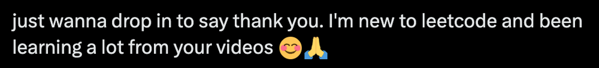

# 【Video】Give me 10 minutes - How we think about a solution.

**Author:** niits
**Votes:** 80
**Link:** [https://leetcode.com/problems/image-smoother/solutions/4423391/](https://leetcode.com/problems/image-smoother/solutions/4423391/)

---

# Intuition
We need to check out of bounds

---

# Solution Video

https://youtu.be/eCHajvYReSg

\u25A0 Timeline of the video

`0:03` Explain how we solve Image Smoother
`1:13` Check Top side
`2:18` Check Bottom side
`4:11` Check left and right side
`3:32` Talk about the first biggest and the second biggest
`6:26` coding
`9:24` Time Complexity and Space Complexity
`9:45` Step by step algorithm of my solution code

### \u2B50\uFE0F\u2B50\uFE0F Don't forget to subscribe to my channel! \u2B50\uFE0F\u2B50\uFE0F

**\u25A0 Subscribe URL**
http://www.youtube.com/channel/UC9RMNwYTL3SXCP6ShLWVFww?sub_confirmation=1

Subscribers: 3,535
My first goal is 10,000 (It's far from done \uD83D\uDE05)
Thank you for your support!

---


MVC(Most Valuable Comment) for me for the last 7 days.




Thanks everyone who left your comments!
Thanks everyone who watched my videos!

---

# Approach

## how we think about a solution

We have to calculate avarage on each cell, so simply we iterate through each cell one by one.

Regarding calculation of each cell, problem is that there is a case where target cell doesn't have 8 directions.

Let's think about this case.
```
[1,2,3]
[4,5,6]
[7,8,9]
```
In this case, only `5` has `8` directions. Others don't have `8` directions.

For example, look at `cell 1`. There are not `top cells` and `left cells` from `cell 1` and There are cells on the `right cells` and `bottom cells` from `cell 1`.

Let's see `cell 2`. There are not `top cells` and there are `left, right and bottom cells` from `cell 2`.


---

\u2B50\uFE0F Points

What I'm trying to say is that each cell has different situation, so we need to check 4 directions which are top, bottom, left and right to prevent out of bounds.

---

#### How can we check 4 directions?

Let's see one by one.

- Top

Let'say we are at (0,0) position. row of top cells should be `row - 1`, so

```
top = max(0, r - 1)

r is current row
```
If `r - 1` is negative, we take `0` as a range of row because `-1` is out of bounds. If not, take `r - 1`.

- Bottom

Look at part of my Python solution code

```
for row in range(top, bottom):
```

Bottom is end of row. If we want to include the next row(= r + 1), we have to compare like this

```
bottom = min(rows, r + 2)

r is current row
```
For example,

```
[1,2,3]
[4,5,6]
[7,8,9]
```
Let's say we are at (0, 0) position in the matrix. In this case,

```
bottom = min(rows, r + 2)
= min(3, 0 + 2)
= 2
```
In the end, row range from (0,0) should be

```
for row in range(top, bottom):
= for row in range(0, 2):

0 is included and 2 is not included in Python
```
So, we can successfuly get right range of row(= from 0 to 1).

If we are at (2, 0),
```
top = max(0, r - 1)
= max(0, 2 - 1)
= 1

bottom = min(rows, r + 2)
= min(3, 2 + 2)
= 3
```
In the end,
```
for row in range(top, bottom):
= for row in range(1, 3):

1 is included and 3 is not included in Python
```
So, we can successfuly get right range of row(= from 1 to 2).

- Left

Let me explain left and right quickly. Actually it's the same idea. Now you understand it easily.

Left side should be

```
left = max(0, c - 1)

c is current column
```
Take `0` if `c - 1` is negative.

- Right

```
right = min(cols, c + 2)

c is current column
```
Take length of column if `c + 2` is bigger.

After we check 4 directions, set 4 directions as iteration ranges. Calculate total and count number of cells.

```
for row in range(top, bottom):
    for col in range(left, right):
        total += img[row][col]
        count += 1
```
Then
```[]
return total // count
```

Easy!\uD83D\uDE04
Let's see a real algorithm!

# Complexity
- Time complexity: $$O(rows * cols)$$
<!-- Add your time complexity here, e.g. $$O(n)$$ -->

- Space complexity: $$O(rows * cols)$$ or $$O(1)$$
If we can ignore output matrix, we can say $$O(1)$$

```python []
class Solution:
    def imageSmoother(self, img: List[List[int]]) -> List[List[int]]:
        # Get the dimensions of the image matrix
        rows, cols = len(img), len(img[0])
        
        # Define a helper function to calculate the average value for a pixel
        def average_value(r, c):
            total, count = 0, 0

            # Define the boundaries for the neighboring pixels
            top = max(0, r - 1)
            bottom = min(rows, r + 2)
            left = max(0, c - 1)
            right = min(cols, c + 2)

            # Iterate over the neighboring pixels and calculate the sum and count
            for row in range(top, bottom):
                for col in range(left, right):
                    total += img[row][col]
                    count += 1

            # Calculate and return the average value for the pixel
            return total // count

        # Apply the average function to each pixel in the image matrix
        return [[average_value(r, c) for c in range(cols)] for r in range(rows)]
```
```javascript []
var imageSmoother = function(img) {
    const rows = img.length;
    const cols = img[0].length;

    // Define a helper function to calculate the average value for a pixel
    function averageValue(r, c) {
        let total = 0;
        let count = 0;

        // Define the boundaries for the neighboring pixels
        const top = Math.max(0, r - 1);
        const bottom = Math.min(rows, r + 2);
        const left = Math.max(0, c - 1);
        const right = Math.min(cols, c + 2);

        // Iterate over the neighboring pixels and calculate the sum and count
        for (let row = top; row < bottom; row++) {
            for (let col = left; col < right; col++) {
                total += img[row][col];
                count += 1;
            }
        }

        // Calculate and return the average value for the pixel
        return Math.floor(total / count);
    }

    // Apply the average function to each pixel in the image matrix
    return Array.from({ length: rows }, (_, r) =>
        Array.from({ length: cols }, (_, c) => averageValue(r, c))
    );    
};
```
```java []
class Solution {
    public int[][] imageSmoother(int[][] img) {
        int rows = img.length;
        int cols = img[0].length;

        // Apply the average function to each pixel in the image matrix
        int[][] result = new int[rows][cols];
        for (int r = 0; r < rows; r++) {
            for (int c = 0; c < cols; c++) {
                result[r][c] = calculateAverage(img, r, c, rows, cols);
            }
        }

        return result;        
    }

    private int calculateAverage(int[][] img, int r, int c, int rows, int cols) {
        int total = 0;
        int count = 0;

        // Define the boundaries for the neighboring pixels
        int top = Math.max(0, r - 1);
        int bottom = Math.min(rows, r + 2);
        int left = Math.max(0, c - 1);
        int right = Math.min(cols, c + 2);

        // Iterate over the neighboring pixels and calculate the sum and count
        for (int row = top; row < bottom; row++) {
            for (int col = left; col < right; col++) {
                total += img[row][col];
                count += 1;
            }
        }

        // Calculate and return the average value for the pixel
        return total / count;
    }    
}
```
```C++ []
class Solution {
public:
    vector<vector<int>> imageSmoother(vector<vector<int>>& img) {
        int rows = img.size();
        int cols = img[0].size();

        // Apply the average function to each pixel in the image matrix
        vector<vector<int>> result(rows, vector<int>(cols, 0));
        for (int r = 0; r < rows; r++) {
            for (int c = 0; c < cols; c++) {
                result[r][c] = calculateAverage(img, r, c, rows, cols);
            }
        }

        return result;
    }

private:
    int calculateAverage(const vector<vector<int>>& img, int r, int c, int rows, int cols) {
        int total = 0;
        int count = 0;

        // Define the boundaries for the neighboring pixels
        int top = max(0, r - 1);
        int bottom = min(rows, r + 2);
        int left = max(0, c - 1);
        int right = min(cols, c + 2);

        // Iterate over the neighboring pixels and calculate the sum and count
        for (int row = top; row < bottom; row++) {
            for (int col = left; col < right; col++) {
                total += img[row][col];
                count += 1;
            }
        }

        // Calculate and return the average value for the pixel
        return total / count;
    }
};
```

## Step by step algorithm

##### Step 1: Initialization
```python
# Get the dimensions of the input image matrix
rows, cols = len(img), len(img[0])
```
In this step, the dimensions of the input image matrix are obtained, with `rows` representing the number of rows and `cols` representing the number of columns.

##### Step 2: Average Calculation Function
```python
def average_value(r, c):
    # Define the boundaries for the neighboring pixels
    top = max(0, r - 1)
    bottom = min(rows, r + 2)
    left = max(0, c - 1)
    right = min(cols, c + 2)

    total, count = 0, 0
```
This step defines a helper function `average_value(r, c)` that calculates the average value for a pixel at position `(r, c)` based on its neighboring pixels. The boundaries for neighboring pixels are determined to ensure we don't go beyond the image edges.

##### Step 3: Neighboring Pixel Boundaries
```python
top = max(0, r - 1)
bottom = min(rows, r + 2)
left = max(0, c - 1)
right = min(cols, c + 2)
```
Here, the boundaries for neighboring pixels are defined. These boundaries ensure that we don't go beyond the edges of the image matrix.

##### Step 4: Iterate Over Neighboring Pixels
```python
for row in range(top, bottom):
    for col in range(left, right):
        total += img[row][col]
        count += 1
```
In this step, nested loops iterate over the neighboring pixels within the determined boundaries. The pixel values are accumulated in `total`, and the count of pixels considered is incremented.

##### Step 5: Calculate Average Value
```python
return total // count
```
The average value for the pixel is calculated by dividing the total sum of neighboring pixel values by the count of pixels considered.

##### Step 6: Apply Average Function to Each Pixel
```python
result = [[average_value(r, c) for c in range(cols)] for r in range(rows)]
```
Using a nested list comprehension, the `average_value` function is applied to each pixel in the image matrix. The outer loop iterates over each row (`r`), and the inner loop iterates over each column (`c`).

##### Step 7: Return the Result
```python
return result
```
The resulting smoothed image matrix is returned.

---

Thank you for reading my post.
\u2B50\uFE0F Please upvote it and don't forget to subscribe to my channel!

\u25A0 Subscribe URL
http://www.youtube.com/channel/UC9RMNwYTL3SXCP6ShLWVFww?sub_confirmation=1

\u25A0 Twitter
https://twitter.com/CodingNinjaAZ

### My next daily coding challenge post and video.

post
https://leetcode.com/problems/buy-two-chocolates/solutions/4427319/video-give-me-5-minutes-how-we-think-about-a-solution/

video
https://youtu.be/nMRj-C4yzpI

\u25A0 Timeline of the video

`0:03` Explain key points
`2:40` coding
`4:49` Time Complexity and Space Complexity
`5:02` Step by step algorithm of my solution code

### My previous daily coding challenge post and video.

post
https://leetcode.com/problems/maximum-product-difference-between-two-pairs/solutions/4418270/video-give-me-5-minutes-how-we-think-about-a-solution/

video
https://youtu.be/DMzedO_tGr8

\u25A0 Timeline of the video

`0:05` Explain solution formula
`0:47` Talk about the first smallest and the second smallest
`3:32` Talk about the first biggest and the second biggest
`5:11` coding
`8:10` Time Complexity and Space Complexity
`8:26` Step by step algorithm of my solution code

