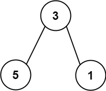
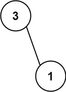

# [666. Path Sum IV](https://leetcode.com/problems/path-sum-iv/)

| Category | Difficulty | Likes | Dislikes |
| :------: | :--------: | :---: | :------: |
| Algorithms | Medium | 426 | 521 |

**Tags:** [`array`](https://leetcode.com/tag/array), [`hash-table`](https://leetcode.com/tag/hash-table), [`tree`](https://leetcode.com/tag/tree), [`depth-first-search`](https://leetcode.com/tag/depth-first-search), [`binary-tree`](https://leetcode.com/tag/binary-tree)

**Companies:** `alibaba`

## Description

If the depth of a tree is smaller than `5`, then this tree can be represented by an array of three-digit integers. You are given an **ascending **array `nums` consisting of three-digit integers representing a binary tree with a depth smaller than `5`, where for each integer:

	- The hundreds digit represents the depth `d` of this node, where `1 <= d <= 4`.

	- The tens digit represents the position `p` of this node within its level, where `1 <= p <= 8`, corresponding to its position in a **full binary tree**.

	- The units digit represents the value `v` of this node, where `0 <= v <= 9`.

Return the **sum** of **all paths** from the **root** towards the **leaves**.

It is **guaranteed** that the given array represents a valid connected binary tree.

 

**Example 1:**

**Input:** nums = [113,215,221]

**Output:** 12

**Explanation:**

The tree that the list represents is shown.

The path sum is (3 + 5) + (3 + 1) = 12.

**Example 2:**

**Input:** nums = [113,221]

**Output:** 4

**Explanation:**

The tree that the list represents is shown. 

The path sum is (3 + 1) = 4.

 

**Constraints:**

	- `1 <= nums.length <= 15`

	- `110 <= nums[i] <= 489`

	- `nums` represents a valid binary tree with depth less than `5`.

	- `nums` is sorted in ascending order.

---

**Links:** [Submissions](https://leetcode.com/problems/path-sum-iv/) | [Solutions](https://leetcode.com/problems/path-sum-iv/)
