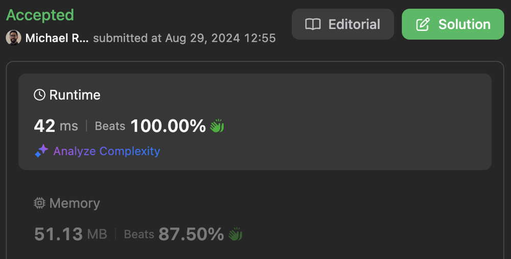

# Binary Tree Array

**Author:** rojas
**Votes:** 0
**Link:** [https://leetcode.com/problems/path-sum-iv/solutions/5707683/](https://leetcode.com/problems/path-sum-iv/solutions/5707683/)

---

# Table of Contents

[toc]

# Binary Tree Array I - Leaf to Root Traversal

- Time complexity: $$O(N)$$

- Space complexity: $$O(1)$$

```typescript []
function pathSum(nums: number[]): number {
    const values = new Array(16).fill(-1);
    const leaves = new Array(16).fill(true);

    // Populate values
    for (let num of nums) {
        const p = Math.floor(num / 10) % 10;
        const d = Math.floor(num / 100) % 10 - 1;
        values[(1 << d) + p - 1] = num % 10;
    }

    // Initialize sum
    let sum = 0;

    // For each node
    for (let i = 15; i > 0; --i) {
        // Skip if not leaf
        if (values[i] < 0 || !leaves[i]) {
            continue;
        }
        // Add values from leaf to root
        let j = i;
        do {
            sum += values[j];
            j >>= 1;
            leaves[j] = false;
        } while (j > 0);
    }

    return sum;
};
```

```javascript []
/**
 * @param {number[]} nums
 * @return {number}
 */
function pathSum(nums) {
    const values = new Array(16).fill(-1);
    const leaves = new Array(16).fill(true);

    // Populate values
    for (let num of nums) {
        const p = Math.floor(num / 10) % 10;
        const d = Math.floor(num / 100) % 10 - 1;
        values[(1 << d) + p - 1] = num % 10;
    }

    // Initialize sum
    let sum = 0;

    // For each node
    for (let i = 15; i > 0; --i) {
        // Skip if not leaf
        if (values[i] < 0 || !leaves[i]) {
            continue;
        }
        // Add values from leaf to root
        let j = i;
        do {
            sum += values[j];
            j >>= 1;
            leaves[j] = false;
        } while (j > 0);
    }

    return sum;
};
```

```java []
class Solution {
    public int pathSum(int[] nums) {
        final int[] values = new int[16];
        final boolean[] branch = new boolean[16];
        Arrays.fill(values, -1);

        for (final int num : nums) {
            final int p = (num / 10) % 10;
            final int d = (num / 100) % 10 - 1;
            values[(1 << d) + p - 1] = num % 10;
        }

        int sum = 0;
        for (int i = 15; i > 0; --i) {
            if (values[i] < 0 || branch[i]) {
                continue;
            }
            int j = i;
            do {
                sum += values[j];
                j >>= 1;
                branch[j] = true;
            } while (j > 0);
        }

        return sum;
    }
}
```

# Binary Tree Array II - Push Down

- Time complexity: $$O(N)$$

- Space complexity: $$O(1)$$

```typescript []
function pathSum(nums: number[]): number {
    const values = new Array(16).fill(0);
    const leaves = new Array(16).fill(true);
    
    // Traverse nums in ascending depth order
    for (let num of nums) {
        // Convert num to array index
        const p = Math.floor(num / 10) % 10;
        const d = Math.floor(num / 100) % 10 - 1;
        const i = (1 << d) + p - 1;
        // Add parent values with value
        values[i] = num % 10 + values[i >> 1];
        // Mark parent as not a leaf node
        leaves[i >> 1] = false;
    }

    // Sum all leaves together
    let sum = 0;
    for (let i = 0; i < 16; ++i) {
        if (leaves[i]) {
            sum += values[i];
        }
    }

    return sum;
};
```

```javascript []
/**
 * @param {number[]} nums
 * @return {number}
 */
function pathSum(nums) {
    const values = new Array(16).fill(0);
    const leaves = new Array(16).fill(true);
    
    // Traverse nums in ascending depth order
    for (let num of nums) {
        // Convert num to array index
        const p = Math.floor(num / 10) % 10;
        const d = Math.floor(num / 100) % 10 - 1;
        const i = (1 << d) + p - 1;
        // Add parent values with value
        values[i] = num % 10 + values[i >> 1];
        // Mark parent as not a leaf node
        leaves[i >> 1] = false;
    }

    // Sum all leaves together
    let sum = 0;
    for (let i = 0; i < 16; ++i) {
        if (leaves[i]) {
            sum += values[i];
        }
    }

    return sum;
};
```

```java []
class Solution {
    public int pathSum(int[] nums) {
        final int[] values = new int[16];
        final boolean[] branch = new boolean[16];

        for (final int num : nums) {
            final int p = (num / 10) % 10;
            final int d = (num / 100) % 10 - 1;
            final int i = (1 << d) + p - 1;
            values[i] = num % 10;
            values[i] += values[i >> 1];
            branch[i >> 1] = true;
        }

        int sum = 0;
        for (int i = 0; i < 16; ++i) {
            if (!branch[i]) {
                sum += values[i];
            }
        }

        return sum;
    }
}
```

# Binary Tree Array III - Push Up

- Time complexity: $$O(N)$$

- Space complexity: $$O(1)$$

[Typescript Solution](https://leetcode.com/problems/path-sum-iv/submissions/1372423788)




```typescript []
function pathSum(nums: number[]): number {
    const counts = new Array(16).fill(0);
    let sum = 0;

    // Traverse nums in descending depth order
    for (let i = nums.length - 1; i >= 0; --i) {
        // Convert num to array index
        let j = (0 | (nums[i] / 10)) % 10 - 1;
        j += 1 << ((0 | (nums[i] / 100)) % 10 - 1);
        // Increase leaf count if node is a leaf
        counts[j] += +(counts[j] == 0);
        // Multiply value by leaf count
        sum += counts[j] * (nums[i] % 10);
        // Add leaf count to parent node
        counts[j >> 1] += counts[j];
    }

    return sum;
};
```

```javascript []
/**
 * @param {number[]} nums
 * @return {number}
 */
function pathSum(nums) {
    const counts = new Array(16).fill(0);
    let sum = 0;

    // Traverse nums in descending depth order
    for (let i = nums.length - 1; i >= 0; --i) {
        // Convert num to array index
        let j = (0 | (nums[i] / 10)) % 10 - 1;
        j += 1 << ((0 | (nums[i] / 100)) % 10 - 1);
        // Increase leaf count if node is a leaf
        counts[j] += +(counts[j] == 0);
        // Multiply value by leaf count
        sum += counts[j] * (nums[i] % 10);
        // Add leaf count to parent node
        counts[j >> 1] += counts[j];
    }

    return sum;
};
```

```java []
class Solution {
    public int pathSum(int[] nums) {
        final int[] counts = new int[16];
        int sum = 0;

        // Traverse nums in descending depth order
        for (int i = nums.length - 1; i >= 0; --i) {
            // Convert num to array index
            int j = (nums[i] / 10) % 10 - 1;
            j += 1 << ((nums[i] / 100) % 10 - 1);
            // Increase leaf count if node is a leaf
            counts[j] += (counts[j] > 0) ? 0 : 1;
            // Multiply value by leaf count
            sum += counts[j] * (nums[i] % 10);
            // Add leaf count to parent node
            counts[j >> 1] += counts[j];
        }

        return sum;
    }
}
```