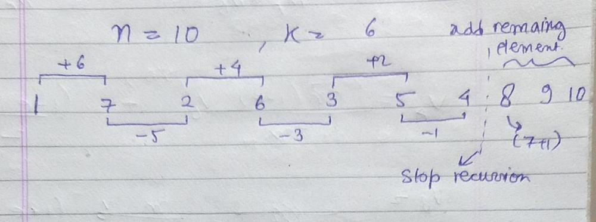

# C++ | No Logic | Just observed a pattern | Must see

**Author:** BlazeYP
**Votes:** 5
**Link:** [https://leetcode.com/problems/beautiful-arrangement-ii/solutions/1425775/](https://leetcode.com/problems/beautiful-arrangement-ii/solutions/1425775/)

---

**Pattern :**
1) Start with "1"
2) Firstly add "k" to the previous element of array and store it.
3)  Secondly subtract "k-1" to the previous element of array and store it.
4)  Do this until adding or subtracting number reaches 1.
5)  store remaining number starting from arr[1]+1 in increasing order until its size becomes equal to n.

ex:-




```
class Solution {
public:
    
    void helper(vector<int> &ans, int k, bool takePositive){
        if(k == 0)
            return;
        takePositive ? ans.push_back(ans[ans.size()-1] + k) : ans.push_back(ans[ans.size()-1] - k);
        helper(ans, k-1, !takePositive);
    }
    
    vector<int> constructArray(int n, int k) {
        vector<int> ans;
        ans.push_back(1);
        helper(ans,k,true);
        int c = n - ans.size();
        int a = ans[1]+1;
        while(c--)
            ans.push_back(a++);
        
        return ans;
    }
};
```
I hope you will like this..... if yes then pls upvote...... explain karne me itni mehnat pehli baar ki he XD