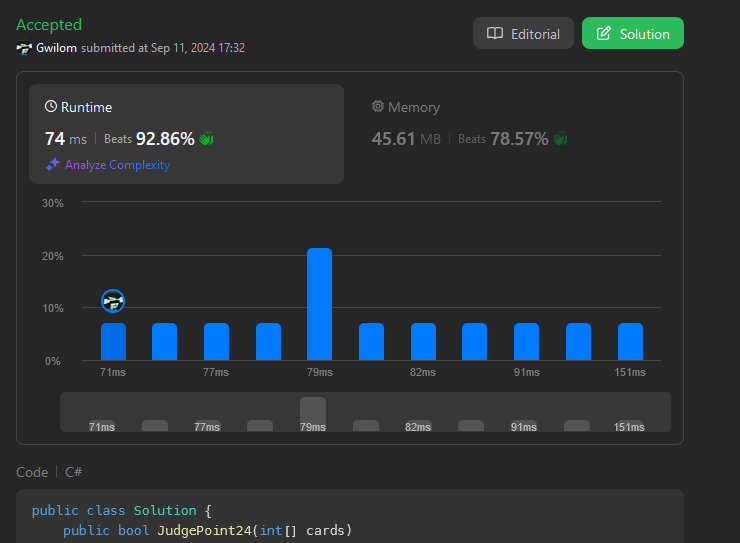

# Recursive hell

**Author:** Gwilom
**Votes:** 0
**Link:** [https://leetcode.com/problems/24-game/solutions/5771907/](https://leetcode.com/problems/24-game/solutions/5771907/)

---



List version is more efficient.

# Code

```csharp [List]
public class Solution 
{
    public bool JudgePoint24(int[] cards)
    {
        bool found = false;
        Helper(ref found, cards.ToList(), 0);
        return found;
    }

    const int TARGET = 24;
    private void Helper(ref bool found, List<int> cards, double curr) 
    {
        if (cards.Count == 0 && Math.Round(curr, MidpointRounding.AwayFromZero) == TARGET)
        {
            found = true;
        }
        else 
        {
            if (found) return;
            for (int i = 0; i < cards.Count; i++)
            {
                int card_val = cards[i];
                cards.Remove(card_val);

                Helper(ref found, cards, curr + card_val);
                Helper(ref found, cards, curr - card_val);
                if (curr != 0)
                {
                    Helper(ref found, cards, curr / card_val);
                    Helper(ref found, cards, curr * card_val);
                    Helper(ref found, cards, card_val / curr);
                }

                if (i < cards.Count)
                {
                    int next_card_val = cards[i];

                    cards.Remove(next_card_val);

                    Helper(ref found, cards, curr * (card_val + next_card_val));
                    if (card_val - next_card_val != 0)
                    {
                        Helper(ref found, cards, curr / (card_val - next_card_val));
                        Helper(ref found, cards, curr * (card_val - next_card_val));
                        Helper(ref found, cards, (card_val - next_card_val) / curr);
                    }

                    cards.Insert(i, next_card_val);
                }

                cards.Insert(i, card_val);
            }
        }
    }
}
```
```csharp [Array]
public class Solution 
{
    public bool JudgePoint24(int[] cards)
    {
        bool found = false;
        Helper(ref found, cards, 0);
        return found;
    }

    const int TARGET = 24;
    private void Helper(ref bool found, int[] cards, double curr) 
    {
        if (cards.Length == 0 && Math.Round(curr, MidpointRounding.AwayFromZero) == TARGET)
        {
            found = true;
        }
        else 
        {
            if (found) return;
            for (int i = 0; i < cards.Length; i++)
            {
                Helper(ref found, [..cards[..i], ..cards[(i + 1)..]], curr + cards[i]);
                Helper(ref found, [..cards[..i], ..cards[(i + 1)..]], curr - cards[i]);
                if (curr != 0)
                {
                    Helper(ref found, [.. cards[..i], .. cards[(i + 1)..]], curr / cards[i]);
                    Helper(ref found, [.. cards[..i], .. cards[(i + 1)..]], curr * cards[i]);
                    Helper(ref found, [.. cards[..i], .. cards[(i + 1)..]], cards[i] / curr);
                }
                if (i + 1 < cards.Length)
                {
                    Helper(ref found, [.. cards[..i], .. cards[(i + 2)..]], curr * (cards[i] + cards[i + 1]));
                    if (cards[i] - cards[i + 1] != 0)
                    {
                        Helper(ref found, [.. cards[..i], .. cards[(i + 2)..]], curr / (cards[i] - cards[i + 1]));
                        Helper(ref found, [.. cards[..i], .. cards[(i + 2)..]], curr * (cards[i] - cards[i + 1]));
                        Helper(ref found, [.. cards[..i], .. cards[(i + 2)..]], (cards[i] - cards[i + 1]) / curr);
                    }
                }
            }
        }
    }
}
```