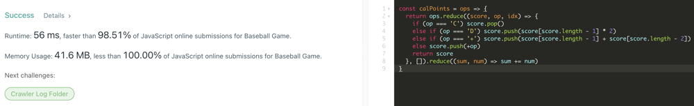

# JavaScript | 100% Stack Reduce

**Author:** casmith1987
**Votes:** 9
**Link:** [https://leetcode.com/problems/baseball-game/solutions/1934341/](https://leetcode.com/problems/baseball-game/solutions/1934341/)

---




```
const calPoints = ops => {
  return ops.reduce((score, op, idx) => {
    if (op === 'C') score.pop()
    else if (op === 'D') score.push(score[score.length - 1] * 2)
    else if (op === '+') score.push(score[score.length - 1] + score[score.length - 2])
    else score.push(+op)
    return score
  }, []).reduce((sum, num) => sum += num, 0)
}
```