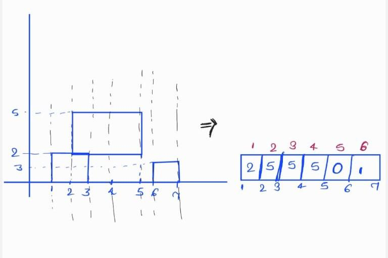

# ✅✅Easy Readable c++ code || Segment Tree with lazy propagation || Cordinate Compression.

**Author:** anupamraZ
**Votes:** 8
**Link:** [https://leetcode.com/problems/falling-squares/solutions/3657139/](https://leetcode.com/problems/falling-squares/solutions/3657139/)

---

# Intuition and Approach
<!-- Describe your first thoughts on how to solve this problem. -->
First of all, it will feel awkard and you might not get the intution of segment tree. But when you deminish 2D concept into 1D by replacing the height by values at in 1D. Then you will get idea of segment tree.

For a time being, forgot about cordinate compression. That is easiest part of this problem.

This figure in testcase-1  will diminish to:


Now think it as range update and range query. Whenever a new square comes, it gets stacked and freezed over tallest stack in its range [l,r]. Just imagine like tetris game. Have you digested till now? If not, please use pen paper and visualize.

so, what will be flow to solve the problem:
    For each query:
       1.Query maximum height in range of upcoming square.
       2.Update the value of all element in this range by 
`updatedVal=height of coming square+ maximum value earlier in that range.`
       3. Then again query for maximum height in overall range [1,n].


So,let's know how to implement it:
use lazy propagation over segment tree for this.You can read it over [here.](https://cp-algorithms.com/data_structures/segment_tree.html#range-updates-lazy-propagation)

Under the topic given above in link, you will have two subsection:
1. Addtion over segment/range [concentrate over why we mark lazy[0] after pushing for the node]
2. Assignment over segment/range. [we will use this].
    since i am not using marked vector to track assignment (just to save space), i will use the fact that our height will never be -1, so i will just make lazy[node]=-1 after pushing/assignment for the node and whenever lazy[node]==-1, i will not update my node.
```
void push(int node)
{
    if(lazy[node]!=-1)
    {
       tree[2*node] =tree[2*node+1]=lazy[node];
       lazy[2*node] = lazy[2*node+1]=lazy[node];
       lazy[node]=-1;
    }
}
```

After that, it is as same as normal code for lazy propagation.

**But you will ask, cordinates are order of 1e8**, so this will not work. So, use cordinate compression for that. Since ,maximum positions can be no more that 2*size of given vector,so we will only need some critical x cordinates.
```
      unordered_map<int, int> index;
      set<int> sortedCoords;
      for (const auto& pos : positions) 
      {
          sortedCoords.insert(pos[0]);
          sortedCoords.insert(pos[0] + pos[1] - 1);
      }
      int compressedIdx = 1;
      for (auto it:sortedCoords) 
      {
          index[it] = compressedIdx;
          compressedIdx++;
      }  

```


Naming of variables are as:
- tl and tr are range of positions denoted by tree[node].
- l and r are our given range of query.

Note: I am using 1-based indexing in the following implementation.

# Complexity
- Time complexity: O(m * log(n)) where n= last compressed index and m=number of queries. As , we are using 2 query and 1 update per query.
<!-- Add your time complexity here, e.g. $$O(n)$$ -->

- Space complexity:O(1e5) as i am using a constant size tree and lazy.
<!-- Add your space complexity here, e.g. $$O(n)$$ -->

# Code
```
class Solution {
public:
    const static int N = 1e5 + 2;
int INF = 1e9;
int tree[4 * N], lazy[4 * N];
void push(int node)
{
    if(lazy[node]!=-1)
    {
       tree[2*node] =tree[2*node+1]=lazy[node];
       lazy[2*node] = lazy[2*node+1]=lazy[node];
       lazy[node]=-1;
    }
}
void update(int node, int tl, int tr, int l, int r, int updatedVal)
{
    if (tl > tr)return;
    else if (l<=tl && tr <=r)
    {
        tree[node] = updatedVal;
        lazy[node] = updatedVal; // ye value update krni hai tl to tr segment of segment tree.
    }
    else if(tl==tr && (tl<l||tr>r)) return;
    else
    {
        push(node);
        int tm = (tl + tr) / 2;
        update(2*node, tl, tm, l,r, updatedVal);
        update(2*node + 1, tm + 1, tr,l, r, updatedVal);
        tree[node] = max(tree[2*node], tree[2*node+ 1]);
    }
}
int query(int node, int tl, int tr, int l, int r)
{
    if (tl >tr)return -INF;
    if (l <= tl && tr <= r)return tree[node];
    if(tl==tr) return -INF;
    push(node);
    int tm = (tl + tr) / 2;
    int q1=query(2*node, tl, tm, l,r);
    int q2=query(2*node + 1, tm + 1, tr,l, r);
    return max(q1,q2);
}

 vector<int> fallingSquares(vector<vector<int>>& positions) 
  {
      memset(tree,0,sizeof(tree));
      memset(lazy,0,sizeof(lazy));
      memset(a,0,sizeof(a));

      unordered_map<int, int> index;
      set<int> sortedCoords;
      for (const auto& pos : positions) 
      {
          sortedCoords.insert(pos[0]);
          sortedCoords.insert(pos[0] + pos[1] - 1);
      }
      int compressedIdx = 1;
      for (auto it:sortedCoords) 
      {
          index[it] = compressedIdx;
          compressedIdx++;
      }  
      int n= compressedIdx;
      int best = 0;
      vector<int> ans;  
      for (const auto& pos : positions) 
      {
          int l = index[pos[0]];
          int r = index[pos[0] + pos[1] - 1];
          int mxinlr=query(1,1,n,l,r);
          update(1,1,n,l,r,mxinlr+pos[1]);
          int temp=query(1,1,n,1,n);
          ans.push_back(temp);
      }
      return ans;
  }
};
```