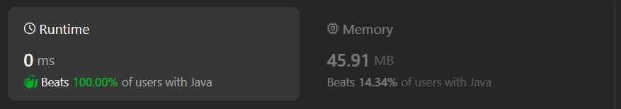
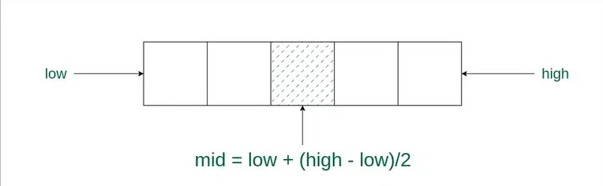

# Easy, Beginner & Dry Run || Binary search||Time complexity O(log n) & Space complexity O(1) || Gits✅

**Author:** GiteshSK_12
**Votes:** 4
**Link:** [https://leetcode.com/problems/binary-search/solutions/4654334/](https://leetcode.com/problems/binary-search/solutions/4654334/)

---

# Guys if the explanation is helpful then upvote me Please!!!!!\u2764\uFE0F\u2764\uFE0F




# Intuition \uD83D\uDC48

In the given problem, we have an array and a target value. The objective is to find the index of the element in the array whose value matches the target. The challenge is to accomplish this within a time complexity of O(n), which implies that the solution should be able to find the target's index in linear time, potentially scanning through each element of the array once.

# There are two methods to solve this code - \uD83D\uDC48

1. Brute Force
2. Optimised (Binary Search)

# 1. Brute Force : O(n) \uD83D\uDC48

# **Brute Force Code Explanation** \uD83D\uDC48
The brute force method for this problem is straightforward: we can iterate through the array, examining each element in turn. If we find an element that matches the target, we return its index. This approach ensures that we examine every element in the array, guaranteeing that we find the target if it is present.

**Step 1. For Loop:** 1\uFE0F\u20E3
- `for(int i = 0; i < nums.length; i++)`: This is a for loop that iterates over the elements of the nums array. i is the loop variable that starts from 0 and increments by 1 after each iteration. The loop continues as long as i is less than the length of the nums array.

**Step 2. If Statement:**

- `if(nums[i] == target) return i;`: Inside the loop, there is an if statement that checks if the current element of the array (nums[i]) is equal to the target value. If this condition is true, the method immediately returns the current index i, which is the position of the target in the array.

**Step 3. Return Statement:**

- `return -1;`: If the loop completes without finding the target (i.e., the if statement never evaluates to true), the method returns -1. This indicates that the target value is not present in the nums array.
# Brute Force Code 
```C []
int search(int* nums, int numsSize, int target) {
    for(int i=0 ; i<numsSize; i++){
        if(nums[i] == target)return i;
    }
    return -1;
}
```
```C++ []
class Solution {
public:
    int search(vector<int>& nums, int target) {
        for(int i = 0; i<nums.size(); i++){
            if(nums[i] == target)return i;
        }
        return -1;
    }
};
```
```Java []
class Solution {
    public int search(int[] nums, int target) {
       for(int i = 0; i< nums.length ; i++){
        if(nums[i] == target)return i;
        }
    return - 1;
    }
}
```
```javascript []
/**
 * @param {number[]} nums
 * @param {number} target
 * @return {number}
 */
var search = function (nums, target) {
    for(let i = 0; i< nums.length ; i++){
        if(nums[i] == target)return i;
    }
    return - 1
};
```
```C# []
public class Solution {
    public int Search(int[] nums, int target) {
    for(int i = 0; i< nums.Length ; i++){
        if(nums[i] == target)return i;
    }
    return - 1;
    }
}
```

```python []
class Solution(object):
    def search(self, nums, target):
        """
        :type nums: List[int]
        :type target: int
        :rtype: int
        """
        for i in range(0 , len(nums)):
            if target == nums[i]: return i
        return -1
```
```python3 []
class Solution:
    def search(self, nums: List[int], target: int) -> int:
        for i in range(0 , len(nums)):
            if target == nums[i]: return i
        return -1
```
```Ruby []
# @param {Integer[]} nums
# @param {Integer} target
# @return {Integer}
def search(nums, target)
    for i in 0..nums.length() do
        if nums[i] == target 
            return i
        end
    end
    return -1
end
```

---

# 2. Optimised (Binary Search): O(log n) \u2705\uD83D\uDC48

- To solve this question using binary search we should know what is binary search.
- Binary Search is defined as a searching algorithm used in a sorted array by repeatedly dividing the search interval in half. The idea of binary search is to use the information that the array is sorted and reduce the time complexity to O(log N).
- Conditions for when to apply Binary Search in a Data Structure:

# To apply Binary Search algorithm: \uD83D\uDC48

1. The data structure must be sorted.
2. Access to any element of the data structure takes constant time. 

# Binary Search Algorithm: \uD83D\uDC48
In this algorithm,

1. Divide the search space into two halves by finding the middle index \u201Cmid\u201D.

2. Compare the middle element of the search space with the key.

3. If the key is found at middle element, the process is terminated.

4. If the key is not found at middle element, choose which half will be used as the next search space.

    - If the key is smaller than the middle element, then the left side is used for next search.
    - If the key is larger than the middle element, then the right side is used for next search.
5. This process is continued until the key is found or the total search space is exhausted.

# Binary Search Code Explanation \uD83D\uDC48

**Step 1. Initial Variables:**

- `int start = 0; int end = nums.length - 1;`: Two variables, start and end, are initialized. start is set to 0 (the beginning of the array), and end is set to nums.length - 1 (the last index of the array).

**Step 2. While Loop:**

- `while(start <= end):` This loop continues as long as start is less than or equal to end. The condition start <= end ensures that the search space is valid.

**Step 3. Middle Element Calculation:**

- `int mid = (start + end) / 2;`: This calculates the middle index of the current search space. The middle element is found by averaging start and end.

**Step 4. If-Else Conditions:**

- `if(target == nums[mid]) return mid;`: If the target value is equal to the element at the mid index, the method returns mid, which is the position of the target in the array.
- `else if(target < nums[mid]) end = mid - 1;`: If the target is less than the element at mid, the method updates end to mid - 1, effectively narrowing the search space to the left half of the current search space.
- `else start = mid + 1;`: If the target is greater than the element at mid, the method updates start to mid + 1, narrowing the search space to the right half of the current search space.

**Step 5. Return Statement:**

- `return -1;`: If the loop completes without finding the target (i.e., start becomes greater than end), the method returns -1. This indicates that the target value is not present in the nums array.

# Complexity \uD83D\uDC48
- Time complexity : time complexity O(n)

- Space complexity : space complexity O(1)

# Binary Search Code \uD83D\uDC48
```C []
int search(int* nums, int numsSize, int target) {
    int start = 0;
    int end = numsSize-1;
    while(start <= end){
        int mid = (start + end)/2;
        if(nums[mid] == target)return mid;
        if(target > nums[mid])start = mid + 1;
        else end = mid - 1;
    }
    return -1;
}
```
```C++ []
class Solution {
public:
    int search(vector<int>& nums, int target) {
        int len = nums.size();
        int start = 0;
        int end = len-1;
        while(start <= end){
            int mid = (start + end)/2;
            if(nums[mid] == target)return mid;
            if(target > nums[mid])start = mid + 1;
            else end = mid - 1;
        }
        return -1;
    }
};
```
```Java []
class Solution {
    public int search(int[] nums, int target) {
        int start = 0;
        int end = nums.length - 1;
        while(start <= end){
            int mid = (start+end)/2;
            if(target == nums[mid])return mid;
            else if(target < nums[mid])end = mid -1;
            else start = mid + 1;
        }
        return - 1;
    }
}
```
```javascript []
/**
 * @param {number[]} nums
 * @param {number} target
 * @return {number}
 */
var search = function (nums, target) {
    let start = 0
    let end = nums.length - 1
    while (start <= end) {
        let mid = Math.floor((start + end) / 2);
        if (nums[mid] === target) return mid
        if(target < nums[mid])end = mid - 1
        else start = mid + 1
    }
    return - 1
};
```
```C# []
public class Solution {
    public int Search(int[] nums, int target) {
        int start = 0;
        int end = nums.Length - 1;
        while(start <= end){
            int mid = (start+end)/2;
            if(target == nums[mid])return mid;
            else if(target < nums[mid])end = mid -1;
            else start = mid + 1;
        }
        return - 1;
    }
}
```
```python []
class Solution(object):
    def search(self, nums, target):
        """
        :type nums: List[int]
        :type target: int
        :rtype: int
        """
        start , end = 0 , len(nums) - 1
        while start <= end :
            mid = (start+end)/2
            if nums[mid] == target: return mid
            elif nums[mid] < nums[end]:
                if target > nums[mid] and target <= nums[end]: start = mid + 1
                else : end = mid - 1
            else :
                if target >= nums[start] and target < nums[mid]: end = mid - 1
                else: start = mid + 1
        return -1
```
```Python3 []
class Solution:
    def search(self, nums: List[int], target: int) -> int:
        start , end = 0 , len(nums) - 1
        while start <= end :
            mid = (start+end)//2
            if nums[mid] == target: return mid
            elif target < nums[mid]:
                end = mid -1
            else :
                start = mid + 1
        return -1
```
```Ruby []
# @param {Integer[]} nums
# @param {Integer} target
# @return {Integer}
def search(nums, target)
    start , last = 0 , nums.length() - 1
    while start <= last
        mid = (start + last)/2
        if target === nums[mid]
            return mid
        elsif target < nums[mid]
            last = mid - 1
        else 
            start = mid + 1
        end
    end
    return -1
end
```
# Binary Search Dry Run - \uD83D\uDC48\uD83D\uDE0E\uD83D\uDC48
 
**Step 1. Initial Variables:**

- start = 0, end = 5 (since the array length is 6, end is length - 1).

**Step 2. First Iteration:**

- Calculate mid: mid = (start + end) / 2 = (0 + 5) / 2 = 2.
- nums[mid] is nums[2], which is 3.
- Since target (9) is greater than nums[mid] (3), we update start to mid + 1.
- New start = 2 + 1 = 3, end remains 5.

**Step 3. Second Iteration:**

- Calculate new mid: mid = (start + end) / 2 = (3 + 5) / 2 = 4.
- nums[mid] is nums[4], which is 9.
- Since target (9) is equal to nums[mid] (9), we return mid, which is 4.

# Guys if the explanation and solution is helpfull then upvote me.


