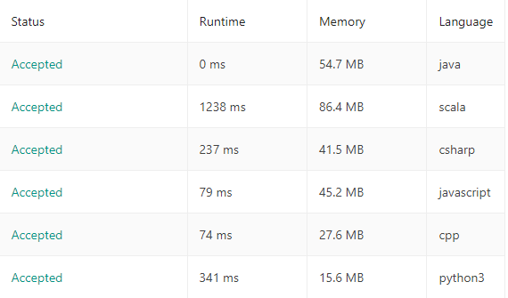

# Сomparison of the classic solution in 6 programming languages

**Author:** FLlGHT
**Votes:** 1
**Link:** [https://leetcode.com/problems/binary-search/solutions/1900406/](https://leetcode.com/problems/binary-search/solutions/1900406/)

---

### Java 
```
public int search(int[] nums, int target) {
        int left = 0;
        int right = nums.length - 1;
        while (left <= right) {
            int middle = left + (right - left) / 2;
            if (nums[middle] == target) return middle;
            if (nums[middle] > target) right = middle - 1;
            else left = middle + 1;
        }
        return -1;
    }
```
#### Scala
```
	def search(nums: Array[Int], target: Int): Int = {
        
				helper(nums, target, 0, nums.length - 1)
    }
    
    def helper(nums: Array[Int], target: Int, left: Int, right: Int): Int = {
					val mid = left + (right - left)/2
					mid match {
						case mid if left > right => -1
						case mid if (nums(mid) == target) => mid
						case mid if (nums(mid) < target) => helper(nums, target, mid + 1, right)
						case _ => helper(nums, target, left, mid - 1)
					}
				}
```

### C++
```
public:
    int search(vector<int>& nums, int target) {
        int left = 0;
        int right = nums.size() - 1;
        while (left <= right) {
            int middle = left + (right - left) / 2;
            if (nums[middle] == target) return middle;
            if (nums[middle] > target) right = middle - 1;
            else left = middle + 1;
        }
        return -1;
    }
```

### C#
```
public int Search(int[] nums, int target) {
        int left = 0;
        int right = nums.Length - 1;
        while (left <= right) {
            int middle = left + (right - left) / 2;
            if (nums[middle] == target) return middle;
            if (nums[middle] > target) right = middle - 1;
            else left = middle + 1;
        }
        return -1;
    }
```

### Python

```
def search(self, nums: List[int], target: int) -> int:
        left = 0
        right = len(nums) - 1
        
        while(left <= right):
            middle = left + (right - left) // 2
            if (nums[middle] == target):
                return middle
            if (nums[middle] > target):
                right = middle - 1
            else: left = middle + 1
        
        return -1
```

### JavaScript
```
var search = function(nums, target) {
    left = 0
    right = nums.length - 1
        
    while(left <= right) {
          middle = Math.floor(left + (right - left) / 2);
          if (nums[middle] == target)
                return middle;
          if (nums[middle] > target)
                right = middle - 1
          else left = middle + 1
    }
        
       return -1
};
```

and if anyone is interested


