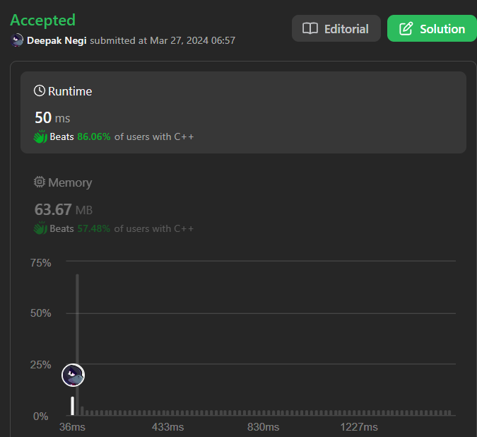

# Sliding Window in Action! Counting Subarrays with Product Less Than K ✅✅✅🔥🔥🔥

**Author:** Hunter_0718
**Votes:** 130
**Link:** [https://leetcode.com/problems/subarray-product-less-than-k/solutions/4930464/](https://leetcode.com/problems/subarray-product-less-than-k/solutions/4930464/)

---



**Intuition:**

Imagine a sliding window traversing the array. We keep track of the product of elements within the window. If the product becomes greater than or equal to `k`, we need to shrink the window from the left side until the product becomes less than `k`. This process ensures that all subarrays considered have a product strictly less than `k`.

**Approach:**

1. **Initialization:** Set `left` and `right` pointers to 0, `product` to 1 (initial empty subarray), and `count` to 0 (to store final subarray count).
2. **Sliding Window:**
   - While `right` hasn't reached the end (`right < n`):
      - Expand the window: Multiply `product` by the current element `nums[right]`.
      - Shrink the window (if necessary):
         - While `product` is greater than or equal to `k`:
            - Divide `product` by the leftmost element `nums[left]` and increment `left`. This shrinks the window and reduces the product.
      - Count subarrays:
         - Add `1 + (right - left)` to `count`. This accounts for:
            - 1: The single-element subarray ending at `right`.
            - `(right - left)`: The number of contiguous subarrays within the current window (excluding elements already removed in the inner loop).
   - Increment `right` to move the window one step forward.
3. **Return Result:**
   - Return the final `count` representing the total number of subarrays with product less than `k`.

**Time Complexity:**

- **Best Case:** O(n) if `k` is very small (product never exceeds `k`) or very large (no window shrinking needed).
- **Average Case:** O(n) due to the efficient sliding window approach. In each iteration, either `right` is incremented (constant time) or `left` is incremented (constant time) in the inner loop. This leads to a maximum of `n` iterations overall.
- **Worst Case:** O(2*n) if elements in `nums` are very close to 1 and `k` is just slightly larger than the product of all elements. In this scenario, the window might shrink very slowly, leading to more iterations in the worst case.

**Space Complexity:**

- O(1) as we use constant extra space (`left`, `right`, `product`, and `count`) independent of the input size.


```C++ []
class Solution {
public:
  int numSubarrayProductLessThanK(vector<int>& nums, int k) {
    int left = 0, right = 0, product = 1, count = 0;
    int n = nums.size();
    if(k <= 1) return 0;
    while (right < n) {
      product *= nums[right];
      while (product >= k) product /= nums[left++];
      count += 1 + (right - left);
      right++;
    }
    return count;
  }
};

```
```Java []
class Solution {
    public int numSubarrayProductLessThanK(int[] nums, int k) {
        if (k <= 1) return 0;

        int left = 0, right = 0, product = 1, count = 0;
        int n = nums.length;

        while (right < n) {
            product *= nums[right];
            while (product >= k) product /= nums[left++];
            count += 1 + (right - left);
            right++;
        }

        return count;
    }
}

```
```Python3 []
class Solution:
    def numSubarrayProductLessThanK(self, nums: List[int], k: int) -> int:
        if k <= 1:
            return 0

        left, right, product, count = 0, 0, 1, 0
        n = len(nums)

        while right < n:
            product *= nums[right]
            while product >= k:
                product //= nums[left]
                left += 1
            count += 1 + (right - left)
            right += 1

        return count

```

```Kotlin []
class Solution {
    fun numSubarrayProductLessThanK(nums: IntArray, k: Int): Int {
        if (k <= 1) return 0

        var left = 0
        var right = 0
        var product = 1
        var count = 0
        val n = nums.size

        while (right < n) {
            product *= nums[right]
            while (product >= k) {
                product /= nums[left++]
            }
            count += 1 + (right - left)
            right++
        }

        return count
    }
}

```
```Javascript []
/**
 * @param {number[]} nums
 * @param {number} k
 * @return {number}
 */
var numSubarrayProductLessThanK = function(nums, k) {
  if (k <= 1) return 0;

  let left = 0, right = 0, product = 1, count = 0;
  const n = nums.length;

  while (right < n) {
    product *= nums[right];
    while (product >= k) product /= nums[left++];
    count += 1 + (right - left);
    right++;
  }

  return count;
};

```


**Dry Run:**

**Example 1: nums = [10, 5, 2, 6], k = 100**

| Step     | left | right | product | count | Explanation              |
|----------|------|-------|---------|-------|---------------------------|
| Initial  | 0    | 0     | 1        | 0      | Empty subarray            |
| Iteration 1 | 0    | 1     | 10       | 1      | [10]                      |
| Iteration 2 | 0    | 2     | 50       | 2      | [10], [5]                 |
| Iteration 3 | 0    | 3     | 100      | 3 (1+2) | [10], [5], [2], [10, 5]    |
| Iteration 4 (Inner loop) | 1    | 3     | 50       | 4 (3+1) | Window shrinks, [5], [2], [6] |
| Iteration 5 | 1    | 4     | 300      | 5 (4+1) | Window shrinks, [2], [6]     |
| Final     | -    | -     | -        | 5      | -                          |

**Edge Case:**

- `k <= 0`: The problem definition states that `k` should be strictly positive. If `k` is less than or equal to 0, no subarray will have a product less than `k`. In the code, we handle this by returning 0 if `k <= 1`.

**Improved Code (Addressing Integer Overflow):**

```c++
class Solution {
public:
  int numSubarrayProductLessThanK(vector<int>& nums, int k) {
    if (k <= 1) return 0; // Handle edge case

    int left = 0, right = 0, product = 1, count = 0;
    int n = nums.size();