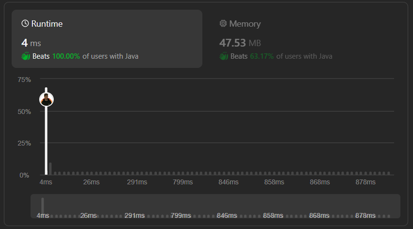

# 🍉✅Beats 100%, With Dry Run🍉 || Both beginner and optimize 🔥|| With Explanation

**Author:** dharmikgohil
**Votes:** 1
**Link:** [https://leetcode.com/problems/subarray-product-less-than-k/solutions/4931441/](https://leetcode.com/problems/subarray-product-less-than-k/solutions/4931441/)

---

> Programming is like a toxic relationship: you keep going back to the same bugs, even though you know they'll just hurt you again


# Intuition
The problem requires counting the number of subarrays whose product is less than k. One way to approach this is by using a sliding window technique where we maintain a window and continuously expand it until the product of elements within the window exceeds k. We increment a count every time we encounter a valid subarray. 

# Approach
We initialize two pointers, left and right, and set the product to 1. We iterate through the array using the right pointer, continuously updating the product by multiplying it with the current element. If the product exceeds or equals k, we move the left pointer to the right until the product becomes less than k. At each step, we count the number of subarrays formed by the window [left, right] and add it to our result. Finally, we return the total count.

# Complexity
- Time complexity: `O(n)`
  - The algorithm iterates through the array once using the sliding window technique. At each step, it performs constant time operations such as multiplication, division, and comparison.
- Space complexity: `O(1)`
  - The algorithm uses a constant amount of extra space regardless of the size of the input array. We only use a few variables to keep track of pointers, product, and count.

# 1) For Beginners\uD83D\uDE4C
```
class Solution {
    public int numSubarrayProductLessThanK(int[] nums, int k) {
       // fisrt method but it is not optimal
       // but is is better understandable for begineer 
       // i used brute force for counting every product which is less than k
        // O(N^2)
        if(k<=1) return 0;
        int count=0;
        for(int i=0;i<nums.length;i++){
            if(nums[i]<k){
                count++;
            }
            int product = nums[i];
            for(int j=i+1;j<nums.length;j++){
                product*=nums[j];
                if(product<k){
                    count++;
                }else{
                    break;
                }
            }
        }
        return count;
    }
}
```

# 2) Optmized and using sliding window 

```Java []
class Solution {
    public int numSubarrayProductLessThanK(int[] nums, int k) {
         if (k <= 1) return 0;

        int left = 0, right = 0, product = 1, count = 0;
        int n = nums.length;

        while (right < n) {
            product *= nums[right];// Extend the window by including nums[right] in the product
            // Shrink the window if product >= k
            while (product >= k) product /= nums[left++]; //we remove left most value from out product
            // and shrink out window 
            count += 1 + (right - left);
             // Count all subarrays that end at right index and satisfy the condition
            right++;
        }
        return count;
    }
}
```
```c++ []
class Solution {
public:
    int numSubarrayProductLessThanK(vector<int>& nums, int k) {
        if (k <= 1) return 0; // If k is less than or equal to 1, no subarray can satisfy the condition

        int left = 0, right = 0, product = 1, count = 0; // Initialize pointers, product, and count
        int n = nums.size(); // Length of the array

        while (right < n) { // Iterate through the array
            product *= nums[right]; // Extend the window by including nums[right] in the product
            while (product >= k) // Shrink the window if product is greater than or equal to k
                product /= nums[left++]; // Remove leftmost value from the product and shrink the window
            count += 1 + (right - left); // Count all subarrays that end at right index and satisfy the condition
            right++; // Move the right pointer to the right
        }
        return count; // Return the total count of subarrays
    }
};

```
```Python []
class Solution:
    def numSubarrayProductLessThanK(self, nums: List[int], k: int) -> int:
        if k <= 1:
            return 0  # If k is less than or equal to 1, no subarray can satisfy the condition

        left, right, product, count = 0, 0, 1, 0  # Initialize pointers, product, and count
        n = len(nums)  # Length of the array

        while right < n:  # Iterate through the array
            product *= nums[right]  # Extend the window by including nums[right] in the product
            while product >= k:  # Shrink the window if product is greater than or equal to k
                product //= nums[left]  # Remove leftmost value from the product and shrink the window
                left += 1
            count += 1 + (right - left)  # Count all subarrays that end at right index and satisfy the condition
            right += 1  # Move the right pointer to the right

        return count  # Return the total count of subarrays

```
```Javascript []
var numSubarrayProductLessThanK = function(nums, k) {
    if (k <= 1) return 0; // If k is less than or equal to 1, no subarray can satisfy the condition

    let left = 0, right = 0, product = 1, count = 0; // Initialize pointers, product, and count
    const n = nums.length; // Length of the array

    while (right < n) { // Iterate through the array
        product *= nums[right]; // Extend the window by including nums[right] in the product
        while (product >= k) // Shrink the window if product is greater than or equal to k
            product /= nums[left++]; // Remove leftmost value from the product and shrink the window
        count += 1 + (right - left); // Count all subarrays that end at right index and satisfy the condition
        right++; // Move the right pointer to the right
    }
    return count; // Return the total count of subarrays
};

```
```C# []
public class Solution {
    public int NumSubarrayProductLessThanK(int[] nums, int k) {
        if (k <= 1) return 0; // If k is less than or equal to 1, no subarray can satisfy the condition

        int left = 0, right = 0, product = 1, count = 0; // Initialize pointers, product, and count
        int n = nums.Length; // Length of the array

        while (right < n) { // Iterate through the array
            product *= nums[right]; // Extend the window by including nums[right] in the product
            while (product >= k) // Shrink the window if product is greater than or equal to k
                product /= nums[left++]; // Remove leftmost value from the product and shrink the window
            count += 1 + (right - left); // Count all subarrays that end at right index and satisfy the condition
            right++; // Move the right pointer to the right
        }
        return count; // Return the total count of subarrays
    }
}

```
```PHP []
class Solution {
    function numSubarrayProductLessThanK($nums, $k) {
        if ($k <= 1) return 0; // If k is less than or equal to 1, no subarray can satisfy the condition

        $left = 0;
        $right = 0;
        $product = 1;
        $count = 0;
        $n = count($nums); // Length of the array

        while ($right < $n) { // Iterate through the array
            $product *= $nums[$right]; // Extend the window by including nums[right] in the product
            while ($product >= $k) { // Shrink the window if product is greater than or equal to k
                $product /= $nums[$left++]; // Remove leftmost value from the product and shrink the window
            }
            $count += 1 + ($right - $left); // Count all subarrays that end at right index and satisfy the condition
            $right++; // Move the right pointer to the right
        }
        return $count; // Return the total count of subarrays
    }
}

```


# DRY RUN

#### Input: nums = [10,5,2,6], k = 100
#### Output: 8

<table border="1">
  <tr>
    <th>Iteration</th>
    <th>left</th>
    <th>right</th>
    <th>product</th>
    <th>count</th>
    <th>Action Taken</th>
  </tr>
  <tr>
    <td>1</td>
    <td>0</td>
    <td>0</td>
    <td>10</td>
    <td>0</td>
    <td>Extend window: product = 10</td>
  </tr>
  <tr>
    <td>2</td>
    <td>0</td>
    <td>1</td>
    <td>50</td>
    <td>1</td>
    <td>Extend window: product = 10*5 = 50</td>
  </tr>
  <tr>
    <td>3</td>
    <td>0</td>
    <td>2</td>
    <td>100</td>
    <td>3</td>
    <td>Shrink window: product = 50/10 = 5, count += 1 + (2 - 0) = 3</td>
  </tr>
  <tr>
    <td>4</td>
    <td>1</td>
    <td>3</td>
    <td>60</td>
    <td>6</td>
    <td>Extend window: product = 5*2*6 = 60</td>
  </tr>
  <tr>
    <td>5</td>
    <td>2</td>
    <td>4</td>
    <td>12</td>
    <td>8</td>
    <td>Shrink window: product = 60/10 = 6, count += 1 + (4 - 2) = 3</td>
  </tr>
</table>

# Hope you get it \uD83D\uDE4C 

