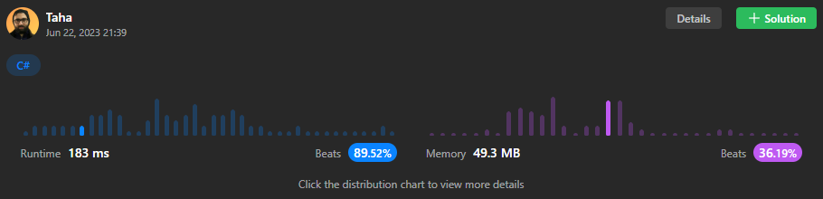

# ✅ C# | easy and readable solution 🚅 faster than 89%

**Author:** Thanat05
**Votes:** 4
**Link:** [https://leetcode.com/problems/best-time-to-buy-and-sell-stock-with-transaction-fee/solutions/3671304/](https://leetcode.com/problems/best-time-to-buy-and-sell-stock-with-transaction-fee/solutions/3671304/)

---



**Don't hesitate to suggest or ask bellow about something that you don't understand**

```
public class Solution {
    public int MaxProfit(int[] prices, int fee) {
        int profit = 0;
        int minPrice = prices[0];
        for (int i = 0; i < prices.Length; i++)
        {
            if (prices[i] < minPrice)
                minPrice = prices[i];
            else if (prices[i] > minPrice + fee)
            {
                profit += prices[i] - minPrice - fee;
                minPrice = prices[i] - fee;
            }
        }
        return profit;
    }
}
```

If you like it don't forget to **upvote!**