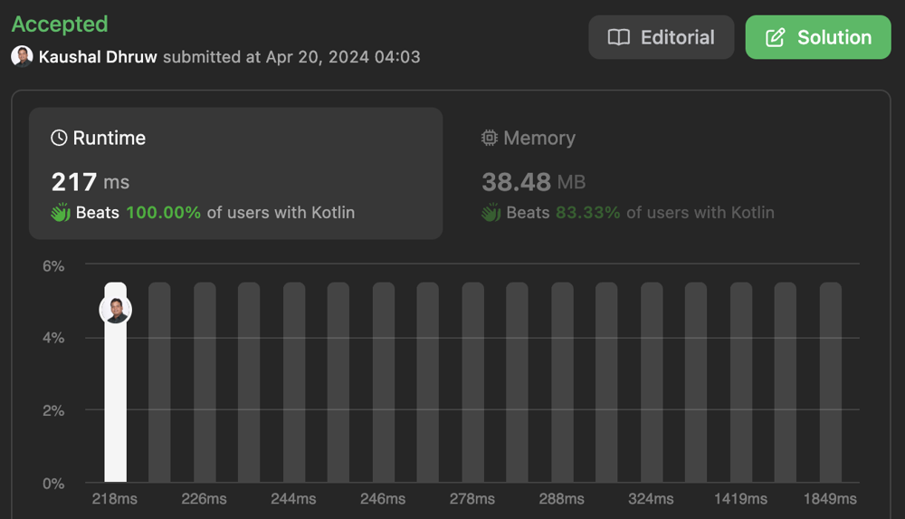

# Beats 100%, Kotlin solution. Tabulation with space optimization

**Author:** drulabs
**Votes:** 0
**Link:** [https://leetcode.com/problems/maximum-length-of-repeated-subarray/solutions/5047625/](https://leetcode.com/problems/maximum-length-of-repeated-subarray/solutions/5047625/)

---

# Intuition
<!-- Describe your first thoughts on how to solve this problem. -->

# Approach
<!-- Describe your approach to solving the problem. -->

# Complexity
- Time complexity: **O(m*n)** where m and n are lengths pf str1 and strt2
<!-- Add your time complexity here, e.g. $$O(n)$$ -->

- Space complexity: **O(n)** where n is length of 2nd string
<!-- Add your space complexity here, e.g. $$O(n)$$ -->

image.png


# Code
```
class Solution {
    fun findLength(nums1: IntArray, nums2: IntArray): Int {
        var prev = IntArray(nums2.size + 1) { 0 }
        var maxLen = 0
        for(i in 1..nums1.size) {
            val curr = IntArray(nums2.size + 1) { 0 }
            for (j in 1..nums2.size) {
                if (nums1[i-1] == nums2[j-1]) {
                    curr[j] = 1 + prev[j-1]
                    maxLen = maxOf(maxLen, curr[j])
                }
            }
            prev = curr
        }
        return maxLen
    }

    // fun findLength(nums1: IntArray, nums2: IntArray): Int {
    //     val dp = Array(nums1.size + 1) { IntArray(nums2.size + 1) { 0 } }
    //     var maxLen = 0
    //     for(i in 1..nums1.size) {
    //         for (j in 1..nums2.size) {
    //             if (nums1[i-1] == nums2[j-1]) {
    //                 dp[i][j] = 1 + dp[i-1][j-1]
    //                 maxLen = maxOf(maxLen, dp[i][j])
    //             }
    //         }
    //     }
    //     return maxLen
    // }
}
```