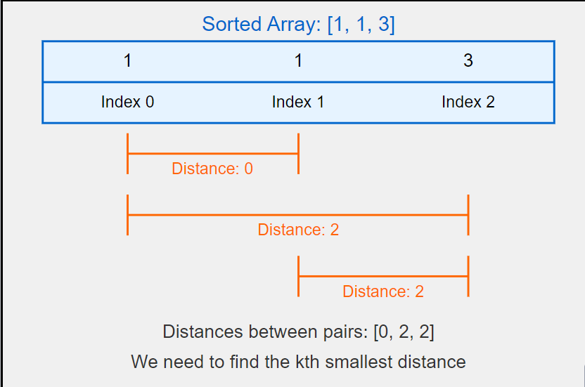
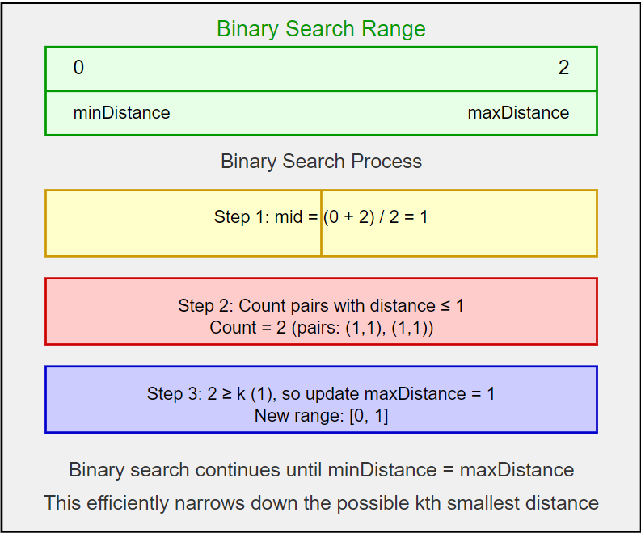
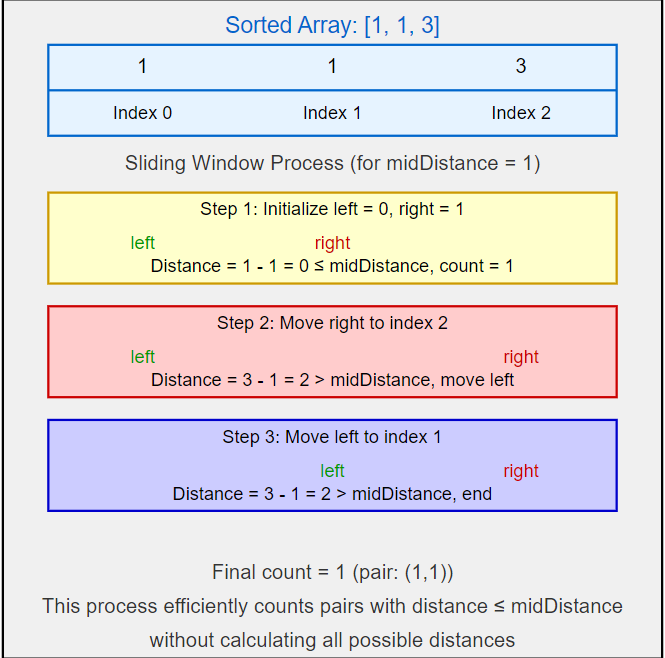
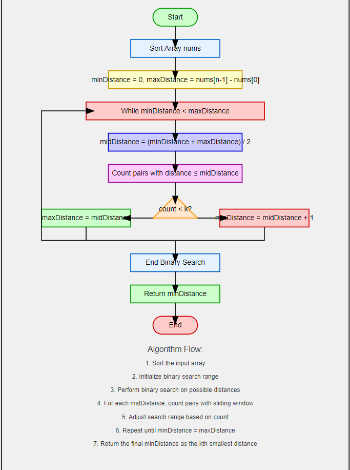
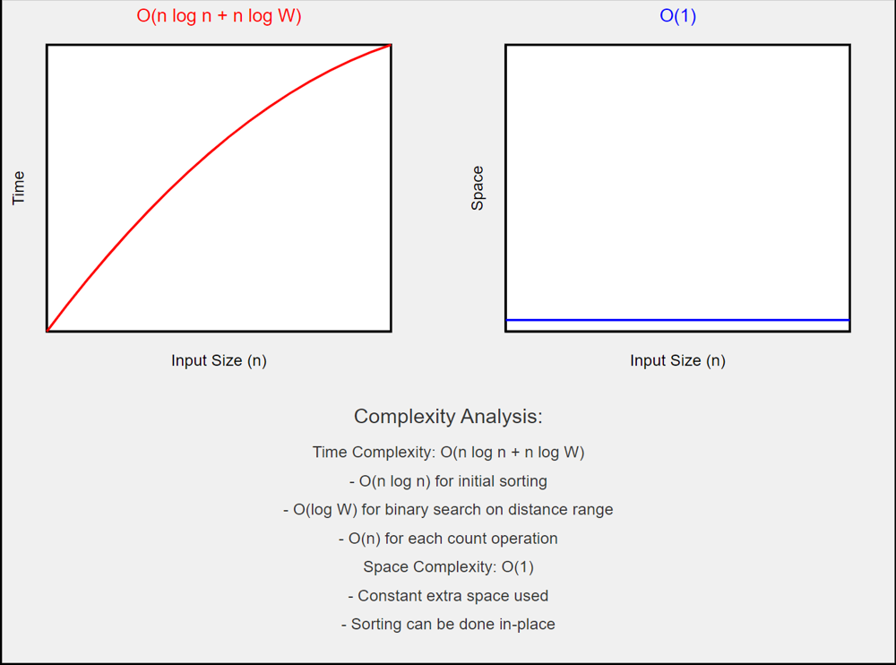
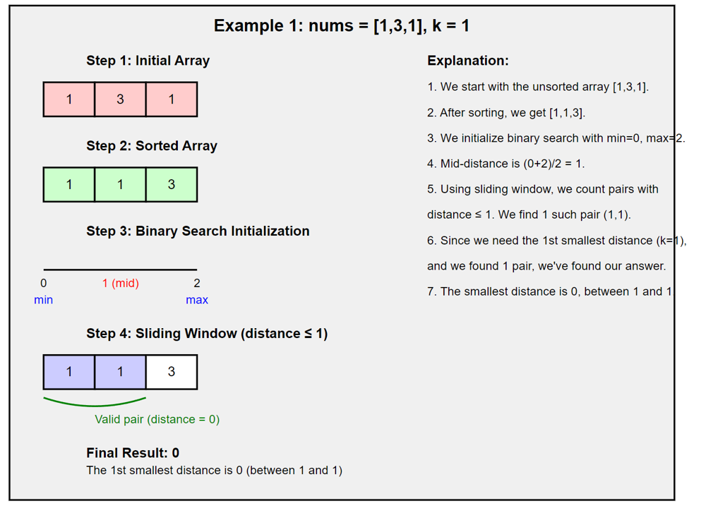
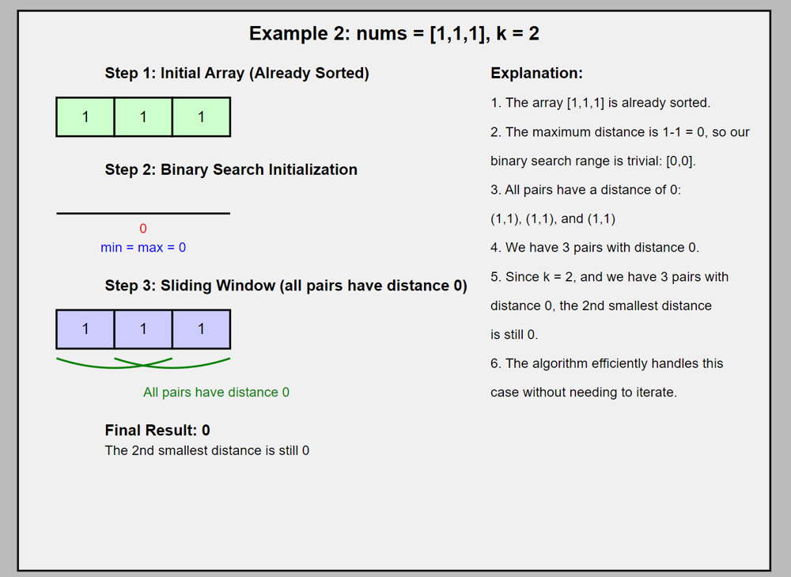
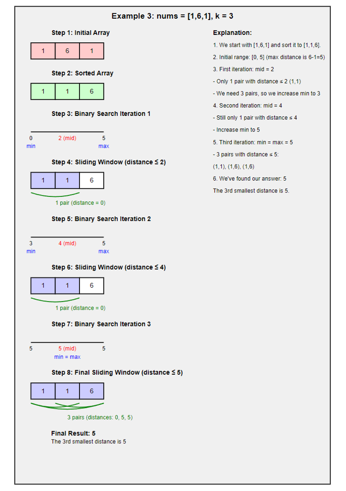

# O(n log n + n log W) | Binary Search + Sliding Window | Java | C++ | Python | Go | Rust | JavaScript

**Author:** kartikdevsharma_
**Votes:** 122
**Link:** [https://leetcode.com/problems/find-k-th-smallest-pair-distance/solutions/5632765/](https://leetcode.com/problems/find-k-th-smallest-pair-distance/solutions/5632765/)

---

### Intuition


We're dealing with a sorting and searching challenge. We need to find the kth smallest distance between any two numbers in an array. It's like we're organizing a group of friends and trying to figure out who's standing closest to whom, but with a twist - we're not just looking for the closest pair, but the kth closest.

Now, why is this problem particularly intriguing? Well, it's not immediately obvious how to approach it efficiently. Our first instinct might be to calculate all possible distances and sort them, but that would be painfully slow for large arrays. We need to be smarter about this.

Let's start by considering the constraints. We're dealing with potentially large arrays (up to 10,000 elements) and large numbers (up to 1,000,000). This immediately rules out any brute-force approaches. We need something more sophisticated.

If you think hard enough for this problem, you must notice the distances between numbers form a pattern. If we sort the array, nearby numbers will tend to have smaller distances between them. This sorting step becomes crucial - it's like organizing our friends in a line based on their height. Once they're in order, it's easier to spot patterns.

But how do we use this pattern? We might start by considering a bucket sort approach. After all, we know the maximum possible distance (the difference between the largest and smallest numbers), so we could create buckets for each possible distance and count how many pairs fall into each bucket. This bucket sort idea is appealing because it's straightforward and easy to visualize. Imagine we have a series of boxes, each labeled with a distance. We go through all pairs of numbers, calculate their distance, and drop a marble into the corresponding box. Then we just need to count marbles from the smallest distance box until we reach our kth marble. However, this approach has a significant drawback. If our numbers span a large range, we'd need an enormous number of buckets, potentially using too much memory. It's like trying to organize a massive library by having a separate shelf for every possible page count - it's just not good enough.

So we need to think differently. What if, instead of trying to count all distances at once, we could somehow guess the right distance and then check if our guess is correct? Yes sir you are thinking correctly its binary search.

It's is like playing a guessing game where you're told "higher" or "lower" after each guess. In our case, we're guessing distances. We start with a range from 0 (the smallest possible distance) to the maximum distance in our sorted array. But here's the smart part: for any given distance, we can count how many pairs in our array have a distance less than or equal to it. This count is our way of getting "higher" or "lower" feedback in our guessing game, this problem can be rephrased as finding the kth smallest element in a sorted matrix. If we sort the input array in ascending order, the matrix element at position (i, j) would be given by matrix[i][j] = nums[j] - nums[i], and k = K + n(n+1)/2 where n is the length of nums. This perspective opens up possibilities for using algorithms developed for similar matrix problems, such as using a Priority Queue or a Zigzag Search.
Now, how do we efficiently count pairs with a distance less than or equal to our guess? This is where we will use sliding window technique. Imagine our sorted array as a line of people. We start with two pointers at the beginning of the line. The distance between these people is our current "window". We slide the right pointer along the line, expanding our window, until we find a pair whose distance exceeds our guess. At this point, we know that the person at the left pointer forms a valid pair (distance within our guess) with everyone between left and right. We count these pairs, then move the left pointer forward and repeat.

This sliding window approach is incredibly efficient because we never have to backtrack. Once we've moved the right pointer, we know all smaller distances have been accounted for. It's like having two friends walk along the line, counting pairs as they go, never needing to go backwards.

The good thing about this approach is how it combines two  techniques: binary search to efficiently narrow down our distance guess, and sliding window to quickly count pairs for each guess. It's like we're zooming in on the correct distance from above, while efficiently scanning the ground level for each zoom.

 Unlike the bucket sort, we don't need to store information about every possible distance. And unlike a brute-force approach, we're not calculating distances for every single pair. Instead, we're making educated guesses and efficiently verifying them. It's like playing a strategic game where each move gives us maximum information with minimum effort. We're using the sorted nature of our array to make smart decisions about where to look next.

This approach also handles edge cases better. What if all numbers in the array are the same? No problem - our sliding window will quickly count all pairs. What if the numbers are very spread out? The binary search will efficiently narrow down the correct distance range, the efficiency of this algorithm stems from two key conditions: 1) We have an efficient verification algorithm (our counting process), and 2) The search space formed by all candidate solutions is manageable (we can binary search it). These conditions make our trial and error approach highly effective for this problem.


### Approach

Let's break this down step by step:

**1. Sorting the Array**

First, we sort the input array `numbers`. This is crucial because it allows us to use a sliding window approach later on. The sorting step takes O(n log n) time, where n is the length of the array. Sorting helps in two main ways:

- It allows us to work with distances in a systematic manner (from smallest to largest).
- It enables the use of the **sliding window technique** to efficiently count pairs within a specific distance.

**Example:**
For the array `numbers = [1, 3, 1]`, after sorting, we get `numbers = [1, 1, 3]`.



**2. Setting up Binary Search**

We're going to use binary search, but not on the array itself. Instead, we're searching the range of possible distances. The minimum possible distance is 0 (if there are duplicate elements), and the maximum possible distance is the difference between the largest and smallest elements in the sorted array.

- **minDistance** is initialized to `0` (smallest distance).
- **maxDistance** is initialized to `numbers[numbers.length - 1] - numbers[0]` (largest distance).

**Example:**
For `numbers = [1, 1, 3]`, the maximum distance is `3 - 1 = 2`. So, `minDistance = 0` and `maxDistance = 2`.



**3. Binary Search Loop**

We enter a loop that continues while minDistance < maxDistance. In each iteration:

- **a) Calculate the Midpoint Distance:** midDistance = minDistance + (maxDistance - minDistance) / 2
We calculate the middle distance (`midDistance`) of the current search range. This `midDistance` represents our "guess" for the k-th smallest distance.
   (We use this formula instead of (minDistance + maxDistance) / 2 to avoid potential integer overflow)
 ```java
  int midDistance = minDistance + (maxDistance - minDistance) / 2;
  ```

  **Example:**  
  For `minDistance = 0` and `maxDistance = 2`, `midDistance` would be `1`

- **b) Count Pairs with Distance \u2264 midDistance:**
We now count how many pairs in the sorted array have a distance less than or equal to `midDistance`. This is where the sliding window technique comes into play.
   (We'll get to how this counting works in a moment)



- **c) Adjust the Search Range:**  
  If the count of pairs is less than `k`, it means our guess (`midDistance`) is too small, so we need to increase `minDistance`. If the count is greater than or equal to `k`, our guess might be too high or correct, we set maxDistance = midDistance.
The loop continues until minDistance and maxDistance converge, at which point we've found our answer.
    ```java
    if (pairsCount < k) {
            minDistance = midDistance + 1;
    } else {
            maxDistance = midDistance;
    }
    ```

    **Example:**  
    If `midDistance = 1` and the count of pairs with distance \u2264 `1` is `2`, and `k = 3`, we would adjust `minDistance` to `midDistance + 1 = 2`.

**4. Counting Pairs with Distance \u2264 midDistance**

This step is crucial for the binary search to work. To count the number of pairs with a distance less than or equal to `midDistance`, we use the sliding window technique:

- **Initialize two pointers:** `left` starts at the beginning of the array, and `right` starts at `1`.
- **Move the `right` pointer:** For each position of `right`, we check the distance between `numbers[right]` and `numbers[left]`.

  - If the distance is greater than `midDistance`, move the `left` pointer forward until the distance is within `midDistance`.
  - The number of valid pairs ending at `right` is `right - left`.

  **Why Sliding Window Works:**
  The sorted array ensures that once a pair exceeds the `midDistance`, all subsequent pairs involving the current `left` index will also exceed `midDistance`. This allows us to increment the `left` pointer efficiently without rechecking unnecessary pairs.

**Example:**  
For `numbers = [1, 1, 3]` and `midDistance = 1`, we would find:
- Pair `(1, 1)` with distance `0` is valid.
- Pair `(1, 3)` with distance `2` is not valid, so we move `left`.
- Pair `(1, 3)` is still invalid after moving `left`.

The total count is `1`.

**5. Finalizing the Result**

When the binary search loop ends, minDistance will be equal to maxDistance, and this value is our answer - the k-th smallest pair distance.


The binary search allows us to efficiently narrow down the possible range for the k-th smallest distance. Each iteration, we effectively eliminate half of the remaining possibilities.

The counting step is the key to making this work. By sorting the array first, we ensure that as we slide our window (moving the right pointer), we're always looking at increasing distances. This allows us to efficiently count all pairs with a distance less than or equal to our current guess.


The thing about this approach is that we never actually need to calculate and store all the pair distances. We're always working with the original array and just counting pairs that meet our criteria.

One thing to note: this method will always find the smallest distance that has at least k pairs less than or equal to it. In other words, if there are multiple pairs with the same distance, we'll get the correct result for the k-th smallest distance.

# Complexity Analysis

**Time Complexity: $O(n log n + n log W)$**

Let's break this down step by step:

1. Sorting the array: $O(n log n)$
   Where n is the length of the input array.

2. Binary search: $O(log W)$
   Where W is the range of possible distances (max element - min element).
   In the worst case, this is O(log M), where M is the maximum possible value in the array (10^6 according to the problem constraints).

3. Counting pairs: $O(n)$ per binary search iteration
   We do this counting step for each iteration of the binary search.

Putting it all together:
$O(n log n) + O(log W) * O(n) = O(n log n + n log W)$

In the worst case, this simplifies to O(n log n + n log M), where M is the maximum possible value in the array.

It's worth noting that while this looks similar to O(n log n), the log M factor can be significant when M is large. However, it's still much better than the O(n^2) complexity of the brute force approach.

**Space Complexity:$O(1)$**

The space complexity is O(1), or constant space, excluding the space needed for sorting.

We're not using any extra data structures that grow with the input size. We're just using a few variables for our pointers and counters.

However, it's important to note that many sorting algorithms require O(n) extra space. If we're using an in-place sorting algorithm like heapsort, we can maintain the O(1) space complexity. But if we're using a sorting algorithm like mergesort, the space complexity would be O(n).




# Code
```Java []
class Solution {
    public int smallestDistancePair(int[] numbers, int k) {
        Arrays.sort(numbers);
        int minDistance = 0;
        int maxDistance = numbers[numbers.length - 1] - numbers[0];
        
        while (minDistance < maxDistance) {
            int midDistance = minDistance + (maxDistance - minDistance) / 2;
            int pairsCount = countPairsWithinDistance(numbers, midDistance);
            
            if (pairsCount < k) {
                minDistance = midDistance + 1;
            } else {
                maxDistance = midDistance;
            }
        }
        
        return minDistance;
    }

    private int countPairsWithinDistance(int[] numbers, int targetDistance) {
        int count = 0;
        int left = 0;
        
        for (int right = 1; right < numbers.length; right++) {
            while (numbers[right] - numbers[left] > targetDistance) {
                left++;
            }
            count += right - left;
        }
        
        return count;
    }
}


```
```C++ []
class Solution {
public:
    int smallestDistancePair(std::vector<int>& numbers, int k) {
        std::sort(numbers.begin(), numbers.end());
        int minDistance = 0, maxDistance = numbers.back() - numbers.front();
        
        while (minDistance < maxDistance) {
            int midDistance = minDistance + (maxDistance - minDistance) / 2;
            if (countPairsWithinDistance(numbers, midDistance) < k) {
                minDistance = midDistance + 1;
            } else {
                maxDistance = midDistance;
            }
        }
        
        return minDistance;
    }

private:
    int countPairsWithinDistance(const std::vector<int>& numbers, int targetDistance) {
        int count = 0, left = 0;
        for (int right = 1; right < numbers.size(); ++right) {
            while (numbers[right] - numbers[left] > targetDistance) {
                ++left;
            }
            count += right - left;
        }
        return count;
    }
};


```
```Python []
class Solution:
    def smallestDistancePair(self, numbers: List[int], k: int) -> int:
        numbers.sort()
        minDistance, maxDistance = 0, numbers[-1] - numbers[0]
        
        while minDistance < maxDistance:
            midDistance = (minDistance + maxDistance) // 2
            if self.countPairsWithinDistance(numbers, midDistance) < k:
                minDistance = midDistance + 1
            else:
                maxDistance = midDistance
        
        return minDistance

    def countPairsWithinDistance(self, numbers: List[int], targetDistance: int) -> int:
        count = left = 0
        for right in range(1, len(numbers)):
            while numbers[right] - numbers[left] > targetDistance:
                left += 1
            count += right - left
        return count

```
```Go []
func smallestDistancePair(numbers []int, k int) int {
    sort.Ints(numbers)
    minDistance, maxDistance := 0, numbers[len(numbers)-1] - numbers[0]

    for minDistance < maxDistance {
        midDistance := minDistance + (maxDistance - minDistance) / 2
        if countPairsWithinDistance(numbers, midDistance) < k {
            minDistance = midDistance + 1
        } else {
            maxDistance = midDistance
        }
    }

    return minDistance
}

func countPairsWithinDistance(numbers []int, targetDistance int) int {
    count, left := 0, 0
    for right := 1; right < len(numbers); right++ {
        for numbers[right] - numbers[left] > targetDistance {
            left++
        }
        count += right - left
    }
    return count
}

```
```Rust []
impl Solution {
    pub fn smallest_distance_pair(numbers: Vec<i32>, k: i32) -> i32 {
        let mut numbers = numbers;
        numbers.sort_unstable();
        let mut minDistance = 0;
        let mut maxDistance = numbers[numbers.len() - 1] - numbers[0];

        while minDistance < maxDistance {
            let midDistance = minDistance + (maxDistance - minDistance) / 2;
            if Self::count_pairs_within_distance(&numbers, midDistance) < k {
                minDistance = midDistance + 1;
            } else {
                maxDistance = midDistance;
            }
        }

        minDistance
    }

    fn count_pairs_within_distance(numbers: &Vec<i32>, targetDistance: i32) -> i32 {
        let mut count = 0;
        let mut left = 0;
        for right in 1..numbers.len() {
            while numbers[right] - numbers[left] > targetDistance {
                left += 1;
            }
            count += (right - left) as i32;
        }
        count
    }
}


```
```JavaScript []
/**
 * @param {number[]} numbers
 * @param {number} k
 * @return {number}
 */
var smallestDistancePair = function(numbers, k) {
    numbers.sort((a, b) => a - b);
    let minDistance = 0;
    let maxDistance = numbers[numbers.length - 1] - numbers[0];

    while (minDistance < maxDistance) {
        let midDistance = Math.floor((minDistance + maxDistance) / 2);
        if (countPairsWithinDistance(numbers, midDistance) < k) {
            minDistance = midDistance + 1;
        } else {
            maxDistance = midDistance;
        }
    }

    return minDistance;
};

/**
 * @param {number[]} numbers
 * @param {number} distance
 * @return {number}
 */
function countPairsWithinDistance(numbers, distance) {
    let count = 0;
    let left = 0;
    for (let right = 1; right < numbers.length; right++) {
        while (numbers[right] - numbers[left] > distance) {
            left++;
        }
        count += right - left;
    }
    return count;
}

```
---


### Example 1: `nums = [1,3,1]`, `k = 1`

**Sorted Array:** `[1, 1, 3]`

**Pairs and Their Distances:**
- Pair `(1,1)` -> Distance = `0`
- Pair `(1,3)` -> Distance = `2`
- Pair `(1,3)` (same as above) -> Distance = `2`

Here, the distances in ascending order are `[0, 2, 2]`.

The problem asks for the 1st smallest distance, which is `0`.

### Output: **`0`**


**Explanation:**

The 1st smallest distance is the distance between the pair `(1,1)` which is `0`.


Let's assess the steps of the algorithm with this understanding.

**Sorted Array:** `[1, 1, 3]`

| Step | Action          | low | high | mid | Count | left | right | Details                                               |
|------|-----------------|-----|------|-----|-------|------|-------|-------------------------------------------------------|
| 1    | Initialize      | 0   | 2    | -   | -     | -    | -     | `high = 3 - 1 = 2`                                   |
| 2    | Binary search   | 0   | 2    | 1   | -     | -    | -     | `mid = (0 + 2) / 2 = 1`                              |
| 3    | Count pairs     | 0   | 2    | 1   | 2     | 0    | 2     | Count pairs with distance `<= 1`                     |
| 4    | Update bounds   | 0   | 1    | -   | -     | -    | -     | `count >= k`, so `high = mid = 1`                    |
| 5    | Binary search   | 0   | 1    | 0   | -     | -    | -     | `mid = (0 + 1) / 2 = 0`                              |
| 6    | Count pairs     | 0   | 1    | 0   | 1     | 0    | 1     | Count pairs with distance `<= 0`                     |
| 7    | Update bounds   | 1   | 1    | -   | -     | -    | -     | `count >= k`, so `high = mid = 0`                    |
| 8    | Terminate       | 0   | 0    | -   | -     | -    | -     | `low == high`, so answer is `0`                      |

**Final Answer:** **`0`**


---
**Example 2: nums = [1,1,1], k = 2**




The array is already sorted: [1,1,1]

| Step | Action | low | high | mid | Count | left | right | Details |
|------|--------|-----|------|-----|-------|------|-------|---------|
| 1 | Initialize | 0 | 0 | - | - | - | - | high = max(nums) - min(nums) = 1 - 1 = 0 |
| 2 | Terminate | 0 | 0 | - | - | - | - | low == high, so we've found our answer |

**Final answer: 0**

In this case, the binary search doesn't even start because the maximum possible distance is already 0.

---

**Example 3: nums = [1,6,1], k = 3**


First, let's sort the array: [1,1,6]

| Step | Action | low | high | mid | Count | left | right | Details |
|------|--------|-----|------|-----|-------|------|-------|---------|
| 1 | Initialize | 0 | 5 | - | - | - | - | high = max(nums) - min(nums) = 6 - 1 = 5 |
| 2 | Binary search | 0 | 5 | 2 | - | - | - | mid = (0 + 5) / 2 = 2 |
| 3 | Count pairs | 0 | 5 | 2 | 2 | 0 | 2 | Count pairs with distance <= 2 |
| 4 | Update bounds | 3 | 5 | - | - | - | - | count < k, so low = mid + 1 = 3 |
| 5 | Binary search | 3 | 5 | 4 | - | - | - | mid = (3 + 5) / 2 = 4 |
| 6 | Count pairs | 3 | 5 | 4 | 2 | 0 | 2 | Count pairs with distance <= 4 |
| 7 | Update bounds | 5 | 5 | - | - | - | - | count < k, so low = mid + 1 = 5 |
| 8 | Terminate | 5 | 5 | - | - | - | - | low == high, so we've found our answer |

**Final answer: 5**


---

  


  

1. **Understanding the Problem:**

- We are given an array of integers.

- We need to find the k-th smallest distance among all possible pairs of elements in the array.

- A "distance" between two elements in the array is the absolute difference between those two elements.

  

2. **Key Concepts:**

- **Sorting**: Arranging elements in a specific order, typically ascending or descending. Sorting helps simplify problems by bringing structure to the data.

- **Binary Search**: A technique to efficiently find a target value in a sorted array by repeatedly dividing the search interval in half.

- **Sliding Window**: A technique where a "window" of elements is considered, and the window is moved through the array to capture different subsets or pairs of elements.

- **Pair Counting**: Counting the number of element pairs in the array that satisfy a specific condition (in this case, pairs with a distance less than or equal to a certain value).

  

3. **Step-by-Step Explanation:**

  

### Step 1: Sorting the Array

  

**Why Sorting?**

- Sorting the array ensures that we can efficiently explore distances between pairs in a structured way. Once the array is  sorted, the difference between any two elements later in the array is greater than or equal to the difference between any two elements earlier in the array.

  

**Example:**

Consider the array $[1, 3, 1]$. After sorting, it becomes $[1, 1, 3]$.

  

### Step 2: Setting Up Binary Search

  

**Range of Distances:**

- The minimum possible distance ($minDistance$) is $0$, which occurs if there are duplicate elements in the array (e.g., $1$ and $1$).

- The maximum possible distance ($maxDistance$) is the difference between the largest and smallest elements in the sorted array (e.g., $3 - 1 = 2$).

  

**Binary Search:**

- We perform a binary search on this range of distances. The idea is to find the k-th smallest distance by narrowing down the possible range.

  

### Step 3: Binary Search Loop

  

**Midpoint Calculation:**

- In each iteration, we calculate the middle of the current search range ($midDistance$). This $midDistance$ is our current guess for the k-th smallest distance.

  

**Pair Counting:**

- We count how many pairs in the array have a distance less than or equal to $midDistance$. This counting helps us adjust our search range:

- If fewer pairs than $k$ have a distance \u2264 $midDistance$, then our guess is too low, and we need to search for larger distances.

- If more or exactly $k$ pairs have a distance \u2264 $midDistance$, then our guess might be too high or correct, so we adjust to potentially find a smaller valid distance.

  

### Step 4: Counting Pairs with Distance \u2264 midDistance

  

**Sliding Window Technique:**

- We use two pointers ($left$ and $right$) to efficiently count pairs within a certain distance.

- $left$ starts at the beginning of the array.

- $right$ moves from $left + 1$ to the end of the array.

- For each position of $right$, we check if the distance between $numbers[right]$ and $numbers[left]$ is \u2264 $midDistance$. If it is, the number of valid pairs is incremented by $(right - left)$, because all pairs between $left$ and $right$ satisfy the condition.

  

**Why It Works:**

- Because the array is  sorted, once a pair exceeds $midDistance$, all subsequent pairs involving the current $left$ will also exceed $midDistance$. Therefore, we can efficiently move the $left$ pointer forward, reducing the number of comparisons needed.

  

### Step 5: Finalizing the Result

  

**Convergence of Search Range:**

- The binary search loop continues until $minDistance$ equals $maxDistance$. At this point, $minDistance$ is the k-th smallest pair distance.

  

### Mathematical Proof

  

**Proof Outline:**

1. **Total Number of Pairs**: The number of pairs we can form from $n$ elements is given by the binomial coefficient $C(n, 2) = n(n-1)/2$. This is because each element can pair with every other element.

Example: For an array of length $n = 3$, the pairs are (1,1), (1,3), and (1,3), giving us 3 pairs.

  

2. **Sorted Array and Pair Distances**:

- After sorting, let's say the array is $A = [a_1, a_2, ..., a_n]$.

- The distance between elements at positions $i$ and $j$ is $|a_j - a_i|$ for $i < j$.

- The smallest distance is $min(|a_2 - a_1|, |a_3 - a_2|, ..., |a_n - a_(n-1)|)$.

- The largest distance is $a_n - a_1$.

  

3. **Binary Search on Distances**:

- We perform binary search on the range of possible distances, which is $[0, a_n - a_1]$.

- In each iteration, we count how many pairs have a distance less than or equal to the current $midDistance$.

  

4. **Counting Pairs**:

- For each $right$, we find the largest $left$ such that the distance $a_{right} - a_{left} \u2264 midDistance$.

- The number of valid pairs is $right - left$.

  

**Example**:

- Consider $A = [1, 1, 3]$ and $midDistance = 1$.

- For $right = 2$ (corresponding to $3$), the distance with $left = 1$ (corresponding to $1$) is $3 - 1 = 2$, which exceeds $midDistance$. Thus, $left$ is incremented, reducing the count of valid pairs.

  

5. **Binary Search Convergence**:

- As the binary search converges, we home in on the exact distance that has exactly $k$ pairs less than or equal to it. This guarantees that we find the k-th smallest pair distance.

  

**Conclusion**:

- The binary search ensures that we efficiently narrow down the range to find the k-th smallest distance without needing to calculate all distances explicitly. The use of sorting and sliding window ensures that the algorithm remains efficient, with time complexity $O(n log n + n log W)$, where $W$ is the range of possible distances.

  


