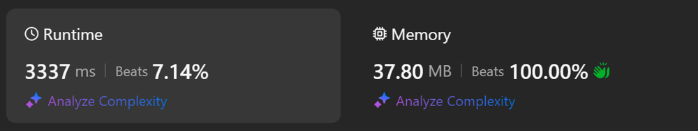

# Kotlin. Beats 7% (3337 ms). PriorityQueue (original, but slow :))

**Author:** mobdev778
**Votes:** 3
**Link:** [https://leetcode.com/problems/find-k-th-smallest-pair-distance/solutions/5634547/](https://leetcode.com/problems/find-k-th-smallest-pair-distance/solutions/5634547/)

---



# Code
```
class Solution {
    fun smallestDistancePair(nums: IntArray, k: Int): Int {
        Arrays.sort(nums)
        val pq = PriorityQueue<Pointer>()
        for (i in 0 until nums.size - 1) {
            pq.offer(Pointer(nums, nums[i], i + 1))
        }

        for (i in 1 until k) {
            val p = pq.poll()
            p.next()
            if (p.distance != Int.MAX_VALUE) pq.offer(p)
        }
        return pq.poll().distance
    }

    class Pointer(val nums: IntArray, val first: Int, var i: Int) : Comparable<Pointer> {
        var distance = nums[i] - first

        fun next() {
            i++
            if (i < nums.size) { distance = nums[i] - first }
            else { distance = Int.MAX_VALUE }
        }

        override fun compareTo(other: Pointer): Int = distance - other.distance
    }
}
```

# Approach

I tried to apply an algorithm similar to the merging sort algorithm of N arrays simultaneously.

The approach is simple - we have several sequences of pairs:

Sequence 0: (nums[0], nums[1]), (nums[0], nums[2]) ...
Sequence 1: (nums[1], nums[2]), (nums[1], nums[3]) ...
..
Sequence N-1: (nums[n - 1], nums[n])

or
Sequence 0: (1, 1), (1, 3)
Sequence 1: (1, 3)

for `intArrayOf(1,1,3)`

We place pointers to all these sequences in the priority queue and select the pointer that can currently provide us with the minimum distance pair (the initial array must be sorted).

Step 0:
Pointer 0: (1, 1), distance = 0
Pointer 1: (1, 3), distance = 2

In this case, the pointer itself within the sequence shifts to the right by 1 position and returns to the priority queue.

Step 1:
Pointer 0: (1, 3), distance = 2
Pointer 1: (1, 3), distance = 2

If the pointer has reached the tail of the sequence, then we consider that the distance in the pair is equal to infinity (Int.MAX_VALUE). Such a pointer should not be put back into the priority queue.

We need to process "k-1" pointers and return the pair of the k-th pointer (or rather, not a pair, but the distance between the elements in the pair).

For large "k" it is more advantageous to find the required distance by calculating distances using the halving method:


```
class Solution {

    fun smallestDistancePair(nums: IntArray, k: Int): Int{
        Arrays.sort(nums)

        var left = 0
        var right = nums[nums.size - 1] - nums[0]

        while (left < right) {
            val midDist = (left + right) shr 1
            val pairs = countPairs(nums, midDist)

            if (pairs >= k) {
                right = midDist
            } else {
                left = midDist + 1
            }
        }

        return left
    }

    private fun countPairs(nums: IntArray, mid: Int): Int {
        var count = 0
        var j = 0

        for (i in nums.indices) {
            count -= i
            while (j < nums.size && nums[j] <= mid + nums[i]) {
                j++
            }
            count += j
        }
        count -= nums.size

        return count
    }
}
```