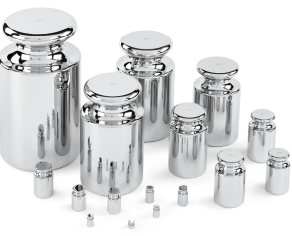

# Python/Go/Java/JS/C++ O(n) sol. by Balance scale. [w/ Animation] 有中文解題文章

**Author:** brianchiang_tw
**Votes:** 214
**Link:** [https://leetcode.com/problems/find-pivot-index/solutions/512992/](https://leetcode.com/problems/find-pivot-index/solutions/512992/)

---

[Tutorial video in Chinese \u4E2D\u6587\u89E3\u984C\u5F71\u7247](https://www.youtube.com/watch?v=hK9gdtn2zq0)

[\u4E2D\u6587\u8A73\u89E3 \u89E3\u984C\u6587\u7AE0](https://vocus.cc/article/655b6d6ffd89780001b34a15)

[\u7528Python\u4F86\u5BE6\u73FEPrefix Sum](https://vocus.cc/article/66d59867fd897800014586cd)

[\u5F9E"\u524D\u7DB4\u548C"\u67E5\u8868\u9AD8\u901F\u8A08\u7B97"\u5340\u9593\u548C"\u7684\u6559\u5B78\u5C08\u6B04](https://vocus.cc/article/660402f4fd8978000101b7b4)

O(n) sol. by Balance scale.

---
# Animation of Balance scale algorithm


---

**Hint**:

#1.
Think of the **Balance scale** in laboratory or traditional markets.


#2.
Imagine each **number** from input list as a **weight**.



#3
Turn the finding of pivot index with left hand sum = right hand sum into the **procedure of reaching the balance on boths sides**.


---

**Algorithm**:

---

Step_#1:

Let 
**Left hand side be empty**, and
**Right hand side holds all weights**.

---

Step_#2:

Iterate weight_*i* from 0 to (n-1)

During each iteration, **take away weight_#i from right hand side**, **check whether balance is met** or not.

**If yes**, then the **index *i*** is the **pivot index**.

If no, **put weight_#*i* on the left hand side**, and **repeat the process** until balance is met or all weights are exchanged.

---

Step_#3:

Finally, if all weights are exchanged and no balance is met, then pivot index does not exist, return -1.

---


```python []
class Solution:
    def pivotIndex(self, nums: List[int]) -> int:
        
        # Initialization:
        # Left hand side be empty, and
        # Right hand side holds all weights.
        total_weight_on_left, total_weight_on_right = 0, sum(nums)

        for idx, current_weight in enumerate(nums):

            total_weight_on_right -= current_weight

            if total_weight_on_left == total_weight_on_right:
                # balance is met on both sides
                # i.e., sum( nums[ :idx] ) == sum( nums[idx+1: ] )
                return idx

            total_weight_on_left += current_weight

        return -1
```
```javascript []
function Accumulation(arr){
    return arr.reduce((a,b)=>a+b);  
}

var pivotIndex = function(nums) {
    

    // Initialization:
    // Left hand side be empty, and
    // Right hand side holds all weights.
    
    let totalWeightOnLeft = 0;
    let totalWeightOnRight = Accumulation(nums);
    
    for( let i = 0 ; i < nums.length ; i++ ){
        
        let currentWeight = nums[i];
        
        totalWeightOnRight -= currentWeight;
        
        if( totalWeightOnLeft == totalWeightOnRight ){
            // balance is met on both sides
            return i;
        }
        
        totalWeightOnLeft += currentWeight
        
        
    }
    
    return -1;
    
};
```
```java []
class Solution {
    public int pivotIndex(int[] nums) {
        
        // Initialization:
        // Left hand side be empty, and
        // Right hand side holds all weights.
        int totalWeightOnLeft = 0;
        int totalWeightOnRight = IntStream.of( nums ).sum();
        
        for( int i = 0 ; i < nums.length ; i++ ){
            
            int curWeight = nums[i];
            
            totalWeightOnRight -= curWeight;
            
            if( totalWeightOnLeft == totalWeightOnRight ){
                // balance is met on both sides
                return i;
            }
            
            totalWeightOnLeft  += curWeight;
        }
        
        return -1;
    }
}
```
```Go []
func accumulation(nums []int) int{
    
    summation := 0
    
    for _, num := range nums{
        summation += num    
    }
    
    return summation
}


func pivotIndex(nums []int) int {
    
    // Initialization
    // Left hand side be empty
    // Right hand side holds all weights
    totalWeightOnLeft := 0
    totalWeightOnRight := accumulation( nums )
    
    for idx, currentWeight := range nums{
        
        totalWeightOnRight -= currentWeight
        
        if totalWeightOnLeft == totalWeightOnRight{
            // balance is met on both sides
            return idx
        }
        
        totalWeightOnLeft += currentWeight
    }
    
    return -1
    
}
```
```C++ []
class Solution {
public:
    int pivotIndex(vector<int>& nums) {
        
        // Initialization:
        // Left hand side be empty, and
        // Right hand side holds all weights.
        
        int totalWeightOnLeft = 0;
        int totalWeightOnRight = std::accumulate( nums.begin(), nums.end(), 0);
        
        
        for(std::size_t i = 0; i < nums.size() ; i++ ){
            
            int currentWeight = nums[i];
            
            totalWeightOnRight -= currentWeight;
            
            if( totalWeightOnLeft == totalWeightOnRight ){
                // balance is met on both sides
                return i;
            }
            
            totalWeightOnLeft += currentWeight;
        }
        
        
        return -1;
    }
};
```

---

Time Complexity: O(n) on for loop iteration, and summation of input array.

Sapce Complexity: O(1) on fixed size of temp variables.

---

Share traditional solution based on prefix sum

```python []
class Solution:
    def pivotIndex(self, nums: List[int]) -> int:
        
        # s = prefix sum of array
        # s[i] = nums[0] + nums[1] + ... + nums[i]
        s = list( itertools.accumulate(nums) )
        total_sum = sum( nums )

        # Linear scan on each index
        for i in range( len(nums) ):

            left_sum = s[i-1] if i >= 1 else 0
            right_sum = total_sum - s[i]

            # Find pivot index from definition
            if left_sum == right_sum:
                return i

        return -1
```

Time complexity: O(n) on linear scan as well as prefix sum table

Space complexity: O( n ) on the size of prefix sum table 


