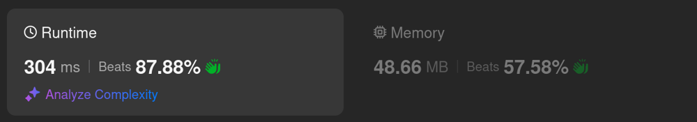
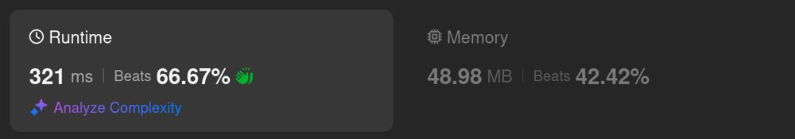

# Kotlin. Beats 87% (304 ms). TreeSet + custom "compareTo" method

**Author:** mobdev778
**Votes:** 4
**Link:** [https://leetcode.com/problems/my-calendar-i/solutions/5836590/](https://leetcode.com/problems/my-calendar-i/solutions/5836590/)

---



# Code
```kotlin []
class MyCalendar() {

    private val intervals = TreeSet<Interval>()

    fun book(start: Int, end: Int): Boolean = intervals.add(Interval(start, end))
}

class Interval(val start: Int, val end: Int): Comparable<Interval> {

    override fun compareTo(other: Interval): Int = when {
        end <= other.start -> -1
        start >= other.end -> 1
        else -> 0
    }
}
```

# Approach

To understand how this code works, it is enough to remember how TreeSet works.

Unlike PriorityQueue, TreeSet does not allow "duplicates" inside its set. This means that if some element is already in this set, it will return the result "false" when calling the 
```
fun TreeSet.add(element): Boolean
```
method.

Inside TreeSet there is a red-black tree, with the help of which the binary search method in O(log N) time determines whether the tree already contains the element being added or not.

All elements added to the tree must implement the "Comparable" interface. Based on the calls of 
```
fun Interval.compareTo(Interval): Int
```
, the tree will find the insertion position for the new tree node, and also perform subsequent balancing.

This method should work as follows:
1) if a < b then `a.compareTo(b) == -1` 
2) if a > b then `a.compareTo(b) == 1`
3) if a == b then `a.compareTo(b) == 0`

To compare intervals with each other, we can use only 3 rules:

1) The current element must be to the left of the specified interval, if its right border of the current one is to the left of the left border of the specified interval. In this case we should return "-1".

```
val a = Interval(10, 15)
val b = Interval(20, 30)
val c = a.compareTo(b) // c == -1
// 15 <= 20 == true
```

2) The current element should be to the right of the given interval if its left border is to the right of the right border of the given interval. In this case we should return "1".

```
val a = Interval(20, 30)
val b = Interval(10, 15)
val c = a.compareTo(b) // c == 1
// 30 <= 10 == false
// 20 >= 15 == true
```

3) If the intervals intersect, we consider them equal and return 0.

```
val a = Interval(10, 20)
val b = Interval(15, 25)
val c = a.compareTo(b) // c == 0
// 20 <= 15 == false
// 10 >= 25 == false
```

Of course, such intervals may have different values \u200B\u200Bfor "start" and "end", but we should consider them "equal" from the point of view of "TreeSet" to avoid adding "doubles" to the set, i.e. intersecting intervals.

# Alternative approach



```
class MyCalendar() {

    private val intervals = TreeSet<Interval> { a, b -> when {
        a.end <= b.start -> -1
        a.start >= b.end -> 1
        else -> 0
    }}

    fun book(start: Int, end: Int): Boolean = intervals.add(Interval(start, end))
}

class Interval(val start: Int, val end: Int)
```