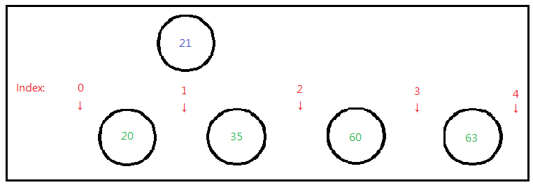

# 🐍Python || Detailed Explanation✅ || Easy Understand || No Libray || Binary Search

**Author:** wingskh
**Votes:** 44
**Link:** [https://leetcode.com/problems/my-calendar-i/solutions/2372304/](https://leetcode.com/problems/my-calendar-i/solutions/2372304/)

---

**Appreciate if you could upvote this solution**

**Binary Search**
The basic idea is that we need to do a **leftmost** binary search to find the location for the start and end when adding an event.

For example, the current calendar is `[[10, 20], [25, 35], [50, 60], [61, 63]]` 
and we want to add an event with time `[21, 24]`

We need to search the location for ***start time*** `21` between all the ***end times*** in the current calendar `[20, 35, 60, 63]`.
The suitable location should be the left-hand side of the smallest value that is larger than the input start time. 
Thus, it is `index 1` in this case.


Then, we need to compare
- the input `start time` with the **end time of previous node**
- the input `end time` with the **start time of next node**
<br/>
```
import collections

class MyCalendar:
    def __init__(self):
        self.calendar = []
		# Use Linked List instead, much more faster
		# self.calender = collections.deque()

    def book(self, start: int, end: int) -> bool:
        right = len(self.calendar)
        if right == 0:
            self.calendar.append((start, end))
            return True

        left = 0
        while left < right:
            mid = int(left + (right - left)/2)
            if self.calendar[mid][1] <= start:
                left = mid + 1
            else:
                right = mid

        if left == len(self.calendar):
            self.calendar.append((start, end))
            return True
                
        if self.calendar[left][0] >= end:
            self.calendar.insert(left, (start, end))
            return True
            
        return False
```
**Time complexity**: 
- Overall: `O(n^2)`
- Ignore insertion to calendar: `O(n log(n))`

**Space complexity**: `O(n)`
<br/>