# Full Sweep Line Concept + Dry Run + illustration + Brute Submission Faster?

**Author:** Rarma
**Votes:** 48
**Link:** [https://leetcode.com/problems/my-calendar-ii/solutions/5838424/](https://leetcode.com/problems/my-calendar-ii/solutions/5838424/)

---

# Youtube Explanation
Coming Soon on Channel : https://www.youtube.com/@Intuit_and_Code
Edited:
https://youtu.be/Bk2PK9evrPs?si=UBAjTnDzgMICskAJ

# Intuition & Approach

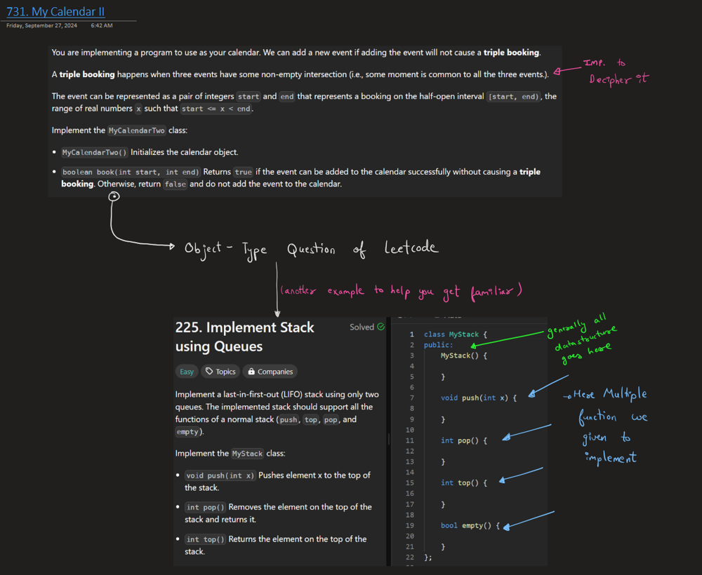
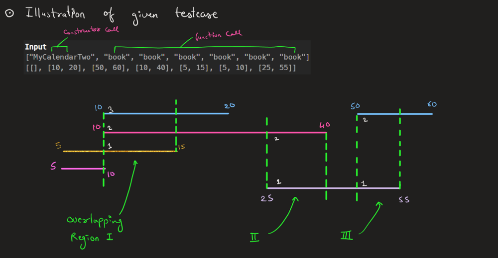
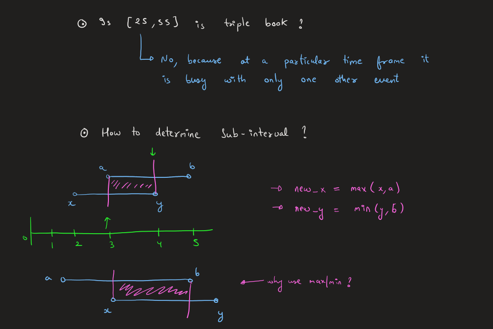
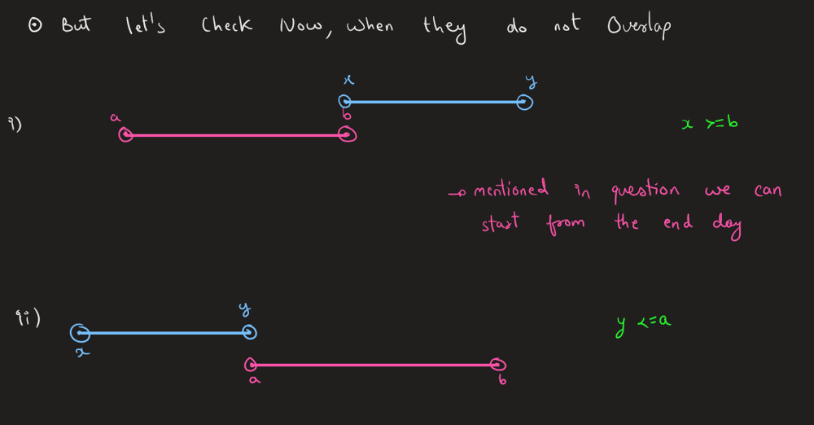

What we will do is check for every sub-interval, how many times it is overlapping with other interval present in vector uptill now.

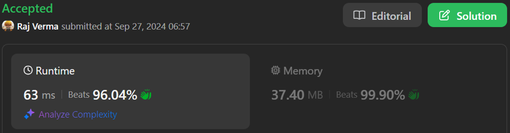

# Code
``` C++ [ ]
// Logical - Brute Approach

class MyCalendarTwo {
public:
    vector<pair<int,int>> vp;
    MyCalendarTwo() {
        // Don't Do anything
    }
    
    bool book(int x, int y) {
        for(auto &val:vp){
            int a = val.first, b = val.second;

            if((x<b) and (y>a)){
                // calculate sub-interval
                int new_x = max(a,x);
                int new_y = min(b,y);

                // checking if the sub-interval is valid or not
                if(check(new_x, new_y)){
                    return false;
                }
            }

        }

        vp.push_back({x,y});
        return true;
    }

    // checking if sub-interval get overlapped more than single time
    bool check(int x, int y){
        int overlapp_cnt = 0;

        for(int i=0;i<vp.size();i++){
            int a = vp[i].first, b = vp[i].second;

            if((x<b) and (y>a)){ // strict condition for overlapping
                overlapp_cnt++;
                if(overlapp_cnt == 2){
                    return true;
                }
            }
        }

        return false;
    }
};
```
``` java [ ]
class MyCalendarTwo {
    // List to hold the booked intervals
    private List<int[]> bookings;

    public MyCalendarTwo() {
        bookings = new ArrayList<>();
    }
    
    public boolean book(int start, int end) {
        // Check for overlaps with existing bookings
        for (int[] interval : bookings) {
            int a = interval[0], b = interval[1];

            // Check if the new booking overlaps with the existing interval
            if (start < b && end > a) {
                // Calculate the overlapping sub-interval
                int newStart = Math.max(a, start);
                int newEnd = Math.min(b, end);

                // Check if the sub-interval overlaps more than once
                if (check(newStart, newEnd)) {
                    return false;  // Overlapping more than once, booking fails
                }
            }
        }

        // If there are no conflicts, add the booking
        bookings.add(new int[] {start, end});
        return true;  // Booking successful
    }

    // Check if the sub-interval overlaps more than once
    private boolean check(int start, int end) {
        int overlapCount = 0;

        for (int[] interval : bookings) {
            int a = interval[0], b = interval[1];

            // Check for strict overlap
            if (start < b && end > a) {
                overlapCount++;
                if (overlapCount == 2) {
                    return true;  // Found more than one overlap
                }
            }
        }

        return false;  // No overlapping found
    }
}
```
``` Python []
class MyCalendarTwo:
    def __init__(self):
        # List to hold the booked intervals
        self.bookings = []
        
    def book(self, start: int, end: int) -> bool:
        # Check for overlaps with existing bookings
        for a, b in self.bookings:
            # Check if the new booking overlaps with the existing interval
            if start < b and end > a:
                # Calculate the overlapping sub-interval
                new_start = max(a, start)
                new_end = min(b, end)
                
                # Check if the sub-interval overlaps more than once
                if self.check(new_start, new_end):
                    return False  # Overlapping more than once, booking fails
        
        # If there are no conflicts, add the booking
        self.bookings.append((start, end))
        return True  # Booking successful
    
    def check(self, start: int, end: int) -> bool:
        overlap_count = 0
        
        for a, b in self.bookings:
            # Check for strict overlap
            if start < b and end > a:
                overlap_count += 1
                if overlap_count == 2:
                    return True  # Found more than one overlap
        
        return False  # No overlapping found
```
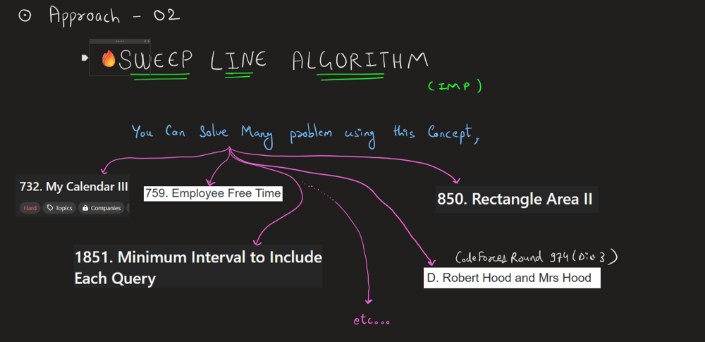
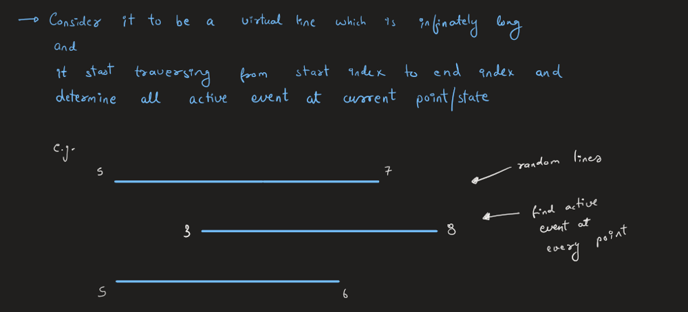
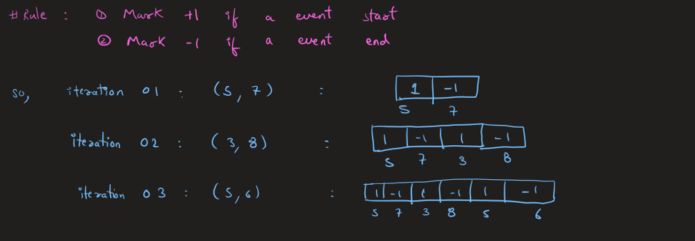
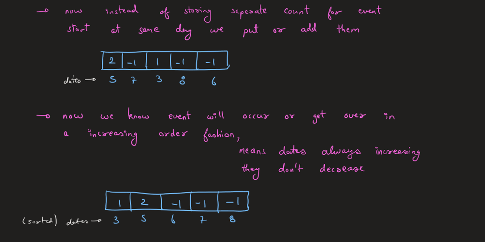

> Terms,
Open means active event / if event start
Clost means event end at that day

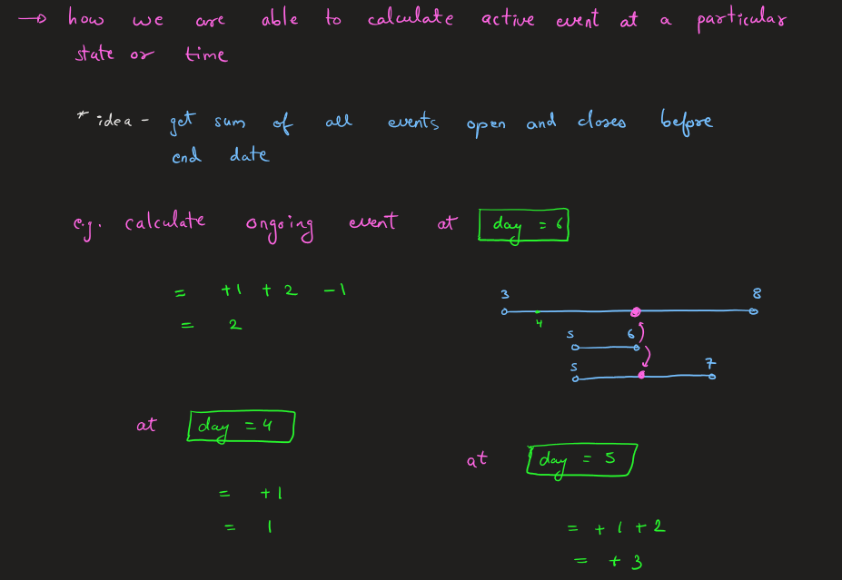
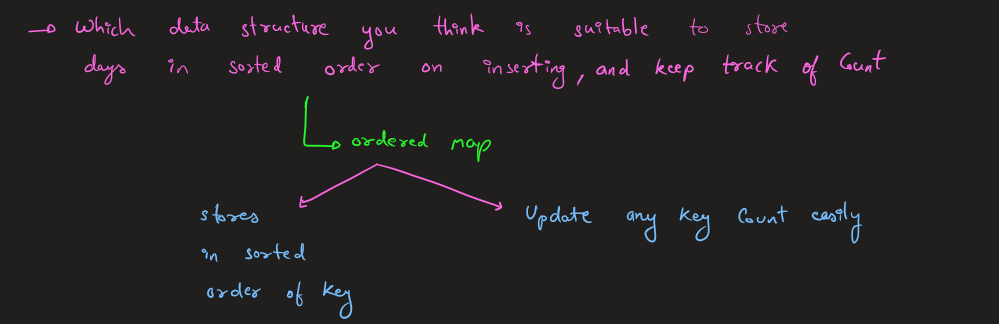


# Code
```cpp []
// Sweep Line - Approach

class MyCalendarTwo {
public:
    map<int, int> events;
    
    MyCalendarTwo() {
        // Nothing to do here
    }
    
    bool book(int start, int end) {
        // First Add the event
        // Increment start by +1 (start of booking)
        events[start]++;
        // Decrement end by -1 (end of booking)
        events[end]--;
        
        // sum of all booking at particular event
        int activeBookings = 0;
        
        // Sweep through the events in chronological order
        for (auto &event : events) {
            // get all the sum
            activeBookings += event.second;
            
            // If we have 3 or more overlapping bookings, it's a triple booking
            if (activeBookings >= 3) {
                // Revert the changes, as the booking is not valid
                events[start]--;
                events[end]++;
                
                // delete from map, as they are not of need
                if (events[start] == 0) {events.erase(start);}
                if (events[end] == 0) {events.erase(end);}

                return false;
            }

            if(event.first > end){
                break;
            }
        }
        
        // Booking is successful if no triple booking is found
        return true;
    }
};

```
``` Java [ ]
class MyCalendarTwo {
    private TreeMap<Integer, Integer> events;

    public MyCalendarTwo() {
        events = new TreeMap<>();
    }
    
    public boolean book(int start, int end) {
        // Increment start by +1 (start of booking)
        events.put(start, events.getOrDefault(start, 0) + 1);
        // Decrement end by -1 (end of booking)
        events.put(end, events.getOrDefault(end, 0) - 1);
        
        int activeBookings = 0;
        
        // Sweep through the events in chronological order
        for (int count : events.values()) {
            activeBookings += count;
            
            // If we have 3 or more overlapping bookings, it's a triple booking
            if (activeBookings >= 3) {
                // Revert the changes, as the booking is not valid
                events.put(start, events.get(start) - 1);
                events.put(end, events.get(end) + 1);

                // Remove from map if count reaches zero
                if (events.get(start) == 0) {
                    events.remove(start);
                }
                if (events.get(end) == 0) {
                    events.remove(end);
                }
                
                return false; // Booking failed
            }

            if (events.higherKey(start) != null && events.higherKey(start) > end) {
                break; // No need to check further
            }
        }
        
        // Booking is successful if no triple booking is found
        return true;
    }
}
```
``` Python [ ]
class MyCalendarTwo:
    def __init__(self):
        # Dictionary to hold the events
        self.events = defaultdict(int)

    def book(self, start: int, end: int) -> bool:
        # Increment start by +1 (start of booking)
        self.events[start] += 1
        # Decrement end by -1 (end of booking)
        self.events[end] -= 1
        
        active_bookings = 0
        
        # Sweep through the events in chronological order
        for time in sorted(self.events.keys()):
            active_bookings += self.events[time]
            
            # If we have 3 or more overlapping bookings, it's a triple booking
            if active_bookings >= 3:
                # Revert the changes, as the booking is not valid
                self.events[start] -= 1
                self.events[end] += 1
                
                # Remove from dict if count reaches zero
                if self.events[start] == 0:
                    del self.events[start]
                if self.events[end] == 0:
                    del self.events[end]
                
                return False  # Booking failed
            
            if time > end:
                break  # No need to check further
        
        # Booking is successful if no triple booking is found
        return True
```

> Want To do More practice with Sweep Line,
Refer **[this](https://leetcode.com/discuss/study-guide/2166045/line-sweep-algorithms)** Article.