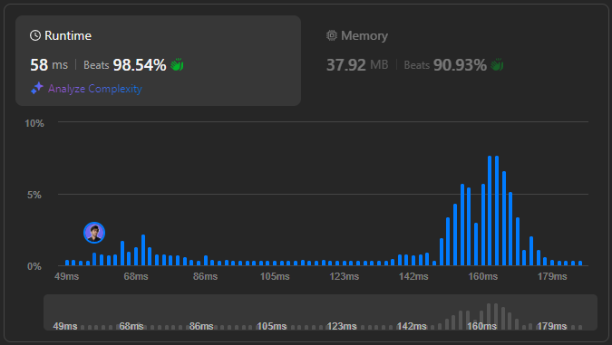

# 🌟 Step-by-Step Guide to Solving My Calendar II in All Languages 🔥💯

**Author:** withaarzoo
**Votes:** 22
**Link:** [https://leetcode.com/problems/my-calendar-ii/solutions/5838458/](https://leetcode.com/problems/my-calendar-ii/solutions/5838458/)

---


Explore a collection of solutions to LeetCode problems in multiple programming languages. Each solution includes a detailed explanation and step-by-step approach to solving the problem efficiently. Whether you're a beginner looking to learn or an experienced coder seeking optimized solutions, this repository aims to provide clear and insightful approaches to tackling challenging LeetCode problems.

### **Access daily LeetCode Solutions Repo :** [click here](https://github.com/withaarzoo/LeetCode-Solutions)

---



---

# Intuition
The problem involves booking events while ensuring no triple bookings. A brute force approach would involve checking all existing events to detect overlaps, but that would be inefficient. Instead, we can maintain two lists: 
- One for single bookings (no overlaps).
- One for double bookings (overlaps between two events).

For each new event, we check if it overlaps with any double-booked interval (which would cause a triple booking). If no triple booking is found, we check for overlaps with single bookings and update the double booking list accordingly.

# Approach
1. Maintain two lists: one for single bookings and another for double bookings.
2. For each new event, check if it overlaps with any double booking. If so, reject the event.
3. If it overlaps only with single bookings, add the overlapping part to the double bookings list.
4. Add the new event to the single booking list.

This ensures that no more than two events overlap in any time interval.

# Complexity
- **Time complexity**:  
  The time complexity is $$O(n)$$ for each booking, where \\(n\\) is the number of previous bookings. We need to check each event in both the single and double bookings.
  
- **Space complexity**:  
  The space complexity is $$O(n)$$ as we store up to \\(n\\) intervals in the single and double booking lists.

# Code

```C++ []
class MyCalendarTwo {
    vector<pair<int, int>> single; // stores single booked intervals
    vector<pair<int, int>> double_booked; // stores double booked intervals
    
public:
    MyCalendarTwo() {}
    
    bool book(int start, int end) {
        // Check if the event would cause a triple booking by overlapping with any double booking
        for (const auto& [s, e] : double_booked) {
            if (max(start, s) < min(end, e)) {
                return false; // Triple booking found
            }
        }
        
        // Add overlapping parts to double bookings
        for (const auto& [s, e] : single) {
            if (max(start, s) < min(end, e)) {
                double_booked.push_back({max(start, s), min(end, e)});
            }
        }
        
        // Add the event to single bookings
        single.push_back({start, end});
        return true;
    }
};

```
```Java []
import java.util.ArrayList;
import java.util.List;

class MyCalendarTwo {
    List<int[]> single = new ArrayList<>();
    List<int[]> doubleBooked = new ArrayList<>();
    
    public MyCalendarTwo() {}
    
    public boolean book(int start, int end) {
        // Check for triple booking by overlapping with double booked intervals
        for (int[] booking : doubleBooked) {
            if (Math.max(start, booking[0]) < Math.min(end, booking[1])) {
                return false; // Triple booking detected
            }
        }
        
        // Add overlapping parts to double bookings
        for (int[] booking : single) {
            if (Math.max(start, booking[0]) < Math.min(end, booking[1])) {
                doubleBooked.add(new int[]{Math.max(start, booking[0]), Math.min(end, booking[1])});
            }
        }
        
        // Add the new event to single bookings
        single.add(new int[]{start, end});
        return true;
    }
}

```
```JavaScript []
var MyCalendarTwo = function() {
    this.single = []; // Stores single booked intervals
    this.doubleBooked = []; // Stores double booked intervals
};

/** 
 * @param {number} start 
 * @param {number} end
 * @return {boolean}
 */
MyCalendarTwo.prototype.book = function(start, end) {
    // Check for triple booking by overlapping with double booked intervals
    for (let [s, e] of this.doubleBooked) {
        if (Math.max(start, s) < Math.min(end, e)) {
            return false; // Triple booking detected
        }
    }
    
    // Add overlapping parts to double bookings
    for (let [s, e] of this.single) {
        if (Math.max(start, s) < Math.min(end, e)) {
            this.doubleBooked.push([Math.max(start, s), Math.min(end, e)]);
        }
    }
    
    // Add the event to single bookings
    this.single.push([start, end]);
    return true;
};

```
```Python []
class MyCalendarTwo:

    def __init__(self):
        self.single = []  # Stores single booked intervals
        self.double_booked = []  # Stores double booked intervals

    def book(self, start: int, end: int) -> bool:
        # Check if the event overlaps with any double booking, which would cause a triple booking
        for s, e in self.double_booked:
            if max(start, s) < min(end, e):
                return False  # Triple booking found
        
        # Add the overlapping parts to double bookings
        for s, e in self.single:
            if max(start, s) < min(end, e):
                self.double_booked.append((max(start, s), min(end, e)))
        
        # Add the event to single bookings
        self.single.append((start, end))
        return True

```
```Go []
type MyCalendarTwo struct {
    single []Interval
    doubleBooked []Interval
}

type Interval struct {
    start, end int
}

func Constructor() MyCalendarTwo {
    return MyCalendarTwo{}
}

func (this *MyCalendarTwo) Book(start int, end int) bool {
    // Check for triple booking by overlapping with double booked intervals
    for _, booking := range this.doubleBooked {
        if max(start, booking.start) < min(end, booking.end) {
            return false // Triple booking detected
        }
    }
    
    // Add overlapping parts to double bookings
    for _, booking := range this.single {
        if max(start, booking.start) < min(end, booking.end) {
            this.doubleBooked = append(this.doubleBooked, Interval{max(start, booking.start), min(end, booking.end)})
        }
    }
    
    // Add the event to single bookings
    this.single = append(this.single, Interval{start, end})
    return true
}

func max(a, b int) int {
    if a > b {
        return a
    }
    return b
}

func min(a, b int) int {
    if a < b {
        return a
    }
    return b
}

```

---

# Step-by-Step Detailed Explanation

1. **Initialization**:  
   We initialize two lists: `single` to store intervals that are booked once and `double_booked` to store intervals that overlap (double bookings).

2. **Checking for Triple Booking**:  
   When a new booking request comes, we first check if it overlaps with any interval in `double_booked`. If there\u2019s an overlap, it would cause a triple booking, and we reject the event.

3. **Handling Overlaps**:  
   If there is no triple booking, we check for overlaps with intervals in `single`. Any overlapping part is moved into the `double_booked` list.

4. **Adding the Event**:  
   Finally, the event is added to the `single` list as long as no triple booking occurs.

---


