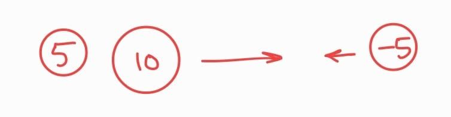
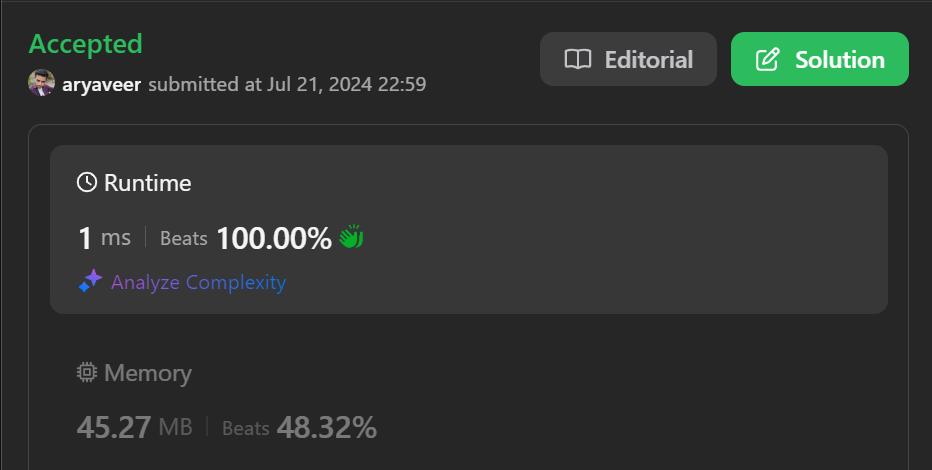

# Beats 100%🔥(1ms) Virtual Stack Solution.

**Author:** veer1214
**Votes:** 6
**Link:** [https://leetcode.com/problems/asteroid-collision/solutions/5513014/](https://leetcode.com/problems/asteroid-collision/solutions/5513014/)

---

# Asteroid Armageddon \uD83D\uDD25: Only the Strongest Will Survive\u2694\uFE0F
Imagine the asteroid belt as a cosmic battlefield.
When a positive asteroid enters the scene (moving rightward "-->"), its no threat to those on its left. It peacefully joins the ranks of survivors.

But when a negative asteroid (moving left <--) shows up, it's trouble! This asteroid starts crashing into positive asteroids, one after the other. This keeps happening until a bigger positive asteroid stops it or the negative one destroys everything in its way and emerges victorious.

> Our plan is to gather the friendly positive asteroids. Then, when a mean negative asteroid arrives, we send the closest positive asteroid to fight it. This happens over and over, with positive versus negative, until only the strongest are left standing or no one.




# Virtual Stack 
1. Setting up: We'll start with an empty stack $$peek=\u22121$$.
The variable peek acts like a finger pointing to the last surviving asteroid in our list. There is no need for the stack data structure.

2. Checking each asteroid:

   1. Positive asteroid: We add it to the top of the stack and continue ($$peek++$$);
   2. Negative asteroid: For each asteroid
      *  If it collides and survives, we continue checking for more collisions ($$peek\u2212\u2212$$;)
      * If it collides and is destroyed, we mark it as not safe ($$isNegSafe=false$$).
      * if both are destroyed $$peek\u2212\u2212$$; $$isNagSafe=false$$;
 3. If the negative one doesn't collide or destroys all positive asteroids, we add it to the stack (if it's still safe $$isNagSafe==true$$).
> The survivors: The asteroids remaining in the stack are the ones that survived all the collisions!

# Complexity
This has a time complexity of O(n). The while loop is not running for every asteroid. In the outer loop we take every asteroid and check for it hence it gives us $$O(n)$$.

# There is no need to track the flag.
If you find that the negative is destroyed or unsafe then just skip it. And if it destroyed all the positives ones then it will reach the code 
$$asteroids[++peek]=asteroids[i]$$; 
(push to victorious negative asteroid).
Check out the second solution.
# Please UpVote \u2B06\uFE0F
# Code
```java [Java(flag)]
class Solution{
public int[] asteroidCollision(int[] asteroids) {
    int peek = -1; // Virtual stack 

    for (int i = 0; i < asteroids.length; i++) {
        if (asteroids[i] > 0) {
            asteroids[++peek] = asteroids[i]; // Rightward asteroid, push to stack
            continue; 
        }

        boolean isNagSafe = true; // to check if the negative asteroid we have, destroyed the others or being destroyed by other

        while (peek >= 0 && asteroids[peek] > 0) { 
            if (asteroids[peek] < Math.abs(asteroids[i])) { // Left is bigger
                peek--; // Pop smaller positive asteroid
            } else if (asteroids[peek] > Math.abs(asteroids[i])) { 
                isNagSafe = false; //negative one is destroyed 
                break; 
            }
            else{
                isNagSafe=false;
                peek--;
                break;
            }
        }

        if (isNagSafe) { // Leftward asteroid survived, push to stack
            asteroids[++peek] = asteroids[i];
        }
    }

    // Extract remaining asteroids
    return Arrays.copyOfRange(asteroids, 0, peek+1); // Cleaner way to copy subarray
}
}
```
```java [Java(withoutFlag)\uD83D\uDD25]
class Solution {
    public int[] asteroidCollision(int[] asteroids) {
        int peek=-1;
        loop:
        for(int i=0; i<asteroids.length; i++){
            if(asteroids[i]>0){
                asteroids[++peek]=asteroids[i];
                continue;
            }
            //once found out that the asteroids is negative: check is there is a positive asteroid available in the stack which we can hit
            while(peek>=0 && asteroids[peek]>0){
                    if(asteroids[peek]<Math.abs(asteroids[i])) peek--;
                    else if(asteroids[peek]>Math.abs(asteroids[i])) continue loop;
                    else {
                        peek--;
                        continue loop;
                    }
                    
                }
            // if the asteroid is negative or destroyed every positive asteroid add this giant asteroid in the virtual stack
            asteroids[++peek]=asteroids[i];
            
        }

        int[] ans=new int[peek+1];
        for(int i=0; i<=peek; i++) ans[i]= asteroids[i];
        
        return ans;
    }
}
```
```python []
class Solution(object):
    def asteroidCollision(self, asteroids):
        peek = -1  # Virtual stack (index of top element)

        for i in range(len(asteroids)):
            if asteroids[i] > 0:
                peek += 1
                asteroids[peek] = asteroids[i]  # Push positive asteroid
                continue

            isNegSafe = True

            while peek >= 0 and asteroids[peek] > 0:
                if asteroids[peek] < abs(asteroids[i]):
                    peek -= 1  # Positive destroyed, negative keeps going
                elif asteroids[peek] > abs(asteroids[i]):
                    isNegSafe = False  # Negative destroyed
                    break
                else:
                    isNegSafe = False  # Both destroyed
                    peek -= 1
                    break

            if isNegSafe:
                peek += 1
                asteroids[peek] = asteroids[i]  # Negative asteroid survives

        return asteroids[:peek + 1]

```
```C++ []
class Solution {
public:
    vector<int> asteroidCollision(vector<int>& asteroids) {
        int peek = -1; // Virtual stack

        for (int i = 0; i < asteroids.size(); i++) {
            if (asteroids[i] > 0) {
                asteroids[++peek] = asteroids[i]; // Push positive asteroid
                continue; 
            }

            bool isNegSafe = true;

            while (peek >= 0 && asteroids[peek] > 0) {
                if (asteroids[peek] < std::abs(asteroids[i])) {
                    peek--; // Positive destroyed, negative keeps going
                } else if (asteroids[peek] > std::abs(asteroids[i])) {
                    isNegSafe = false; // Negative destroyed
                    break; 
                } else { // Both destroyed
                    isNegSafe = false;
                    peek--;
                    break;
                }
            }

            if (isNegSafe) {
                asteroids[++peek] = asteroids[i];
            }
        }

        asteroids.resize(peek + 1); // Resize to contain only the survivors
        return asteroids;
    }
};
```
```javascript []
... sorry :(
```


