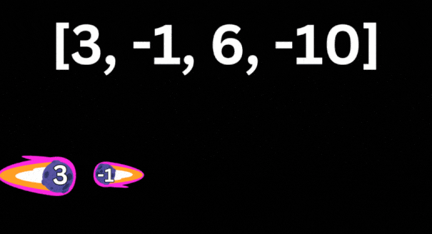

# ✅ O(2n) || PHP || Visual explanation🔥🔥🔥

**Author:** shahovkit
**Votes:** 3
**Link:** [https://leetcode.com/problems/asteroid-collision/solutions/4684915/](https://leetcode.com/problems/asteroid-collision/solutions/4684915/)

---



# Complexity
- Time complexity: O(2n)
Becouse only two operations - add and delete with all asteroids in baddest case.

- Space complexity: O(n)
Becouse stack may contains only all asteroids in baddest case.

# Code
```
class Solution {

    /**
     * @param Integer[] $asteroids
     * @return Integer[]
     */
    function asteroidCollision($asteroids) {
        $stack = [];
        foreach ($asteroids as $asteroid) {
            $crush = 1;
            while ($crush > 0 && $asteroid < 0 && !empty($stack) && end($stack) > 0) {
                /*
                Spaceship (<=>) for save separated info about crush
                -1 for convert negative int to positive
                (0 - is both crush, 1 - is current asteroid crush, -1 - is stack asteroid crush)
                */
                $crush = -1 * $asteroid <=> end($stack);
                if ($crush >= 0) { 
                    array_pop($stack); 
                }
            }
            if ($crush > 0) {
                array_push($stack, $asteroid);
            }
        }
        return $stack;
    }
}
```