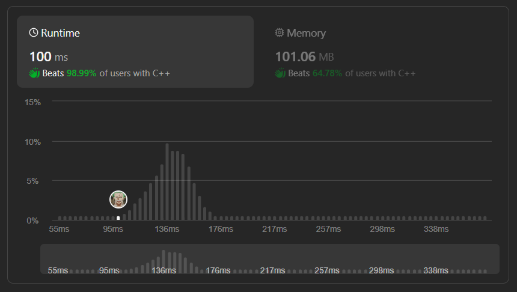

# ✅☑Beats 98.99% Users || [C++/Java/Python/JavaScript] || 2 Approaches || EXPLAINED🔥

**Author:** MarkSPhilip31
**Votes:** 107
**Link:** [https://leetcode.com/problems/daily-temperatures/solutions/4651687/](https://leetcode.com/problems/daily-temperatures/solutions/4651687/)

---

# PLEASE UPVOTE IF IT HELPED

---


---

# Approaches
(Also explained in the code)

#### ***Approach 1***
1. Initialize a deque to store indices of temperatures.
1. Initialize a result vector to store the days until a warmer temperature is encountered.
1. Iterate through the temperatures in reverse order.
1. If the deque is empty, push the current index and set the result for that index to 0.
1. If the deque is not empty, pop indices from the front of the deque while the current temperature is greater than or equal to the temperature at the front.
1. If the deque is empty after the above step, set the result for the current index to 0.
1. If the deque is not empty, set the result for the current index to the difference between the front of the deque and the current index.
1. Push the current index to the front of the deque.
1. Continue these steps for all temperatures.
1. Return the result vector.


# Complexity
- Time complexity:
   $$O(n)$$
    

- Space complexity:
   $$O(n)$$
    


# Code
```C++ []
class Solution {
public:
    vector<int> dailyTemperatures( vector<int>& temperatures) {
        deque<int> deque;
        
        vector<int> res(temperatures.size(), 0);

        for (int i = temperatures.size() - 1; i >= 0; --i) {
            if (deque.empty()) {
                deque.push_front(i);
                res[i] = 0;
            } else {
                while (!deque.empty() && temperatures[i] >= temperatures[deque.front()]) {
                    deque.pop_front();
                }

                if (deque.empty()) {
                    res[i] = 0;
                } else {
                    res[i] = deque.front() - i;
                }

                deque.push_front(i);
            }
        }

        return res;
    }
}; 


```
```Java []


class Solution {
    public int[] dailyTemperatures(int[] temperatures) {
        Deque<Integer> deque = new ArrayDeque<>();
        
        int[] res = new int[temperatures.length];

        for (int i = temperatures.length - 1; i >= 0; --i) {
            if (deque.isEmpty()) {
                deque.offerFirst(i);
                res[i] = 0;
            } else {
                while (!deque.isEmpty() && temperatures[i] >= temperatures[deque.peekFirst()]) {
                    deque.pollFirst();
                }

                if (deque.isEmpty()) {
                    res[i] = 0;
                } else {
                    res[i] = deque.peekFirst() - i;
                }

                deque.offerFirst(i);
            }
        }

        return res;
    }
}


```
```python3 []
from collections import deque

class Solution:
    def dailyTemperatures(self, temperatures):
        deq = deque()
        res = [0] * len(temperatures)

        for i in range(len(temperatures) - 1, -1, -1):
            if not deq:
                deq.appendleft(i)
                res[i] = 0
            else:
                while deq and temperatures[i] >= temperatures[deq[0]]:
                    deq.popleft()

                if not deq:
                    res[i] = 0
                else:
                    res[i] = deq[0] - i

                deq.appendleft(i)

        return res


```
```javascript []
/**
 * @param {number[]} temperatures
 * @return {number[]}
 */
var dailyTemperatures = function(temperatures) {
    const stack = [];
    const result = new Array(temperatures.length).fill(0);

    for (let i = temperatures.length - 1; i >= 0; --i) {
        while (stack.length > 0 && temperatures[i] >= temperatures[stack[0]]) {
            stack.shift();
        }

        if (stack.length === 0) {
            result[i] = 0;
        } else {
            result[i] = stack[0] - i;
        }

        stack.unshift(i);
    }

    return result;
};


```
---

#### ***Approach 2***

1. **Using vector instead of deque:**
    - Using only the front of the deque, so we can replace the deque with a vector.

1. **Avoid repeated array indexing:**
    - Instead of repeatedly accessing `temperatures[i]`, we are storing it in a variable, which might help in some cases.

# Complexity
- Time complexity:
   $$O(n)$$
    

- Space complexity:
   $$O(n)$$
    


# Code
```C++ []
class Solution {
public:
    vector<int> dailyTemperatures(vector<int>& temperatures) {
        vector<int> result(temperatures.size(), 0);
        vector<int> stack;

        for (int i = temperatures.size() - 1; i >= 0; --i) {
            int currTemperature = temperatures[i];

            while (!stack.empty() && currTemperature >= temperatures[stack.back()]) {
                stack.pop_back();
            }

            if (!stack.empty()) {
                result[i] = stack.back() - i;
            }

            stack.push_back(i);
        }

        return result;
    }
};


```
```Java []


class Solution {
    public int[] dailyTemperatures(int[] temperatures) {
        int[] result = new int[temperatures.length];
        Deque<Integer> stack = new ArrayDeque<>();

        for (int i = temperatures.length - 1; i >= 0; --i) {
            int currTemperature = temperatures[i];

            while (!stack.isEmpty() && currTemperature >= temperatures[stack.peekLast()]) {
                stack.pollLast();
            }

            if (!stack.isEmpty()) {
                result[i] = stack.peekLast() - i;
            }

            stack.offerLast(i);
        }

        return result;
    }
}


```
```python3 []

from collections import deque

class Solution:
    def dailyTemperatures(self, temperatures):
        result = [0] * len(temperatures)
        stack = []

        for i in range(len(temperatures) - 1, -1, -1):
            curr_temperature = temperatures[i]

            while stack and curr_temperature >= temperatures[stack[-1]]:
                stack.pop()

            if stack:
                result[i] = stack[-1] - i

            stack.append(i)

        return result


```
```javascript []

/**
 * @param {number[]} temperatures
 * @return {number[]}
 */
var dailyTemperatures = function(temperatures) {
    const result = new Array(temperatures.length).fill(0);
    const stack = [];

    for (let i = temperatures.length - 1; i >= 0; --i) {
        const currTemperature = temperatures[i];

        while (stack.length > 0 && currTemperature >= temperatures[stack[stack.length - 1]]) {
            stack.pop();
        }

        if (stack.length > 0) {
            result[i] = stack[stack.length - 1] - i;
        }

        stack.push(i);
    }

    return result;
};


```
---


# PLEASE UPVOTE IF IT HELPED

---
---


---