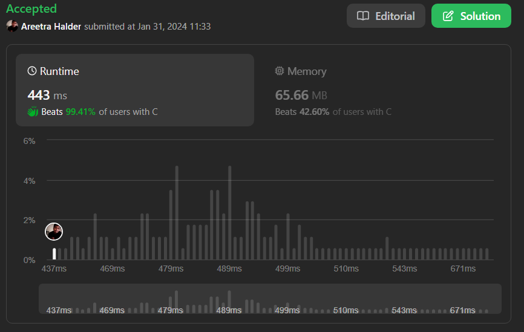

# ✅🔥🔥Beats 99.41% with Proof | Very Easy to Understand | Intuitive Approach 🔥🔥✅

**Author:** areetrahalder
**Votes:** 7
**Link:** [https://leetcode.com/problems/daily-temperatures/solutions/4652831/](https://leetcode.com/problems/daily-temperatures/solutions/4652831/)

---

# Proof - Upvote if you are watching the proof


> # Micro Optimization Tips
> * Use `while` loops instead of `for` or `foreach` loops
> * Instead of writing `top-1` in one line and `top--` in the other, Try using pre decrement and post decrement to increase execution time
> * Same goes with `top++`
> * To check if the stack is not empty using array i have used top > 0

# Intuition
<!-- Describe your first thoughts on how to solve this problem. -->
The solution uses a stack to keep track of indices of temperatures while iterating through the array. When a higher temperature is encountered, it calculates the waiting days and updates the answer array.

# Approach
<!-- Describe your approach to solving the problem. -->
Initialize an array for the answer and a stack. Iterate through temperatures, updating the answer when a warmer day is found. The stack stores indices, helping track waiting days efficiently.

1. Stack to Track Indices: A stack is used to keep track of the indices of the temperatures as we iterate through the array. The indices represent the days for which we are yet to find a warmer temperature.

2. Iterative Traversal: The algorithm iterates through the given array of temperatures, denoted by the variable `i`.
3. Comparing Temperatures: For each day (`temperatures[i]`), compare it with the temperature at the index stored on top of the stack (`temperatures[stack[top - 1]]`).
4. Updating Answer Array: If the current temperature is higher than the temperature at the top of the stack, update the answer for the index at the top of the stack with the difference in days: `answer[stack[top - 1]] = i - stack[--top]`.
5. Maintaining a Monotonic Stack: The stack is maintained in a way that it represents a monotonic decreasing sequence of temperatures. If the current temperature is not greater than the temperature at the top of the stack, push the current index onto the stack.
6. Efficient Waiting Days Calculation: As the stack only contains indices of temperatures with no future warmer days identified, the waiting days can be efficiently calculated when a warmer day is encountered. This is possible because the stack maintains a decreasing order of temperatures.
7. Handling Unresolved Cases: If there is no future day with a warmer temperature, the answer for that day remains 0, which is the default value for elements not updated in the array.

> Why it Works:
> * The stack helps efficiently identify the next warmer day for each temperature.
> * The monotonic decreasing stack ensures that we always have a reference to the most recent higher temperature encountered.
> * The approach avoids redundant calculations and efficiently determines the waiting days for each day.

In summary, this approach utilizes a monotonic stack to optimize the calculation of waiting days for temperatures, resulting in an efficient solution to the problem.

# Complexity
- Time complexity: $$O(n)$$
<!-- Add your time complexity here, e.g. $$O(n)$$ -->

- Space complexity: $$O(n)$$
<!-- Add your space complexity here, e.g. $$O(n)$$ -->

# Code
```Java []
class Solution {
    public int[] dailyTemperatures(int[] temperatures) {
        // Stack to store indices of temperatures, answer array for result
        int[] stack = new int[100000], answer = new int[temperatures.length];
        // Initialize index variable and stack top
        int i = 1, top = 1;

        // Iterate through the temperatures array
        while (i < temperatures.length) {
            // Check if the stack is not empty and current temperature is higher
            if (top > 0 && temperatures[stack[top - 1]] < temperatures[i]) {
                // Calculate waiting days and update answer
                answer[stack[top - 1]] = i - stack[--top];
            } else {
                // If no warmer day, push current index onto the stack
                stack[top++] = i++;
            }
        }

        // Return the final array of waiting days
        return answer;
    }
}
```
```C []
/**
 * Note: The returned array must be malloced, assume caller calls free().
 */
int* dailyTemperatures(int* temperatures, int temperaturesSize, int* returnSize) {
    // Initialize variables
    int* stack = (int*)malloc(temperaturesSize * sizeof(int));
    int* answer = (int*)malloc(temperaturesSize * sizeof(int));
    int top = 0;

    // Iterate through the temperatures array
    for (int i = 0; i < temperaturesSize; ++i) {
        // Check if the stack is not empty and current temperature is higher
        while (top > 0 && temperatures[stack[top - 1]] < temperatures[i]) {
            // Calculate waiting days and update answer
            int index = stack[--top];
            answer[index] = i - index;
        }

        // Push the current index onto the stack
        stack[top++] = i;
    }

    // Set answer for remaining indices with no future warmer days to 0
    for (int i = 0; i < temperaturesSize; ++i) {
        if (answer[i] < 0) {
            answer[i] = 0;
        }
    }

    // Set the return size
    *returnSize = temperaturesSize;

    // Free the stack memory
    free(stack);

    // Return the final array of waiting days
    return answer;
}
```
```C++ []
class Solution {
public:
    std::vector<int> dailyTemperatures(std::vector<int>& temperatures) {
        // Stack to store indices of temperatures, answer vector for result
        std::vector<int> answer(temperatures.size(), 0);
        std::stack<int> st;

        // Iterate through the temperatures vector
        for (int i = 0; i < temperatures.size(); ++i) {
            // Check if the stack is not empty and current temperature is higher
            while (!st.empty() && temperatures[i] > temperatures[st.top()]) {
                // Calculate waiting days and update answer for indices on the stack
                answer[st.top()] = i - st.top();
                st.pop();
            }

            // Push the current index onto the stack
            st.push(i);
        }

        // Return the final vector of waiting days
        return answer;
    }
};
```

```C# []
public class Solution {
    public int[] DailyTemperatures(int[] temperatures) {
        int[] stack = new int[100000];
        int[] answer = new int[temperatures.Length];
        int i = 1;
        int top = 1;

        // Iterate through the temperatures array
        while (i < temperatures.Length) {
            // Check if the stack is not empty and current temperature is higher
            if (top > 0 && temperatures[stack[top - 1]] < temperatures[i]) {
                // Calculate waiting days and update answer
                answer[stack[top - 1]] = i - stack[--top];
            } else {
                // If no warmer day, push current index onto the stack
                stack[top++] = i++;
            }
        }

        // Return the final array of waiting days
        return answer;
    }
}
```
```Python []
class Solution(object):
    def dailyTemperatures(self, temperatures):
        """
        :type temperatures: List[int]
        :rtype: List[int]
        """
        stack = []  # Stack to store indices of temperatures
        answer = [0] * len(temperatures)  # Answer array initialized with zeros
        
        i = 0  # Initialize index variable
        
        while i < len(temperatures):
            # Check if the stack is not empty and current temperature is higher
            while stack and temperatures[stack[-1]] < temperatures[i]:
                # Calculate waiting days and update answer for the index at the top of the stack
                index = stack.pop()
                answer[index] = i - index
            
            # Push current index onto the stack
            stack.append(i)
            i += 1  # Move to the next day
        
        return answer
```
```Python3 []
class Solution:
    def dailyTemperatures(self, temperatures: List[int]) -> List[int]:
        # Stack to store indices of temperatures, answer array for result
        stack, answer = [], [0] * len(temperatures)

        # Iterate through the temperatures array
        for i in range(len(temperatures)):
            # Check if the stack is not empty and current temperature is higher
            while stack and temperatures[stack[-1]] < temperatures[i]:
                # Calculate waiting days and update answer
                idx = stack.pop()
                answer[idx] = i - idx

            # Push current index onto the stack
            stack.append(i)

        # Return the final array of waiting days
        return answer
```
```Javascript []
/**
 * @param {number[]} temperatures
 * @return {number[]}
 */
var dailyTemperatures = function(temperatures) {
    const stack = [];
    const answer = new Array(temperatures.length).fill(0);

    for (let i = 0; i < temperatures.length; i++) {
        // Check if the stack is not empty and current temperature is higher
        while (stack.length > 0 && temperatures[i] > temperatures[stack[stack.length - 1]]) {
            const index = stack.pop();
            // Calculate waiting days and update answer
            answer[index] = i - index;
        }
        // Push current index onto the stack
        stack.push(i);
    }

    return answer;
};
```
```Typescript []
function dailyTemperatures(temperatures: number[]): number[] {
    // Stack to store indices of temperatures, answer array for result
    const stack: number[] = [];
    const answer: number[] = new Array(temperatures.length).fill(0);

    // Iterate through the temperatures array
    for (let i = 0; i < temperatures.length; i++) {
        // Check if the stack is not empty and current temperature is higher
        while (stack.length > 0 && temperatures[stack[stack.length - 1]] < temperatures[i]) {
            // Calculate waiting days and update answer
            const index = stack.pop()!;
            answer[index] = i - index;
        }

        // Push current index onto the stack
        stack.push(i);
    }

    // Return the final array of waiting days
    return answer;
}
```

# Upvote - Please

