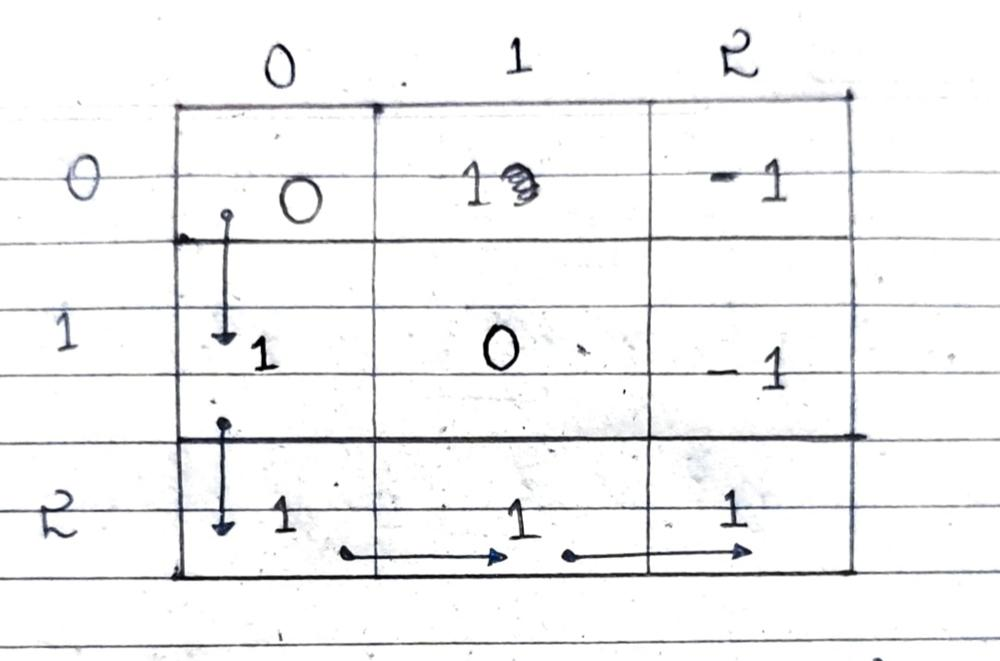
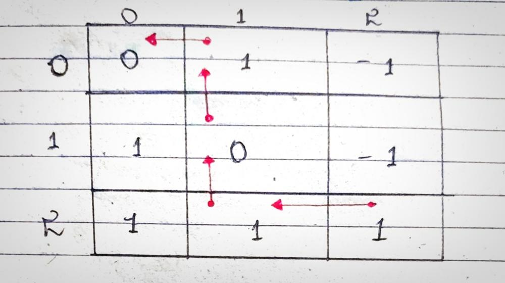
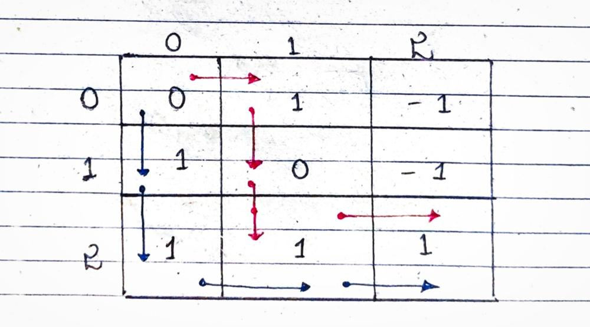
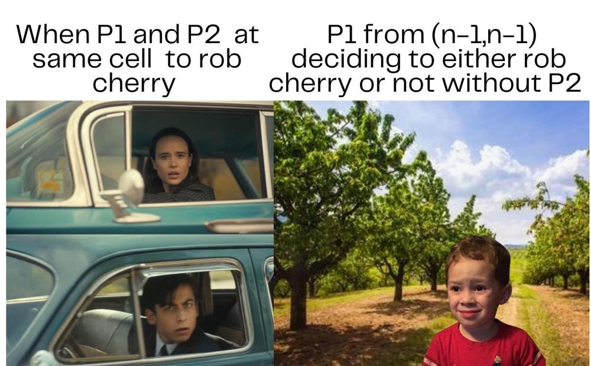

# Most Efficient + 2 intuitions +  explained with pictures + Best Explanation

**Author:** Sarim_Malik01
**Votes:** 43
**Link:** [https://leetcode.com/problems/cherry-pickup/solutions/5478591/](https://leetcode.com/problems/cherry-pickup/solutions/5478591/)

---


# Intuition
<!-- Describe your first thoughts on how to solve this problem. -->
This glorious question seems to be another easy one of dfs traversal using recursion and dynamic programming until we hit the part where we have to return from (n-1,n-1) to (0,0) while picking up maximum cherries again. 

This naive intuition of computing the maximum cherries collected separately for both paths: one from (0, 0) to (n-1, n-1) and another from (n-1, n-1) back to (0, 0) is wrong in several testcases and here's a glimpse of how the intution will look like :
# - **Naive Intuition : 1** ( Incorrect )
To traverse till the (n-1,n-1) while picking up maximum cherries using simple recursion and dp , then another recursion call which traverses from (n-1,n-1)  till (0,0) maximising the no. of cherries.

- **Approach of this intution will be :**
Certainly! Here are the key points of the algorithm:

Sure, here are the key points concisely:

1. **Initialization**:
   - If the grid has only one cell, return its value.
   - Create a copy of the grid (`grid2`).
   - Initialize a 2D array (`dp`) with -1.

2. **First Path (Top-Left to Bottom-Right)**:  **Helper1 function**
   - Calculate the maximum cherries collected from top-left to bottom-right using a helper function.
   - Update the copied grid (`grid2`) to remove cherries collected.

3. **Check for Early Termination**:
   - If the bottom-right cell has a cherry in both grids, return 0.

4. **Second Path (Bottom-Right to Top-Left)**:    **Helper2 function**
   - Reset `dp`.
   - Calculate the maximum cherries collected from bottom-right to top-left using another helper function.

5. **Combine Results**:
   - Sum the cherries collected from both paths and return the total.

**Failure of this approach**
-  Incorrect Path Marking
In this helper function, it attempts to mark the path by setting certain cells in grid2 to 0 when they are part of the path being explored. However, this marking isn't correctly managed across different paths or backtracks, which can lead to incorrect assumptions in the second part of this algorithm (helper2).


---

# - **Intuition : 2 ( Correct )**
The question clearly states that the path which we traverse will be rejected and another path will be traversed to maximise the no. of cherries during homecoming to (0,0) . Now when we dry run this statement in the following pictogtaphic dry run 

- When Person moves from (0,0) -> (2,2) with moves 
       - Down -> Down -> Right -> Right
       



- When Person moves from (2,2) -> (0,0) with moves 
       - Left -> Up -> Up -> Left
       



- These 2 dry runs when combined into one will look like this 



# **Kaboom** \uD83C\uDF89\uD83C\uDF89
This is exactly what we were looking for after first failed intuition , that is :
### **the combined dry run**  -> looks like two different people walking from the same starting point towards (n-1,n-1) while covering up cherries in their maximised way.

- Notice that when they encounter the same cell that is (2,1) the cherry is only added once that is because the first person would have taken that cherry earlier during traversal.


# Approach
<!-- Describe your approach to solving the problem. -->
We will need a :
####  **DP array of size n^3** (n : grid.length) to store the r1, c1 , c2 for memoisation
We won't store r2 as it will be specified for each recursive call as it follows r1+c1=r2+c2 as if the other person will always either right or down when first person moves .
 
Step By Step Approach will be : 
1. The helper function will be called with arguments as (grid,dp,r1,c1,c2)
2. The following if conditions will be checked
         a. The out of bounds for r1,c1,r2,c2 and grid[r1][c1] or grid[r2][c2] is -1 , if true return Integer.MIN_VAlUE
         b. The r1 and c1 if reach (n-1,n-1) then return the value stored there.
         c. The dp check : if the value is already stored return the value in r1,c1,c2 lest compute the value .
3. The cherry of current cell will be added after checking if the two persons are on same cell if they are add cherry only once lest add the cherry seperately for both the persons.
4. then recursive calls for 4 seperate cases is made for finding maximum cherries in subsequent cases :
### Combination of moves of P1 and P2

| P1 | P2 | r1 | c1 | r2 | c2 |
|----|----|----|----|----|----|
| Down   |  Down  |  r1+1  | c1 + 0   |  r1+1+c1-c2=+1   |  c2+0  |
| Down   |  Right  |  r1+1  | c1 + 0  | r1+c1-c2=+0 |  c2+1  |
| Right  |  Down  |  r1  | c1 + 1  | r1+c1+1-c2=+1   |  c2+0  |
| Right   |  Right  |  r1  | c1 + 1   | r1+c1-c2=+0   |  c2+1  |

5. The maxcherries are checked if that value is Integer.MIN_VALUE if that is then return maxcherries lest return maxcherries+cherry .


# Complexity
- Time complexity: O(n^3) - due to the number of unique states and recursive calls.

<!-- Add your time complexity here, e.g. $$O(n)$$ -->


- Space complexity:  O(n^3) - due to the memoization array.
<!-- Add your space complexity here, e.g. $$O(n)$$ -->


# Code
( Comments added in code for better explanation )
```python []
class Solution:
    def cherryPickup(self, grid):
        n = len(grid)
        memo = [[[-1] * n for _ in range(n)] for _ in range(n)]
        return max(0, self.dp(grid, memo, 0, 0, 0))
    
    def dp(self, grid, memo, r1, c1, c2):
        n = len(grid)
        r2 = r1 + c1 - c2
        
        # Out of bounds or thorn cell
        if r1 >= n or r2 >= n or c1 >= n or c2 >= n or grid[r1][c1] == -1 or grid[r2][c2] == -1:
            return float('-inf')
        
        # Memoization check
        if memo[r1][c1][c2] != -1:
            return memo[r1][c1][c2]
        
        # Base case: reached bottom-right corner
        if r1 == n - 1 and c1 == n - 1:
            return grid[r1][c1]
        
        # Calculate cherries collected at (r1, c1) and (r2, c2)
        cherries = grid[r1][c1] if r1 == r2 and c1 == c2 else grid[r1][c1] + grid[r2][c2]
        
        # Move right or down
        maxCherries = max(self.dp(grid, memo, r1, c1 + 1, c2), self.dp(grid, memo, r1 + 1, c1, c2))
        # Move down or right
        maxCherries = max(maxCherries, self.dp(grid, memo, r1, c1 + 1, c2 + 1))
        maxCherries = max(maxCherries, self.dp(grid, memo, r1 + 1, c1, c2 + 1))
        
        # Memoize the result
        memo[r1][c1][c2] = maxCherries if maxCherries == float('-inf') else maxCherries + cherries
        
        return memo[r1][c1][c2]

```
```java []
import java.util.*;

public class Solution {
    public int cherryPickup(int[][] grid) {
        int n = grid.length;
        Integer[][][] memo = new Integer[n][n][n];
        return Math.max(0, dp(grid, memo, 0, 0, 0));
    }
    
    private int dp(int[][] grid, Integer[][][] memo, int r1, int c1, int c2) {
        int n = grid.length;
        int r2 = r1 + c1 - c2;
        
        // Out of bounds or thorn cell
        if (r1 >= n || r2 >= n || c1 >= n || c2 >= n || grid[r1][c1] == -1 || grid[r2][c2] == -1)
            return Integer.MIN_VALUE;
        
        // Memoization check
        if (memo[r1][c1][c2] != null)
            return memo[r1][c1][c2];
        
        // Base case: reached bottom-right corner
        if (r1 == n - 1 && c1 == n - 1)
            return grid[r1][c1];
        
        // Calculate cherries collected at (r1, c1) and (r2, c2)
        int cherries = (r1 == r2 && c1 == c2) ? grid[r1][c1] : grid[r1][c1] + grid[r2][c2];
        
        // Move right or down
        int maxCherries = Math.max(dp(grid, memo, r1, c1 + 1, c2), dp(grid, memo, r1 + 1, c1, c2));
        // Move down or right
        maxCherries = Math.max(maxCherries, dp(grid, memo, r1, c1 + 1, c2 + 1));
        maxCherries = Math.max(maxCherries, dp(grid, memo, r1 + 1, c1, c2 + 1));
        
        // Memoize the result
        memo[r1][c1][c2] = (maxCherries == Integer.MIN_VALUE) ? Integer.MIN_VALUE : maxCherries + cherries;
        
        return memo[r1][c1][c2];
    }

  
}
```
```cpp []
#include <vector>
#include <algorithm>
#include <climits>

using namespace std;

class Solution {
public:
    int cherryPickup(vector<vector<int>>& grid) {
        int n = grid.size();
        vector<vector<vector<int>>> memo(n, vector<vector<int>>(n, vector<int>(n, -1)));
        return max(0, dp(grid, memo, 0, 0, 0));
    }
    
    int dp(vector<vector<int>>& grid, vector<vector<vector<int>>>& memo, int r1, int c1, int c2) {
        int n = grid.size();
        int r2 = r1 + c1 - c2;
        
        // Out of bounds or thorn cell
        if (r1 >= n || r2 >= n || c1 >= n || c2 >= n || grid[r1][c1] == -1 || grid[r2][c2] == -1) {
            return INT_MIN;
        }
        
        // Memoization check
        if (memo[r1][c1][c2] != -1) {
            return memo[r1][c1][c2];
        }
        
        // Base case: reached bottom-right corner
        if (r1 == n - 1 && c1 == n - 1) {
            return grid[r1][c1];
        }
        
        // Calculate cherries collected at (r1, c1) and (r2, c2)
        int cherries = (r1 == r2 && c1 == c2) ? grid[r1][c1] : grid[r1][c1] + grid[r2][c2];
        
        // Move right or down
        int maxCherries = max(dp(grid, memo, r1, c1 + 1, c2), dp(grid, memo, r1 + 1, c1, c2));
        // Move down or right
        maxCherries = max(maxCherries, dp(grid, memo, r1, c1 + 1, c2 + 1));
        maxCherries = max(maxCherries, dp(grid, memo, r1 + 1, c1, c2 + 1));
        
        // Memoize the result
        memo[r1][c1][c2] = (maxCherries == INT_MIN) ? INT_MIN : maxCherries + cherries;
        
        return memo[r1][c1][c2];
    }
};
```


---




---


# **\u2764\uFE0F\uD83E\uDEC2**


