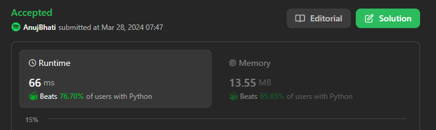
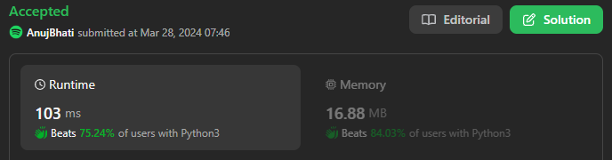
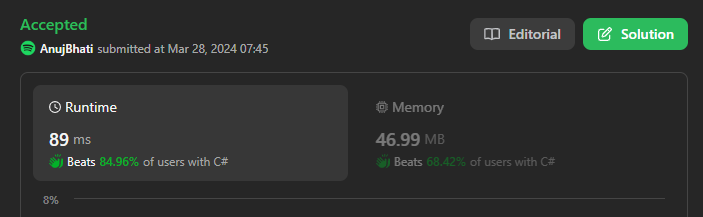
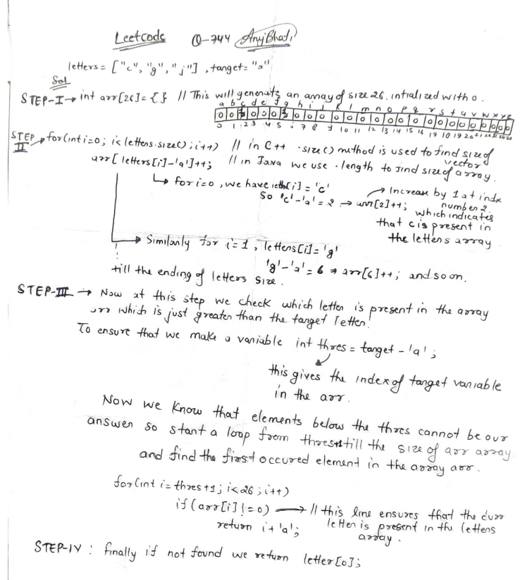
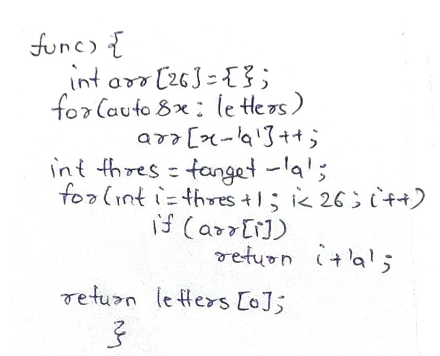

# ☠💀💯 Faster✅💯 Lesser🧠 🎯 C++✅Python3✅Java✅C✅Python✅C#✅💥🔥💫Explained with pics☠💥🔥 Beats 💯

**Author:** Edwards310
**Votes:** 10
**Link:** [https://leetcode.com/problems/find-smallest-letter-greater-than-target/solutions/4935246/](https://leetcode.com/problems/find-smallest-letter-greater-than-target/solutions/4935246/)

---

# Intuition







```C++ []
class Solution {
public:
    char nextGreatestLetter(vector<char>& letters, char target) {
        vector<int> freq(26, 0);
        for (auto& x : letters)
            freq[x - 'a']++;
        int thres = target - 'a';
        for (int i = 0; i < freq.size(); i++)
            if (i > thres and freq[i])
                return i + 'a';

        return letters[0];
    }
};
```
```python3 []
class Solution:
    def nextGreatestLetter(self, letters: List[str], target: str) -> str:
        t_ord = ord(target) - ord("a")
        for i in letters:
            l_ord = ord(i) - ord("a")
            if l_ord > t_ord:
                return i
        return letters[0]
```
```C# []
public class Solution {
    public char NextGreatestLetter(char[] letters, char target) {
        int []freq = new int[26];
        for(int i = 0; i < letters.Length; i++)
            freq[letters[i] - 'a']++;
        int th = target - 'a';
        for(int i = 0; i < freq.Length; i++)
            if(i > th && freq[i] != 0)
               return (char)(i + 'a');
        return letters[0];
    }
}
```
```java []
class Solution {
    public char nextGreatestLetter(char[] letters, char target) {
        int[] freq = new int[26];
        for (int i = 0; i < letters.length; i++)
            freq[letters[i] - 'a']++;
        int th = target - 'a';
        for (int i = 0; i < freq.length; i++)
            if (i > th && freq[i] != 0)
                return (char) (i + 'a');
        return letters[0];
    }
}
```
```python []
class Solution(object):
    def nextGreatestLetter(self, letters, target):
        """
        :type letters: List[str]
        :type target: str
        :rtype: str
        """
        n = len(letters)
        left, right = 0, n - 1
        while left < right:
            mid = left + (right - left) // 2
            if letters[mid] > target:
                right = mid
            else:
                left = mid + 1
        if letters[left] > target:
            return letters[left] 
        else:
            return letters[0]
```
```C []
char nextGreatestLetter(char* letters, int lettersSize, char target) {
    int freq[26] = {};
    for (int i = 0; i < lettersSize; i++)
        freq[letters[i] - 'a']++;
    int thres = target - 'a';
    for (int i = 0; i < 26; i++)
        if (i > thres && freq[i])
            return i + 'a';

    return letters[0];
}
```
<!-- Describe your first thoughts on how to solve this problem. -->

# Approach
<!-- Describe your approach to solving the problem. -->

# Complexity
- Time complexity:
<!-- Add your time complexity here, e.g. $$O(n)$$ -->
    O(n)
- Space complexity:
<!-- Add your space complexity here, e.g. $$O(n)$$ -->
    O(26) -- O(1)
# Code
```
class Solution {
public:
    char nextGreatestLetter(vector<char>& letters, char target) {
        vector<int> freq(26, 0);
        for (auto& x : letters)
            freq[x - 'a']++;
        int thres = target - 'a';
        for (int i = 0; i < freq.size(); i++)
            if (i > thres and freq[i])
                return i + 'a';

        return letters[0];
    }
};
```
# Please upvote if it's useful for you in any case 

