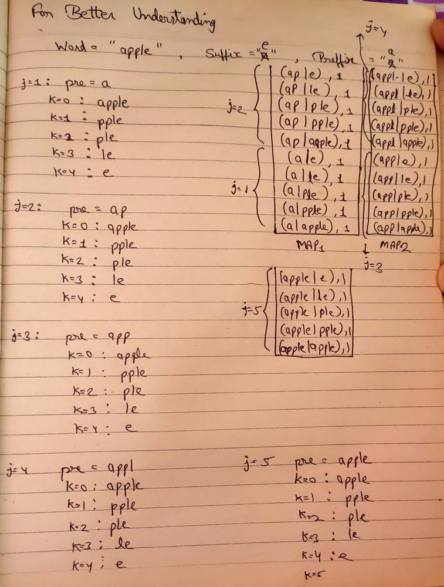

# ✅C++ | ✅Use Hashmap | ✅Simple solution with comments | 🗓️ DLC June, Day 18

**Author:** Yash2arma
**Votes:** 67
**Link:** [https://leetcode.com/problems/prefix-and-suffix-search/solutions/2165519/](https://leetcode.com/problems/prefix-and-suffix-search/solutions/2165519/)

---

**Please upvote if it helps \uD83D\uDE0A\u2764\uFE0F**

**Time Complexity : O(NxW^2)**
**Space Complexity : O(NxW^2)**
*N: Number of word in words 
W: Size of a word*

**Code:**
```
class WordFilter {
public:
    unordered_map<string, int> mp; //stores preffix and suffix sequence in it
    
    WordFilter(vector<string>& words) 
    {
        int n = words.size();
        
        for(int i=0; i<n; i++) //cover each word in words
        {
            string word = words[i]; 
            int wordsize = word.size();
            
            //storing all possible sequence of prefix and suffix of a word in the hashmap
            for(int j=1; j<=wordsize; j++) //for preffix 
            {
                string pre = word.substr(0,j);
                
                for(int k=0; k<wordsize; k++) //for suffix
                {
                    string suff = word.substr(k, wordsize);
                    mp[pre + "|" + suff] = i+1; //set index i+1 for all possible sequence of a word
                    //we set i+1 to handle i=0 because by-default map initialized with 0 
                }
            }
        }
    }
    
    int f(string prefix, string suffix) 
    {
        string s = prefix + "|" + suffix;
        return mp[s]-1; //if sequence found in hashmap we return its index
    }
};
```
**For Better Understanding:**
***Example-1:***


**Please upvote if it helps \uD83D\uDE0A\u2764\uFE0F**

