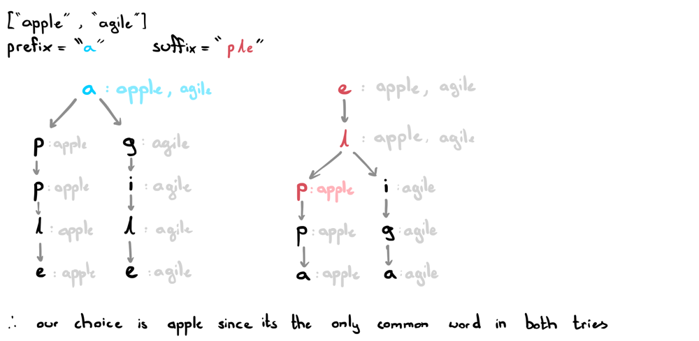

# Visual Explanation | Double Trie JAVA

**Author:** ciote
**Votes:** 32
**Link:** [https://leetcode.com/problems/prefix-and-suffix-search/solutions/2164117/](https://leetcode.com/problems/prefix-and-suffix-search/solutions/2164117/)

---

### Logic:
The logic behind my approach is quite straightforward! Simply construct two tries: `rootP` and `rootS` each representing the root nodes of a **prefix trie** and a **suffix trie**.

Building these two tries doesn't take too much effort. First, let's discuss how our `TrieNode` class will work.
```text
TrieNode:
	Map<Character, TrieNode> children:          stores all letters following the current letter (TrieNodes) 
	Set<String> words:                          stores all words that share the current prefix / suffix
```

The `words` set is particularly important. Basically, in our prefix trie, at each TrieNode we will store all words associated with the current prefix in the words set. We will do the same for the suffix trie. This is what it would look like for the words `["apple", "agile"]` with prefix "a" and suffix "ple":



As you can see, all we really need to do is collect the words associated with the ends of the prefix and suffix and find the common word with the largest index. To keep track of indexes, we'll simply use a map `indexes` that will store the largest index for each word.

Awesome, now we have everything we need to start coding!
___
### Code:
If you have any questions, suggestions or improvements, feel free to let me know. Thanks for reading!
```java
class TrieNode {
    public Map<Character, TrieNode> children;
    public Set<String> words;
    public TrieNode() {
        children = new HashMap<>();
        words = new HashSet<>();
    }
}
```
```java
class WordFilter {
    private TrieNode rootP, rootS; 
    private Map<String, Integer> indexes; 
    
    public WordFilter(String[] words) {
        rootP = new TrieNode();
        rootS = new TrieNode();
        indexes = new HashMap<>();
        for (int i=0; i<words.length; i++) {
            insert(words[i]);
            indexes.put(words[i], i);
        }
    }
    
    private void insert(String word) {
        TrieNode ptrP = rootP, ptrS = rootS;
        for (int i=0; i<word.length(); i++) {
            // insert as prefixes
            char c = word.charAt(i);
            if (!ptrP.children.containsKey(c))
                ptrP.children.put(c, new TrieNode());
            ptrP = ptrP.children.get(c);
            ptrP.words.add(word);
            
            // insert as suffixes
            c = word.charAt(word.length()-1-i);
            if (!ptrS.children.containsKey(c))
                ptrS.children.put(c, new TrieNode());
            ptrS = ptrS.children.get(c);
            ptrS.words.add(word);
        }
    }
    
    public int f(String prefix, String suffix) {
        TrieNode ptrP = rootP, ptrS = rootS;
        
        // get all words with prefix
        for (int i=0; i<prefix.length(); i++) {
            char c = prefix.charAt(i);
            if (!ptrP.children.containsKey(c)) return -1;
            ptrP = ptrP.children.get(c);            
        }
        Set<String> prefixes = ptrP.words;
        
        // get all words with suffix
        for (int i=0; i<suffix.length(); i++) {
            char c = suffix.charAt(suffix.length()-1-i);
            if (!ptrS.children.containsKey(c)) return -1;
            ptrS = ptrS.children.get(c);            
        }
        Set<String> suffixes = ptrS.words;
        
        int index = -1;
        for (String word: prefixes) 
            if (suffixes.contains(word))
                 index = Math.max(index, indexes.get(word));
        
        return index;
    }
}
```
**Time complexity:**
> WordFilter: `O(L + W)`, where `L` is the length of the words array and `W` is the length of each word
> insert: `O(W),`
> f: `O(L)`, at worst case, we have to find the largest index of `L` words.

**Space complexity:** `O(L * W^2)`